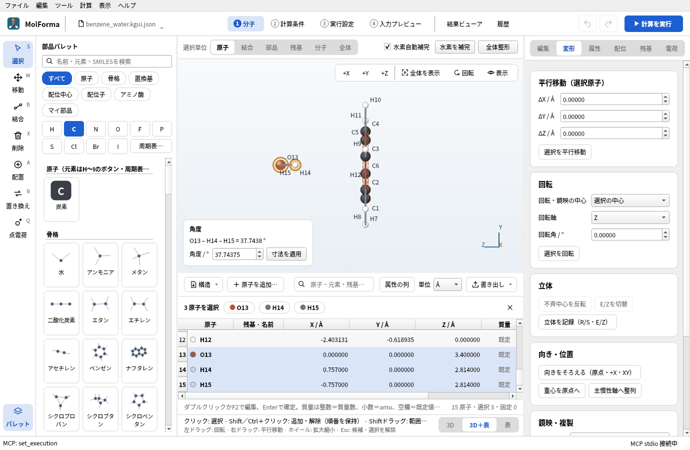
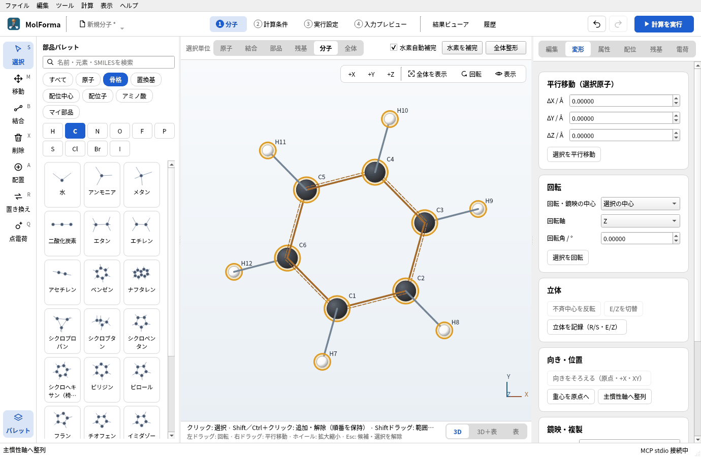
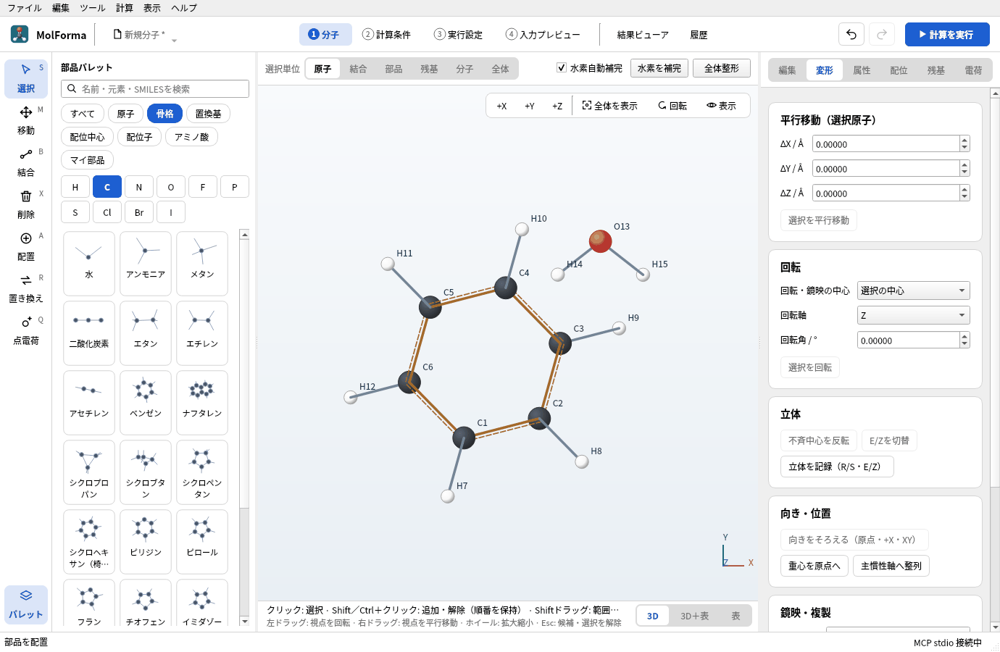
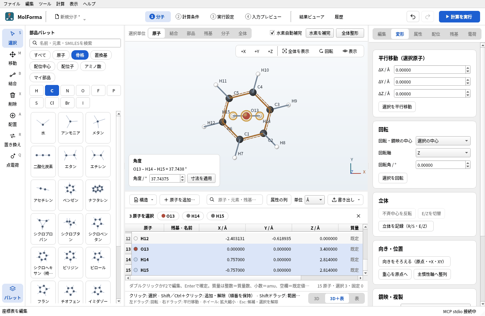
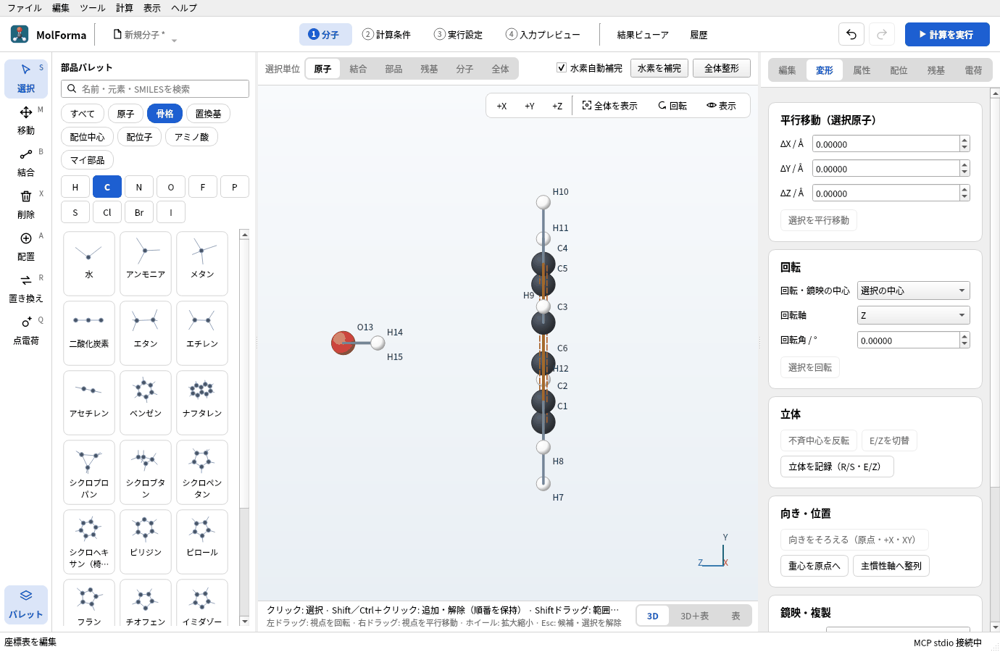
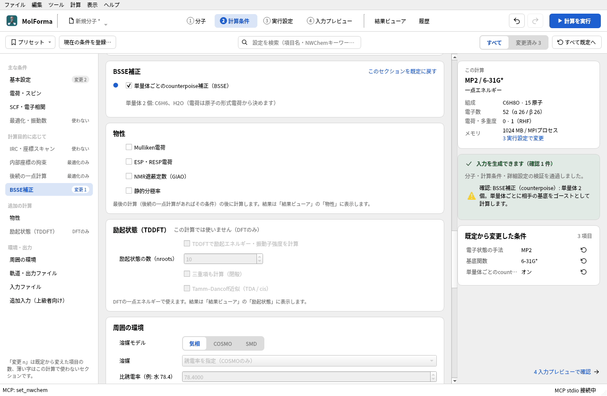
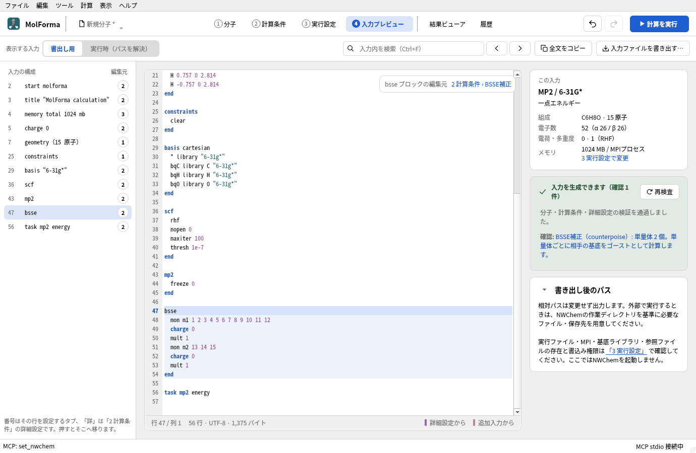
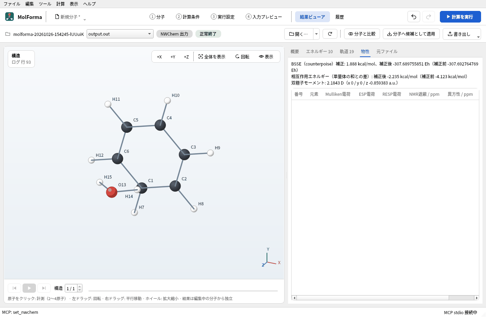

# 題材9 分子間錯体とBSSE補正（ベンゼン–水）

ベンゼンを座標の原点・XY面にそろえ、その環の中心の真上3.40 Åに水の酸素を置いて、2つの水素を環に向けた二量体を作ります。2つの分子は結合していないので、MolFormaはそれぞれを単量体として扱えます。MP2/6-31G*で、基底関数重なり誤差（BSSE）をcounterpoise法で補正した相互作用を計算します。

| 作るもの | 内容 |
| --- | --- |
| 分子 | ベンゼン–水二量体 C₆H₈O（15原子・電荷 0・一重項） |
| 使う機能 | 2つ目の分子を空白に置く、選択単位「分子」、主慣性軸へ整列、座標の表（3D＋表）のセルの編集、寸法による分子どうしの距離、BSSE補正（counterpoise） |
| 計算 | MP2/6-31G*、一点エネルギー、BSSE補正 |
| 計算時間の目安 | 約20秒（MPI 6プロセス） |
| 計算環境 | AMD Ryzen 7 2700X（8コア・16スレッド）、メモリ 32 GB、NWChem 7.3.1（Linux） |
| 練習データ | [`benzene_water.kgui.json`](samples/benzene_water.kgui.json) |

## 1. ベンゼンを原点・XY面にそろえる

1. 「ファイル → 新規」で、分類「骨格」の「ベンゼン」を空白に置きます。
2. 3D画面の上の「選択単位」を「分子」にし、ベンゼンの原子を1つクリックします。分子全体（12原子）が選ばれます。
3. 右側の「変形」ページの「向き・位置」で「主慣性軸へ整列」を押します。重心が原点に、環がXY面に、環の法線がZ軸になります（座標の表で炭素のZが0.000000になります）。

   

   **図1** 選択単位「分子」でベンゼンを選び、「変形」ページの「主慣性軸へ整列」を押したところ。

## 2. 水を置いて位置を決める

1. 選択を解除（Esc）し、分類「骨格」の「水」を、ベンゼンから離れた空白にクリックして置きます。結合していない2つ目の分子になります（C6H8O · 15原子 · 14結合）。

   

   **図2** 空白に置いた水は、結合していない2つ目の分子になります。

2. 3D画面の下の帯の右端で「3D＋表」を選び、座標の表を出します。水の原子はO13・H14・H15です。
3. 表のX・Y・Zのセルをダブルクリックして値を入れ、Enterで確定します。

   | 原子 | X | Y | Z |
   | --- | --- | --- | --- |
   | O13 | 0 | 0 | 3.40 |
   | H14 | 0.757 | 0 | 2.814 |
   | H15 | −0.757 | 0 | 2.814 |

   酸素は環の中心の真上3.40 Åに、2つの水素は環の側（Zが小さい側）に向きます。セル1つの編集が「元に戻す」1回です。

   

   **図3** 座標の表に水の座標を入れたところ。行を選ぶと3D画面でもその原子が選ばれます。

4. 「+X」で横から見て、水が環の真上にあることを確かめます。

   

   **図4** 「+X」から見ると、環の中心の真上に水があり、水素が環を向いているのがわかります。

座標を直接入れる代わりに、結合していない2原子（例: ベンゼンの炭素と水の酸素）を選んで「寸法を適用」で距離を決めることもできます。別々の分子どうしでは、後に選んだ原子の分子全体が平行移動します。「表示 → 水素結合を表示」をオンにすると、条件を満たすX–H···Y（X, Y = N, O, F）を破線で示します。

## 3. BSSE補正の設定

1. 「2 計算条件」の「基本設定」で、計算目的を「一点エネルギー」、電子状態の手法を「MP2」、基底関数を「6-31G*」にします。
2. 左の一覧の「BSSE補正」で「単量体ごとのcounterpoise補正（BSSE）」をオンにします。「単量体 2 個: C6H6、H2O（電荷は原子の形式電荷から決めます）」と表示されます。

   

   **図5** 「BSSE補正」をオンにすると、単量体の数と組成が表示されます。

3. 「4 入力プレビュー」で、`bsse` ブロックに `mon m1 1 2 … 12`（ベンゼン）と `mon m2 13 14 15`（水）、`basis` に相手の原子をゴーストとして計算するための `bqC library C "6-31g*"` などの行が自動で入っていることを確かめます。

   

   **図6** 入力の `bsse` ブロック。単量体ごとの原子番号と電荷・多重度が入ります。

BSSE補正は、結合でつながった分子を単量体とします。単量体はどれも閉殻で、全電荷が形式電荷の合計と一致している必要があります。溶媒・TDDFT・物性・後続の一点計算・CUBE/MOLDEN出力・外部点電荷とは併用できません。計算目的を「構造最適化」にすると、BSSE補正した勾配で最適化します。

## 4. 計算して結果を見る

「計算を実行」（F5）で計算します。NWChemは二量体、各単量体（自分の基底だけ）、各単量体（二量体の基底＝相手をゴースト）の順に計算します。「結果ビューア」の「概要」の「計算のエネルギー」は補正後の値で、「物性」タブにBSSE補正量と、各単量体（自分の基底）の和との差である相互作用エネルギー（補正後・補正前）が出ます。

**図7** 「結果ビューア」の「物性」タブ。BSSE補正量と相互作用エネルギーが出ます。

### 実行した結果

| 計算 | MP2エネルギー |
| --- | --- |
| 二量体 | −307.692764769 Eh |
| ベンゼン（自分の基底 / 二量体の基底） | −231.487186463 / −231.488803294 Eh |
| 水（自分の基底 / 二量体の基底） | −76.199007153 / −76.200399241 Eh |
| BSSE補正量 | 0.003008919 Eh（1.888 kcal/mol） |
| 補正後のエネルギー | −307.689755851 Eh |

| 相互作用エネルギー | kcal/mol |
| --- | --- |
| 補正前（二量体 − 単量体の和） | −4.12 |
| 補正後（counterpoise） | −2.24 |

補正前の値は、相手の基底関数を借りて単量体が安定になる分（BSSE）だけ結合を過大に見積もっています。6-31G*は分散関数を含まない小さな基底なので、補正後は高精度の文献値（約 −3.3 kcal/mol）より弱い結合になります。

NWChem 7.3.1が出力する「BSSE error」（0.001616831 Eh）と「Corrected energy」は、1つ目の単量体（ベンゼン）の補正しか含みません。MolFormaは結果を読み込むときに各単量体のエネルギーから補正量を求め直し、「NWChemが出力したBSSE補正量 0.001616831 Eh は一部の単量体の和なので、…」と警告して、正しい値を表示します。

## うまくいかないとき

- **「単量体なし」で設定できない**: 分子が1つしかありません。水を空白に置き直します（水素をクリックすると結合した原子として置かれます）。
- **「BSSE補正の単量体の電荷は原子の形式電荷から決めます。」**: 全電荷を形式電荷の合計にします（「電荷」ページの「形式電荷の合計を全電荷に適用」）。
- **表のセルが編集できない**: 候補を表示している間は編集できません。「変更を確定」か「候補を取消」をしてから編集します。

関連: [座標の表](../features/coordinates.md)、[「2 計算条件」](../features/calculation.md)の物性・BSSE・後続の一点計算、[題材12 溶媒和クラスターと点電荷](hydrated_sodium.md)。
