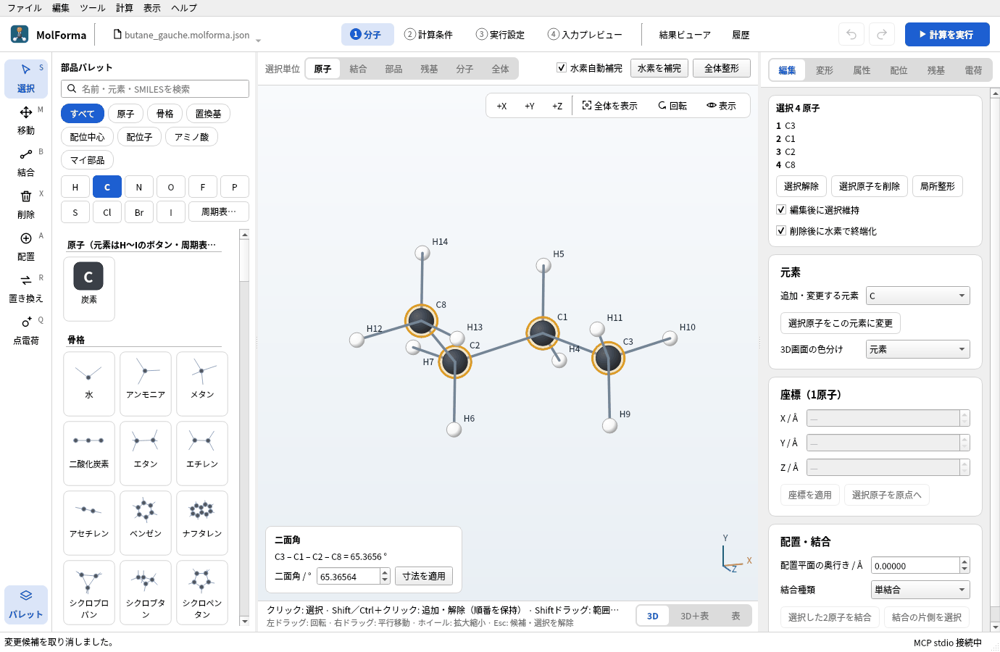
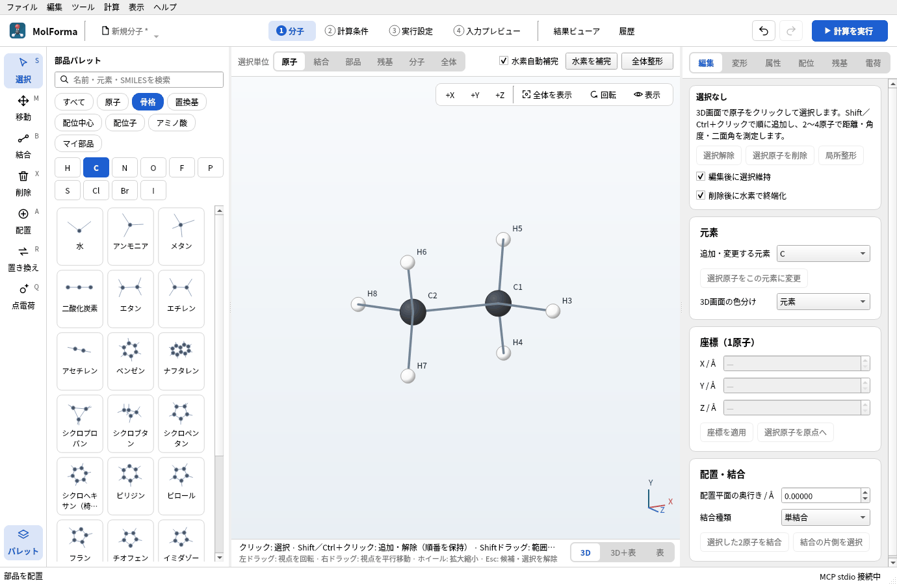
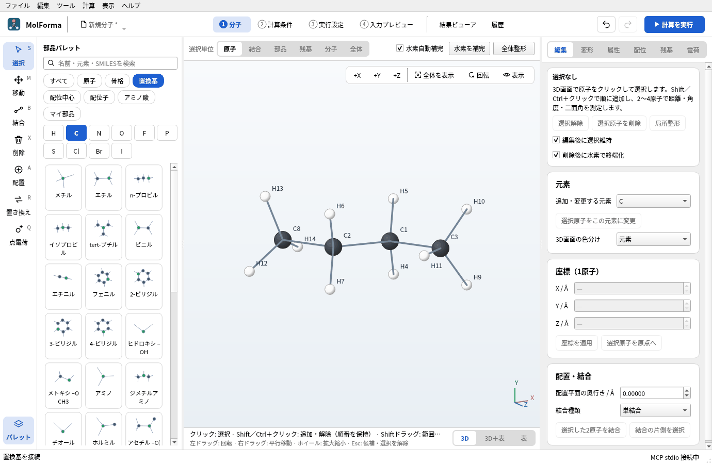
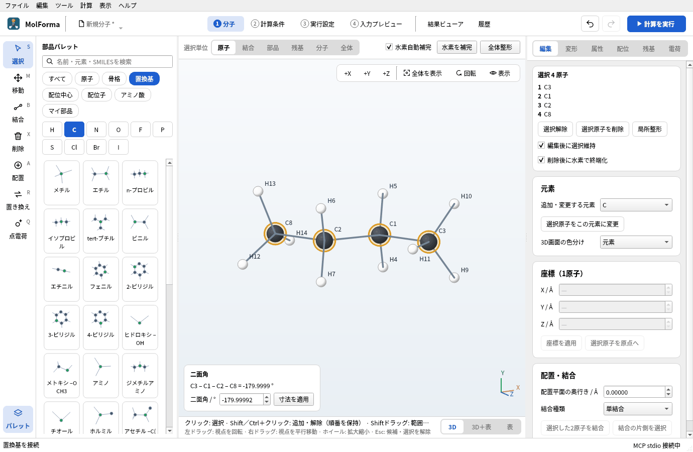
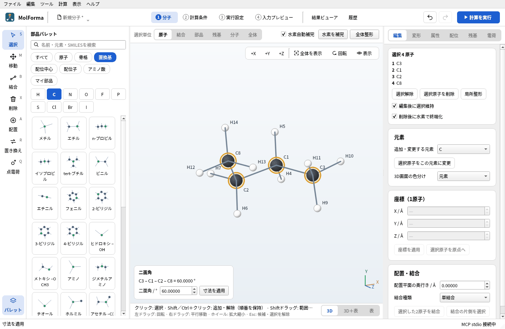
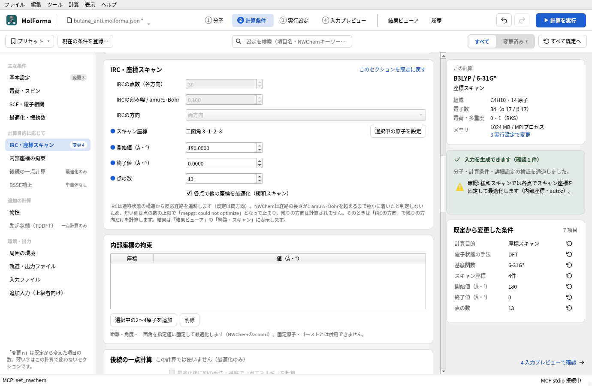
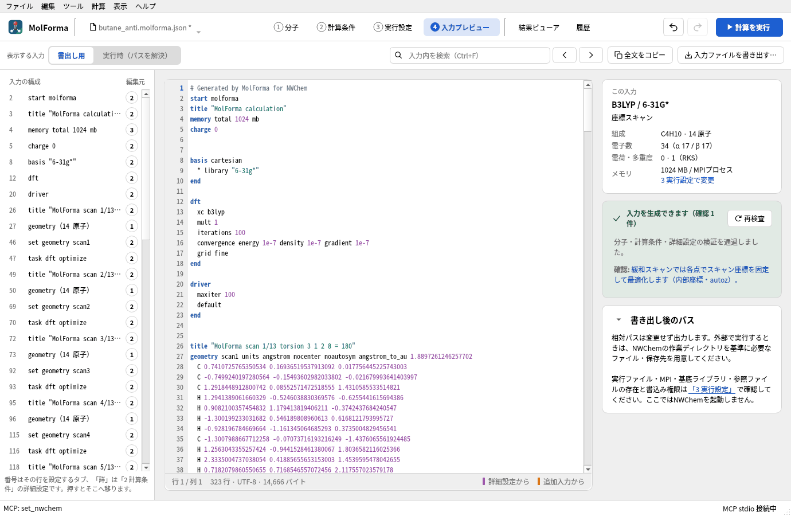
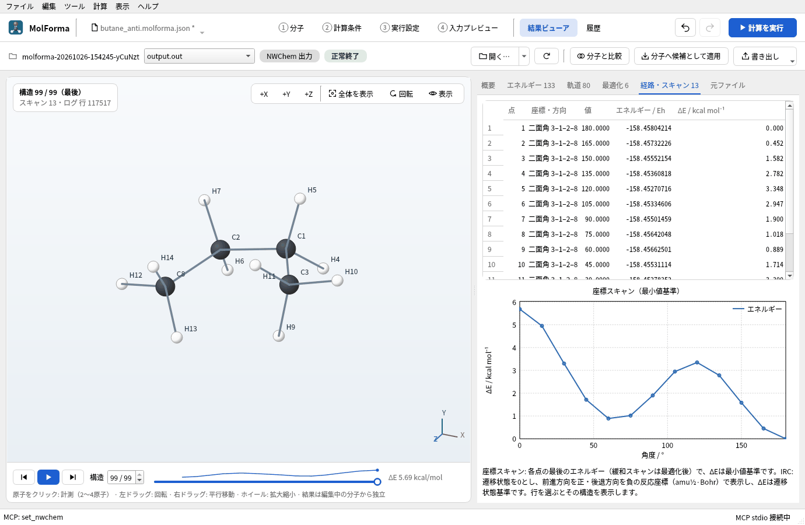

# 題材5 鎖状分子と配座（n-ブタンのanti・gauche）

エタンにメチル基を2つ付けてn-ブタンを作り、4原子を順に選んで二面角を測り、数値を入れてanti（180°）とgauche（60°）の配座を作り分けます。それぞれを別のファイルに保存し、最後に中央のC–C結合の二面角を180°から0°まで回す緩和スキャンで、配座のエネルギー曲線を求めます。

| 作るもの | 内容 |
| --- | --- |
| 分子 | n-ブタン C₄H₁₀（14原子）のanti配座とgauche配座 |
| 使う機能 | 置換基の付ける位置、4原子の選択と二面角の測定、寸法の数値指定、名前を付けて保存、座標スキャン（緩和スキャン）、結果ビューアの「経路・スキャン」 |
| 計算 | B3LYP/6-31G*、緩和スキャン（二面角 180°→0°、13点） |
| 計算時間の目安 | 約92分（MPI 2プロセス、ほかの計算と並行。1点あたり約7分） |
| 計算環境 | AMD Ryzen 7 2700X（8コア・16スレッド）、メモリ 32 GB、NWChem 7.3.1（Linux） |
| 練習データ | [`butane_anti.molforma.json`](samples/butane_anti.molforma.json)、[`butane_gauche.molforma.json`](samples/butane_gauche.molforma.json)、[`butane_scan.molforma.json`](samples/butane_scan.molforma.json)（スキャンの設定つき） |

## 1. エタンからn-ブタンを組む

1. 「ファイル → 新規」で空の分子にし、分類「骨格」の「エタン」を空白に置きます（C1・C2とH3〜H8）。

   

   **図1** 分類「骨格」の「エタン」を置いたところ。

2. 分類「置換基」の「メチル」を選び、C1の水素の1つ（例: H3）をクリックします。プロパンになります。
3. もう一度「メチル」を選び、C2の水素のうち、さっきの水素とC1–C2をはさんで反対側（二面角が約180°）の水素をクリックします。n-ブタン（C4H10 · 14原子）になり、最初の配座はanti に近い形になります。同じ側の水素を選ぶとgaucheから始まります。

   

   **図2** C1とC2の水素を、C1–C2をはさんで反対側どうし「メチル」に置き換えたn-ブタン（anti に近い形）。

## 2. 二面角を測ってanti・gaucheを作る

1. 「選択」ツールにして、炭素を端から順に、1つ目はクリック、2つ目からはShift＋クリックで4つ選びます（この手順ではC3 → C1 → C2 → C8）。選んだ順番が二面角の定義になります。
2. 3D画面の左下に「二面角 C3 – C1 – C2 – C8 = −179.9999 °」のように表示されます。IUPACの定義で、antiは±180°、gaucheは±60°付近です。

   

   **図3** 4原子を順に選ぶと、3D画面の左下に二面角が出ます。選んだ順が二面角の定義です。

3. 3D画面の上の「全体整形」を押して確定し、「ファイル → 名前を付けて保存…」で `butane_anti.molforma.json` として保存します。
4. 4原子を選んだまま、左下の「二面角 / °」に 60 を入れて「寸法を適用」を押します。C1–C2結合のまわりで、3番目の原子（C2）の側が回ってgaucheになります。

   

   **図4** 「二面角 / °」に60を入れて「寸法を適用」すると、gaucheの配座になります。

5. 「全体整形」で整えると、二面角は約65°に開きます（メチル基どうしの反発を力場が和らげるため）。`butane_gauche.molforma.json` として別名で保存します。

二面角を変える操作は、環の中の結合では片側だけを回せないため拒否されます。固定原子を含む側も動かせません。

## 3. 緩和スキャンの設定

1. 4つの炭素をC3 → C1 → C2 → C8の順に選んだまま、「2 計算条件」を開きます。
2. 「基本設定」の計算目的を「座標スキャン」、手法を「DFT」（B3LYP）、基底関数を「6-31G*」にします。
3. 左の一覧の「IRC・座標スキャン」で「選択中の原子を設定」を押します。スキャン座標に4原子の二面角が入り、開始値に今の値が入ります。
4. 開始値を 180、終了値を 0、点の数を 13 にします（15°おき）。「各点で他の座標を最適化（緩和スキャン）」はオンのままにします。
5. 右の「既定から変更した条件」に、計算目的・手法・基底・スキャン座標（4件）・開始値・終了値・点の数が並びます。

   

   **図5** 「IRC・座標スキャン」の設定。スキャン座標・開始値・終了値・点の数を決めます。

「4 入力プレビュー」では、点ごとに `geometry scanN` と `zcoord` の `torsion 3 1 2 8 … constant` があり、二面角を固定して残りを最適化する `task dft optimize` が13回並びます。各点の `title` には `MolForma scan k/13` が入り、結果ビューアがこれを手がかりに点ごとの構造とエネルギーを読み取ります。

**図6** スキャンの入力。点ごとに `geometry scanN` と `task dft optimize` が並びます。

## 4. 計算して結果を見る

「計算を実行」（F5）で計算し、「結果ビューア」の「経路・スキャン」タブで、二面角とエネルギー（最小値を基準にしたΔE / kcal mol⁻¹）の表とグラフを見ます。行を選ぶと、その点の構造を3D画面に表示します。

**図7** 「経路・スキャン」タブ。行を選ぶとその点の構造を表示します。

### 実行した結果

13点とも最適化が収束しました。最小値（180°、−158.458042135 Eh）を基準にしたΔEです。

| 二面角 | 180° | 165° | 150° | 135° | 120° | 105° | 90° | 75° | 60° | 45° | 30° | 15° | 0° |
| --- | --- | --- | --- | --- | --- | --- | --- | --- | --- | --- | --- | --- | --- |
| ΔE / kcal mol⁻¹ | 0 | 0.45 | 1.58 | 2.78 | 3.35 | 2.95 | 1.90 | 1.02 | 0.89 | 1.71 | 3.30 | 4.95 | 5.69 |

- gauche（60°付近）はantiより約0.9 kcal/mol高い極小です（実験値 約0.7 kcal/mol）。15°おきの点なので、本当の極小（約65°）はこの間にあります。
- anti → gauche の障壁（120°、メチル基とHが重なる）は3.35 kcal/mol、メチル基どうしが重なる0°（syn）は5.69 kcal/molです。

「経路・スキャン」タブのグラフで、180°・60°の2つの谷と120°・0°の2つの山が確かめられます。

## うまくいかないとき

- **「選択中の原子を設定」が押せない**: 2〜4原子を選んでいません。「1 分子」に戻って選び直します。
- **gaucheにしたつもりが別の値になる**: 選ぶ順番で二面角の符号と、どちら側が回るかが決まります。数値を入れた後に「全体整形」をすると力場の好む値（約65°）に動きます。
- **スキャンの1点だけ高い**: 緩和スキャンの各点は前の点と独立した初期構造から最適化します。点を増やすか、範囲を分けて計算します。

関連: [「2 計算条件」](../features/calculation.md)の遷移状態・IRC・拘束・スキャン、[題材13 遷移状態と反応経路](sn2_transition_state.md)。
