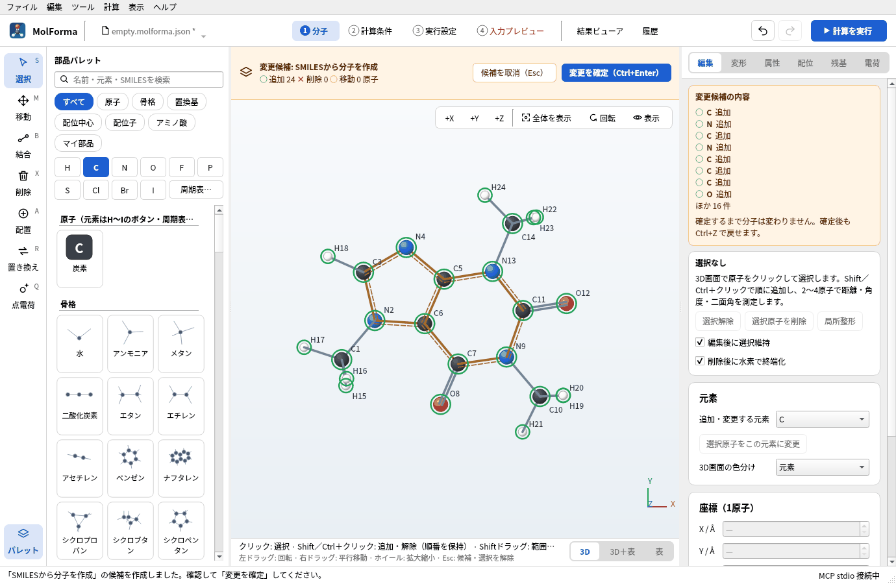
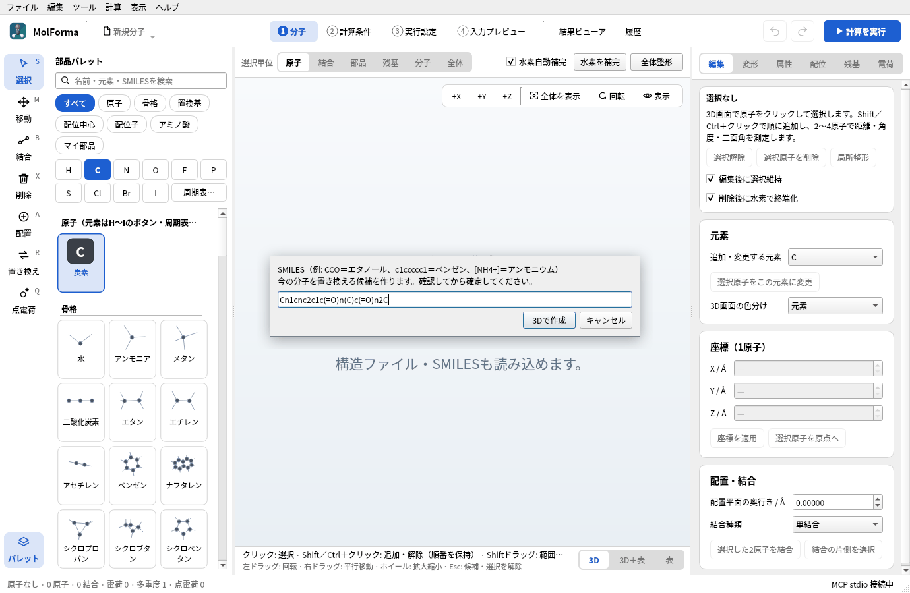
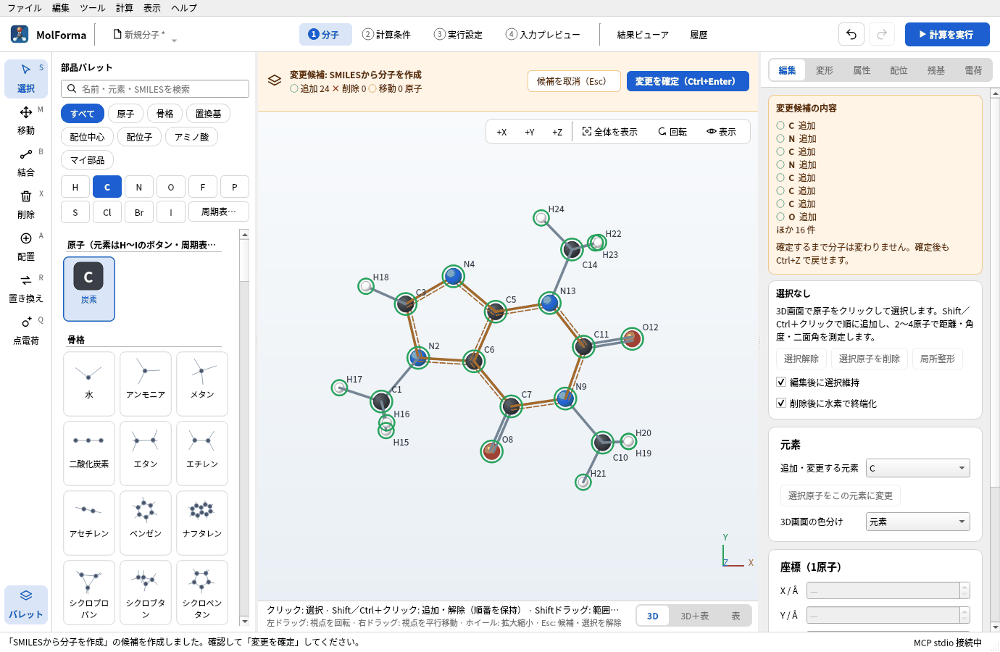
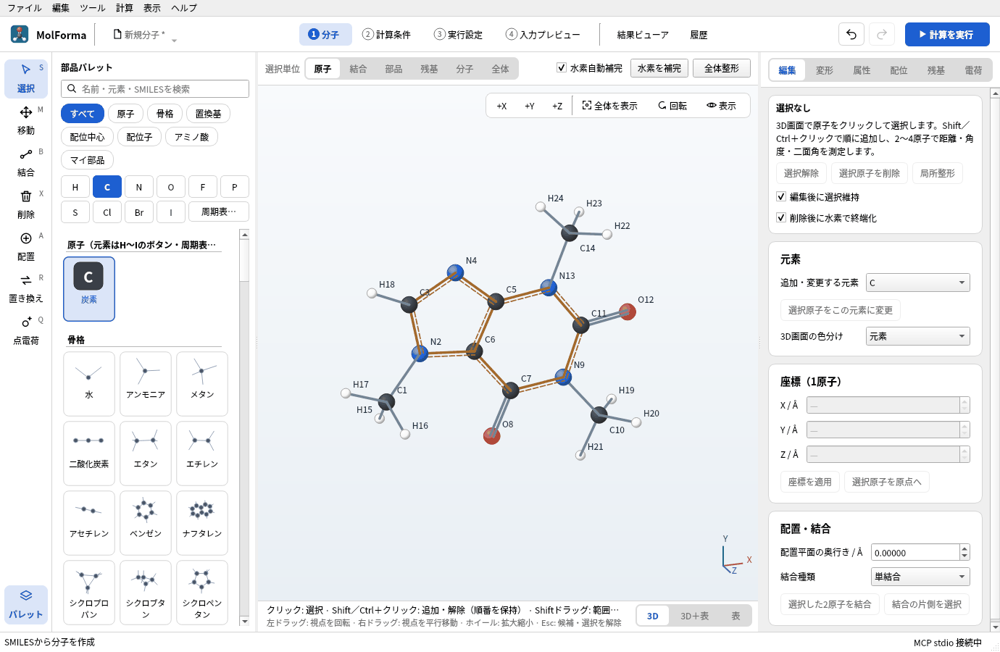
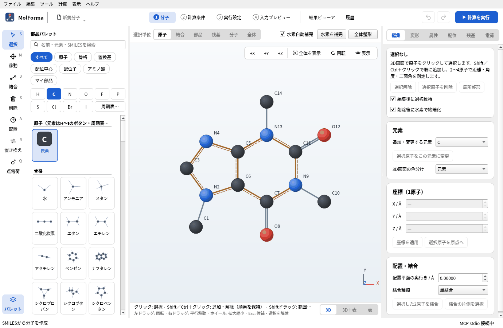
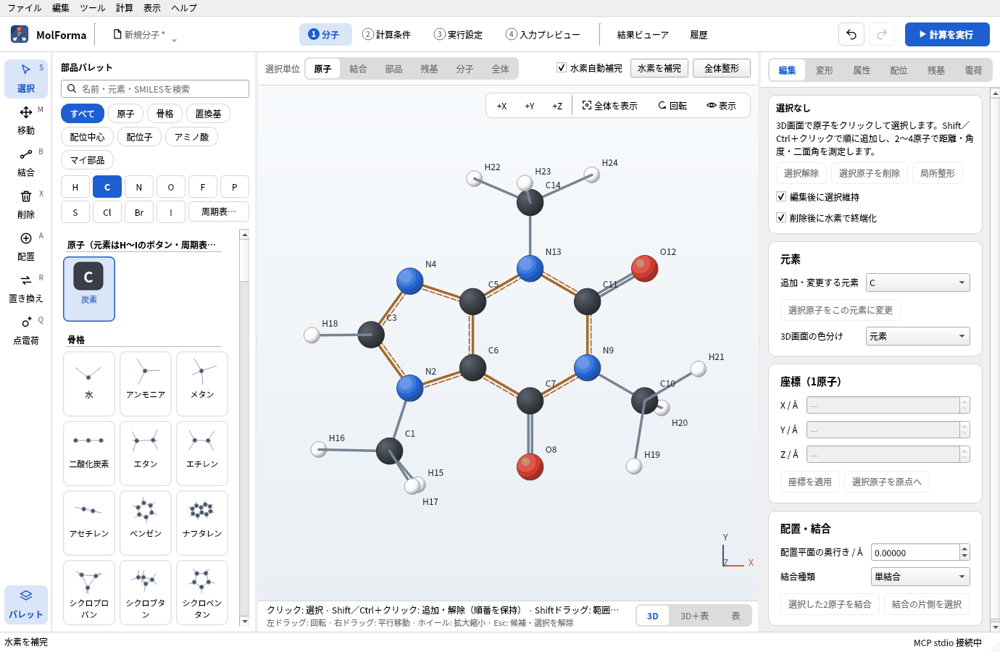
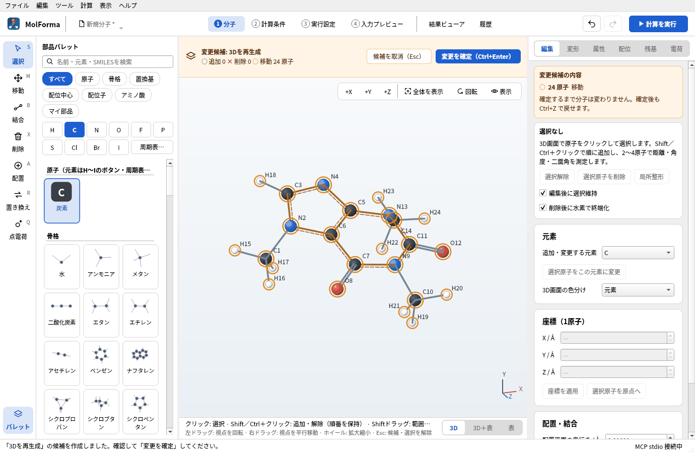
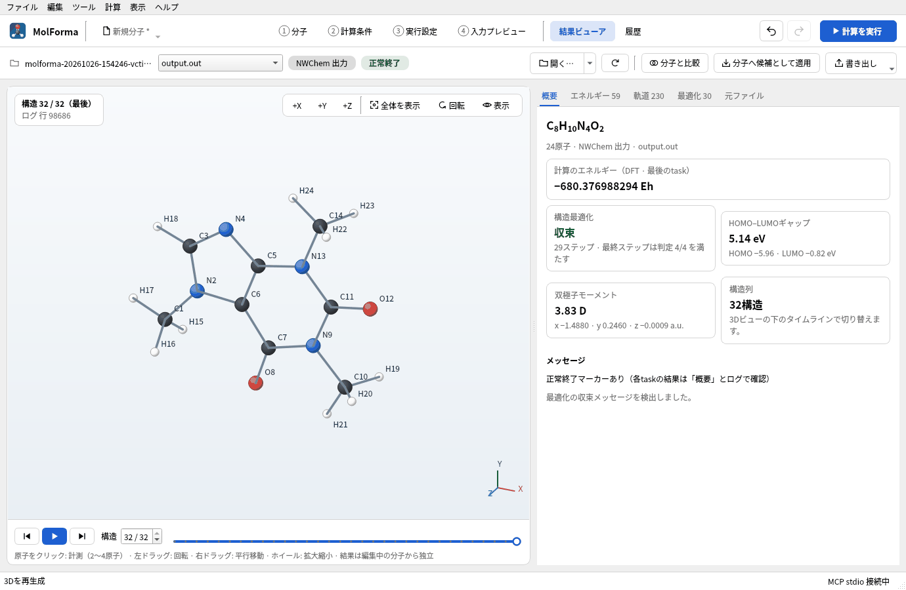
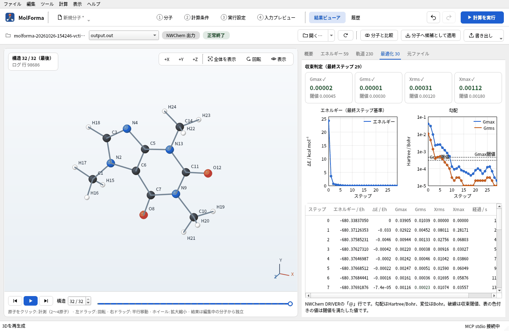

# 題材4 複素環をSMILES・構造式ファイルから作る（カフェイン）

骨格テンプレートにない縮合環の分子は、SMILES（1行の構造式）か、ほかのソフトで描いた構造式ファイルから作ります。カフェインをSMILESから3Dで作る方法と、2次元で描いた `.sdf` を開いて水素を補い、3D構造を作り直す方法の2通りを試し、B3LYP/6-31G*で構造を最適化します。

| 作るもの | 内容 |
| --- | --- |
| 分子 | カフェイン C₈H₁₀N₄O₂（24原子・電荷 0・一重項） |
| 使う機能 | SMILESから作成、パレットの検索からのSMILES、構造ファイルを開く、水素を補完、3Dを再生成、骨格テンプレートの複素環 |
| 計算 | B3LYP/6-31G*、構造最適化 |
| 計算時間の目安 | 約59分（MPI 6プロセス、ほかの計算と並行） |
| 練習データ | [`caffeine.kgui.json`](samples/caffeine.kgui.json)（SMILESから作った構造）、[`caffeine_2d.sdf`](samples/caffeine_2d.sdf)（水素のない2次元の構造式） |

## 1. SMILESから作る

1. 「ファイル → SMILESから作成…」を選びます（ヘッダー左のファイル名のメニューにも同じ項目があります）。
2. 入力欄に `Cn1cnc2c1c(=O)n(C)c(=O)n2C` を入れて「3Dで作成」を押します。Open Babelが水素を付けて3D構造を作り、力場（MMFF94）で整えた結果が**候補**になります（「変更候補: SMILESから分子を作成」）。別プロセスで動くので、時間がかかる分子では3D画面の上の「整形を中止」で止められます。

   

   **図1** 「ファイル → SMILESから作成…」のダイアログにSMILESを入れて「3Dで作成」を押します。

3. 候補が C8H10N4O2 · 24原子 · 25結合であることを確かめて「変更を確定」します。芳香環の結合は破線付きの二重線で表示されます。

   

   **図2** 3D構造は候補として表示されます。原子数と結合数を確かめて確定します。

   

   **図3** 確定したカフェイン（C8H10N4O2 · 24原子）。

SMILESを読めないときは理由を表示し、「SMILESを修正…」で入力し直せます。今の分子を残したまま横に加える場合は「ファイル → SMILESから断片を追加…」を使います。部品パレットの検索欄にSMILESを入れると、どの部品にも当たらない場合に「SMILES「…」から3Dで作成」が出て、クリックすると今の分子の横に候補を作ります。

## 2. 2次元の構造式ファイルから作る

構造式エディタで描いて書き出した `.sdf` / `.mol` は、平面の座標（z = 0）で水素がないことがよくあります。

1. 「ファイル → 開く…」で `caffeine_2d.sdf` を開きます。重原子だけの C8N4O2 · 14原子が平面に並びます。

   

   **図4** 2次元の構造式ファイルを開いたところ。水素がなく、原子が平面に並んでいます。

2. 3D画面の上の「水素を補完」を押します。足りない水素が付いて C8H10N4O2 · 24原子になります（原子を選んでいなければ全体が対象）。

   

   **図5** 「水素を補完」で足りない水素が付き、24原子になります。形はまだ平面のままです。

3. 「ツール → 3Dを再生成」を押します。結合から3D座標を作り直し、力場で整えた結果が候補になります（「変更候補: 3Dを再生成」）。確かめて「変更を確定」します。

   

   **図6** 「ツール → 3Dを再生成」の結果は候補として表示されます。

開ける形式は XYZ・MOL・SDF・Mol2・CML・PDB・NWChem入力（`.nw`）・Gaussian入力（`.gjf`）です。XYZは結合を距離から推定するので、イオンでは形式電荷を設定してから水素を補完してください。座標の表の「構造 → 構造ファイルを読み込む…」で読むと、計算条件を残したまま構造だけを置き換えます。

## 3. テンプレートとの使い分け

骨格テンプレートには単環の複素環（ピリジン・ピロール・フラン・チオフェン・イミダゾール・ピリミジン）とナフタレンがあります。これらに置換基を付けて作れる分子はテンプレートから組み（[題材3](aromatic_substitution.md)）、プリン骨格のような縮合複素環や大きな分子はSMILESか構造ファイルから作ります。

## 4. 計算して結果を見る

1. 「2 計算条件」で、計算目的を「構造最適化」、手法を「DFT」（B3LYP）、基底関数を「6-31G*」にします。全電荷 0・多重度 1です。
2. 「計算を実行」（F5）で計算します。

   

   **図7** 計算後の「結果ビューア」の「概要」。

   

   **図8** 「最適化」タブ。初めの数ステップでエネルギーが大きく下がり、残りはメチル基の回転などの小さな調整です。

### 実行した結果

| 項目 | 値 |
| --- | --- |
| 計算のエネルギー | −680.376988294 Eh |
| 構造最適化 | 29ステップで収束 |
| 双極子モーメント | 3.83 D |

縮合環の骨格は初期構造（SMILESからの3D）でほぼ決まっていて、ステップの多くは3つのメチル基の回転に使われます。振動数も計算すると、極小であること（虚振動なし）を確かめられます。

## うまくいかないとき

- **「SMILESを解析できません」**: 括弧・環番号の対応、芳香族の小文字（`c`・`n`）の書き方を確かめます。電荷は `[NH4+]` のように角括弧で書きます。
- **2次元のまま平らになっている**: 「3Dを再生成」を使います。「全体整形」は今の座標から力場で整えるだけなので、平面の初期構造から立体を起こすには向きません。
- **固定原子があると3D再生成できない**: 3D再生成は全原子の座標を作り直すので、固定原子があると拒否します。

関連: [「1 分子」の右側のページ](../features/molecule_pages.md)の構造ツール、[座標の表](../features/coordinates.md)、[題材14 計算結果から次の計算へ](reuse_result.md)。
