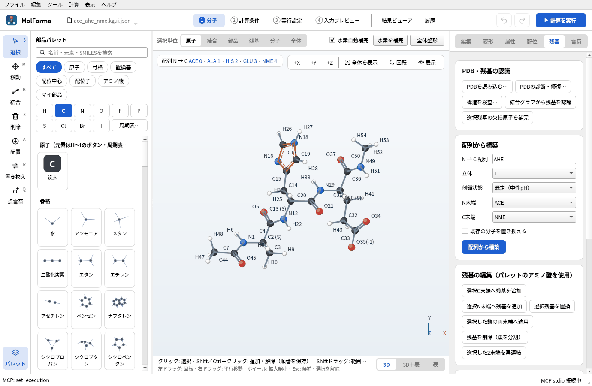

# 題材7 ペプチド（ACE–Ala–His–Glu–NME）

アミノ酸の1文字配列から三残基のペプチドを作り、N末端をアセチル基（ACE）、C末端をN-メチルアミド（NME）でふさぎます。Hisのプロトン化状態（HIE・HID・HIP）とGluの荷電・中性を選び分けて全電荷の変化を確かめ、主鎖の二面角を変え、最後にCOSMO（水）の中でB3LYP/6-31G*の一点計算をします。

| 作るもの | 内容 |
| --- | --- |
| 分子 | ACE–Ala–His–Glu–NME C₁₇H₂₅N₆O₆（54原子・電荷 −1・一重項）。HisはHIE、Gluは荷電型 |
| 使う機能 | 「残基」ページの配列から構築・末端・側鎖状態、3D画面の配列、選択単位「残基」、選択残基を置換、主鎖・側鎖の二面角、周囲の環境（COSMO） |
| 計算 | B3LYP/6-31G*、一点エネルギー、COSMO（水） |
| 計算時間の目安 | 約14分（MPI 8プロセス、「DFT積分を毎回再計算」オン） |
| 練習データ | `docs/recipes/samples/ace_ahe_nme.kgui.json` |

## 1. 配列から作る

1. 「ファイル → 新規」で空の分子にし、右側の「残基」ページを開きます。
2. 「配列から構築」で「N → C 配列」に `AHE`（`ALA-HIS-GLU` でも可）を入れます。
3. 「立体」を L、「側鎖状態」を「既定（中性pH）」、「N末端」を「ACE」、「C末端」を「NME」にします。既定の側鎖状態は、Asp・Gluが−1、Lys・Argが+1、HisがHIE（Nεにプロトン）です（欄にポインターを重ねると説明が出ます）。
4. 「配列から構築」を押します。候補が C17H25N6O6 · 54原子 · 電荷 −1 であることを確かめて「変更を確定」します。全電荷は、構築前の値（0）が形式電荷の合計（0）と一致していたので、Gluの−1に追従します。

3D画面の左上に「配列 N → C　ACE 0 · ALA 1 · HIS 2 · GLU 3 · NME 4」と出ます。残基名をクリックすると、その残基の原子を選びます。不斉炭素のラベルにはL-アミノ酸のCα の立体「(S)」が表示されます。

## 2. 側鎖の状態を変えて全電荷を見る

1. 3D画面の配列の「HIS 2」をクリックするか、3D画面の上の「選択単位」を「残基」にしてHisの原子をクリックします。
2. 部品パレットの分類「アミノ酸」で「ヒスチジン（HIP, +1）」をクリックし、「残基」ページの「選択残基を置換」を押します。主鎖（N・Cα・C・O）はそのままで、側鎖がHIPに置き換わった候補になります。
3. 確定すると C17H26N6O6、全電荷は −1 から **0** に変わります（置換前の全電荷が形式電荷の合計と一致していたので追従します）。
4. 「ヒスチジン（HID）」で置換すると、分子式はHIEと同じで、プロトンの位置がNδに移ります。「グルタミン酸（中性）」でGluを置換すると、全電荷はさらに+1されます。

置換する状態はパレットで選んだアミノ酸（「ヒスチジン（HIP, +1）」など）で決まります。「残基」ページの「側鎖状態」は「配列から構築」で全残基に使う状態です。

## 3. 主鎖の二面角を変える

1. 残基（例: ALA 1）を選び、「残基」ページの「主鎖・側鎖の二面角」で「二面角」を phi、「角度 / °」を −57 にして「二面角を適用」を押します。
2. 同じ残基で psi を −47 にします。αヘリックスのφ・ψの値です。omega（ペプチド結合、通常180°）や側鎖のchi1〜chi5も同じ操作で変えられます。

N末端・C末端への残基の追加は、「残基」ページの「選択C末端へ残基を追加」「選択N末端へ残基を追加」、または分類「アミノ酸」の部品を選んだときに3D画面に出る緑の「＋ C」「＋ N」をクリックして行います。「アミノ酸の連続追加」をオンにすると、パレットでアミノ酸を選ぶたびに同じ端に伸ばします。

## 4. 計算条件を決める

1. 「2 計算条件」の「基本設定」で、計算目的を「一点エネルギー」、手法を「DFT」（B3LYP）、基底関数を「6-31G*」にします。
2. 「電荷・スピン」で全電荷 −1・多重度 1を確かめます。
3. 左の一覧の「周囲の環境」で、溶媒モデルを「COSMO」、溶媒を「水」にします。電荷を持つペプチドは、気相より溶媒中のほうが現実に近い電子状態になります。
4. 左の一覧の「SCF・電子相関」の「詳細設定」で、「DFT積分を毎回再計算」をオンにします。50原子を超える分子では、NWChemが積分を作業ディレクトリに保存すると数GB〜十数GBになることがあります。オンにすると積分をディスクに保存せず、作業ディスクの容量不足で止まるのを防げます（練習データはオンで保存しています）。

## 5. 計算して結果を見る

「計算を実行」（F5）で計算します。「結果ビューア」の「概要」に計算のエネルギーと、ほかの結果としてCOSMOの溶媒和エネルギーが出ます。

### 実行した結果

ACE–Ala–His(HIE)–Glu(−)–NME（54原子・全電荷 −1）の一点計算です。

| 項目 | 値 |
| --- | --- |
| 計算のエネルギー（COSMO・水） | −1442.962159354 Eh |
| 同じ構造の気相のエネルギー | −1442.808414957 Eh |
| COSMO溶媒和エネルギー（静電項、溶液 − 気相） | −96.48 kcal/mol |

COSMOでは、NWChemは気相と溶媒中の2回のSCFを行います。溶媒和エネルギーの大部分は、Gluの側鎖のカルボキシラート（−1）が溶媒の誘電体に安定化される分です。電荷を持つ分子の双極子モーメントは原点の取り方で変わるので、比べる量には使いません。

## うまくいかないとき

- **「未知の1文字残基コード」「未知の3文字残基コード」**: 1文字表記（`AHE`）か、3文字表記をハイフンで区切った形（`ALA-HIS-GLU`）で入れます。
- **置換したのに状態が変わらない**: パレットで状態つきのアミノ酸（「ヒスチジン（HIP, +1）」など）を選んでから「選択残基を置換」を押します。
- **全電荷が変わらない**: 置換や構築の前に全電荷を手で変えていると追従しません。「電荷」ページの「形式電荷の合計を全電荷に適用」で合わせます。
- **NWChemが「No space left on device」などで止まる**: 作業ディレクトリのディスクが積分のファイルでいっぱいになりました。「DFT積分を毎回再計算」をオンにするか、「3 実行設定」の「ジョブ保存先」を空きの多いディスクにします。
- **二面角を適用できない**: 前後の残基がない二面角は定義できません（「N末端にphiは定義できません。」）。キャップ（ACE・NME）が付いていれば、端の残基のphi・psiも変えられます。

関連: 「[機能と操作](../features.md)」の「1 分子」の右側タブ（残基）、[題材8 残基の置換と鎖の編集](residue_mutation.md)。
