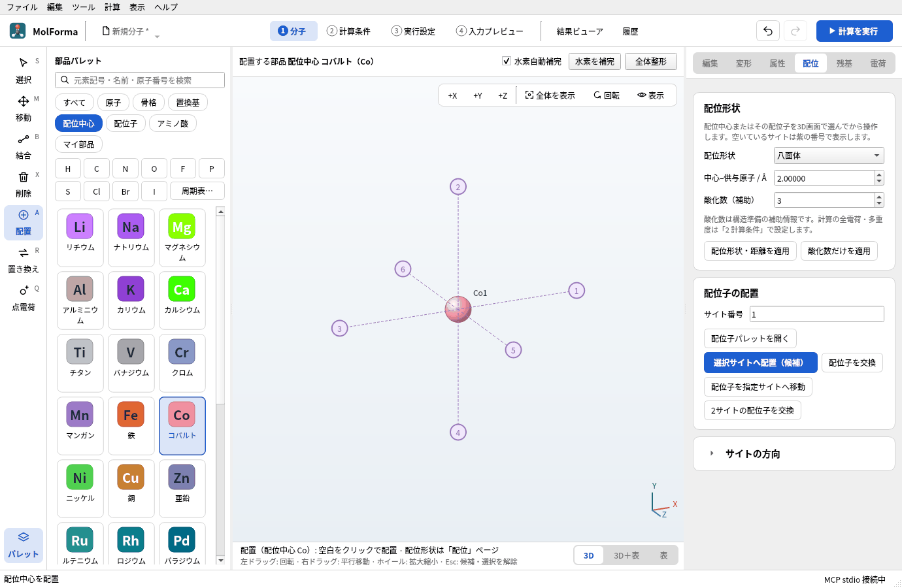
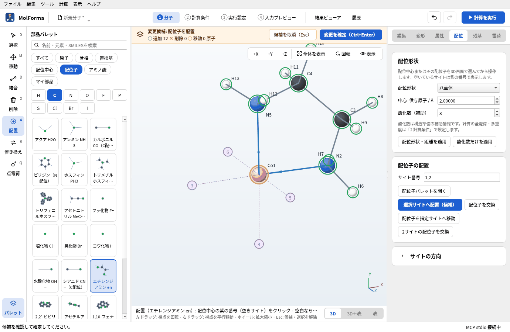
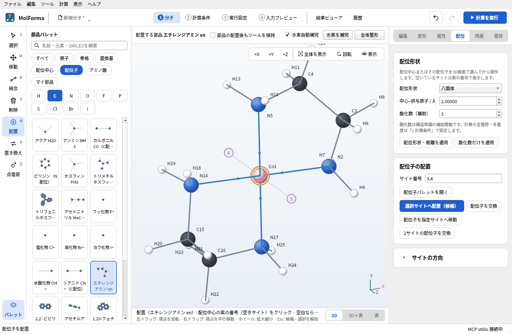
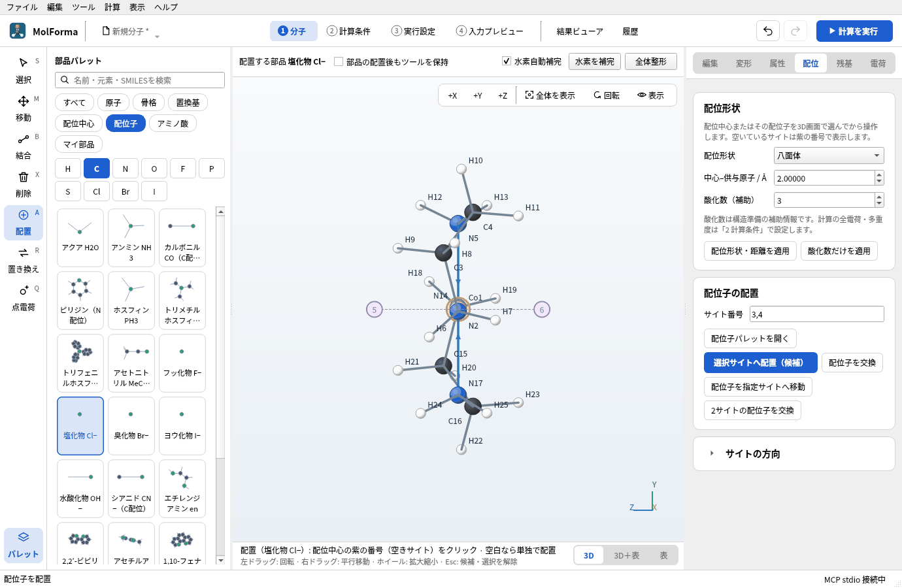
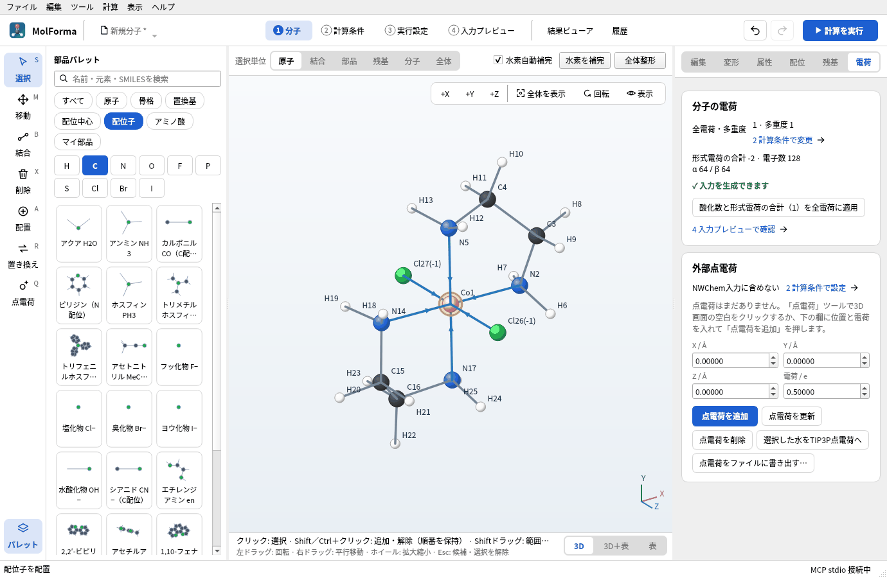
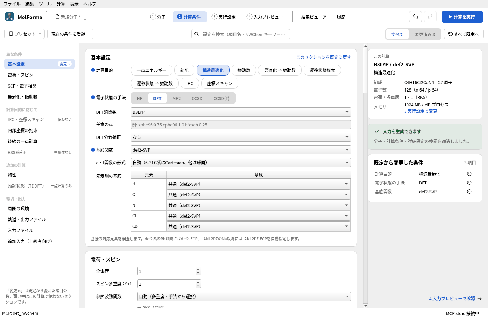
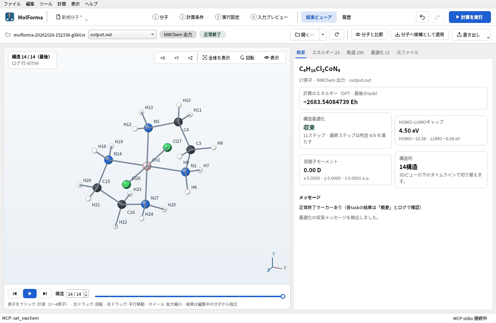
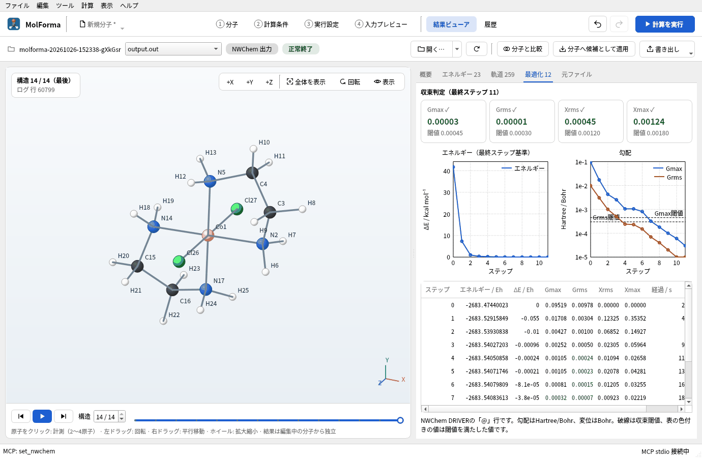

# 題材2 配位化合物（trans-[Co(en)₂Cl₂]⁺）

配位中心のCoを八面体の形で置き、紫の番号で示される配位サイトに、二座配位子のエチレンジアミン（en）2個と塩化物イオン2個を並べます。配位子を置くたびに全電荷が酸化数と配位子の電荷に追従し、最後に+1になることを確かめ、B3LYP/def2-SVPで構造を最適化します。

| 作るもの | 内容 |
| --- | --- |
| 分子 | trans-[Co(en)₂Cl₂]⁺ C₄H₁₆Cl₂CoN₄（27原子・電荷 +1・一重項） |
| 使う機能 | 配位中心、配位形状・中心–供与原子の距離・酸化数、配位サイトのクリック、二座配位子、配位子の連続配置、電荷の追従、構造の検査 |
| 計算 | B3LYP/def2-SVP、構造最適化 |
| 計算時間の目安 | 約40分（MPI 8プロセス、11ステップ） |
| 練習データ | [`co_en_complex.kgui.json`](samples/co_en_complex.kgui.json) |

![配位サイトにenと塩化物を並べたtrans-[Co(en)2Cl2]+](images/cobalt_complex.png)

## 1. 配位中心を置く

1. 「ファイル → 新規」で空の分子にします。
2. 部品パレットの分類で「配位中心」を選び、「コバルト」をクリックします。ツールが「配置」になり、右側が「配位」ページに切り替わります。
3. 「配位」ページの「配位形状」が「八面体」であることを確かめ、「中心–供与原子 / Å」を 2.0、「酸化数（補助）」を 3にします。

   

   **図1** 分類「配位中心」の「コバルト」を選ぶと、右側が「配位」ページになります。配位形状・距離・酸化数はここで決めます。

4. 3D画面の空白をクリックします。Coの周りに紫の丸で配位サイト1〜6が表示されます。ステータスバーの電荷は3になります（空の分子の全電荷0は、構造から見込まれる値0と一致していたので、Co(III)の酸化数に追従します）。

   

   **図2** Coを置くと、紫の番号で配位サイトが出ます。全電荷はCo(III)の酸化数に追従して3になります。

八面体のサイトは、1が+X、2が+Y、3が−X、4が−Y、5が+Z、6が−Zの向きです。正面（+Z）から見るとサイト5と6は中心と重なるので、後で横から見て置きます。

酸化数は構造準備の補助情報で、NWChemの入力には出ません。計算に使う全電荷・多重度は「2 計算条件」の値です。

## 2. エチレンジアミンを2個置く

1. 分類で「配位子」を選び、「エチレンジアミン en」をクリックします。
2. 紫のサイト1をクリックし、続けてサイト2をクリックします。二座配位子は2つのサイトを選んだところで候補になります（「配位」ページの「サイト番号」に `1,2` と入ります）。隣り合う（90°の）サイトを選びます。

   

   **図3** 2つのサイトを選ぶと、二座配位子enが候補として置かれます。

3. 続けてサイト3、サイト4をクリックします。前の配位子の候補が確定してから、次の配位子が候補になります（ステータスバー「前の配位子を確定し、次の配位子を候補にしました」）。
4. 「変更を確定」（Ctrl+Enter）を押します。C4H16CoN4 · 25原子になり、電荷は3のままです（enは中性）。

   

   **図4** enを2個置いて確定したところ（C4H16CoN4 · 25原子）。

## 3. 塩化物を軸方向に置く

1. 「塩化物 Cl−」をクリックします。
2. 3D画面右上の「+X」を押して横から見ると、サイト5と6が左右に見えます。

   

   **図5** 「+X」で横から見ると、サイト5と6が左右に見えます。

3. サイト5、サイト6を順にクリックし、「変更を確定」します。C4H16Cl2CoN4 · 27原子になり、電荷は3 + 2×(−1) = **+1** に変わります。

   ![塩化物を軸方向に2個置いたtrans-[Co(en)2Cl2]+。Coの両側に塩化物Cl26とCl27がある](images/cobalt_complex/06_complex.png)

   **図6** 塩化物を2個置いて確定すると、全電荷は 3 + 2×(−1) = +1 になります。

4. 「ツール → 構造を検査…」で「問題は見つかりませんでした。」と出ることを確かめます。「電荷」ページには「形式電荷の合計 −2 · 電子数 128」「α 64 / β 64」と出ます。

   

   **図7** 「電荷」ページには、形式電荷の合計と電子数、酸化数を含めた合計を全電荷に合わせるボタンがあります。

塩化物をサイト1・2に置き、enをサイト3・5と4・6に置くとcis体になります。置いた配位子は「配位」ページの「配位子を交換」「配位子を指定サイトへ移動」「2サイトの配位子を交換」で入れ替えられます。

金属と配位結合を含む分子は力場の対象外なので、「全体整形」は使えません（「配位結合を含む分子（金属錯体など）は力場整形の対象外です。」）。理想的な八面体の初期構造から、NWChemで最適化します。

## 4. 計算条件を決める

1. 「2 計算条件」の「基本設定」で、計算目的を「構造最適化」、電子状態の手法を「DFT」（B3LYP）、基底関数を「def2-SVP」にします。def2系はRb以降にECPを自動で付けますが、Coは全電子です。

   

   **図8** def2-SVPを選んだ計算条件。元素別の基底の表に、Coを含むすべての元素が並びます。

2. 「電荷・スピン」で全電荷 1・多重度 1を確かめます。Co(III)は低スピンd⁶なので一重項です。高スピンなどほかのスピン状態を計算する場合は多重度を自分で変えます（参照波動関数は自動でUKSになります）。
3. 全電荷が+1になっていない場合（配位子を置く前に全電荷を手で変えていた場合など）は、「電荷」ページの「酸化数と形式電荷の合計（1）を全電荷に適用」か、「2 計算条件」の「配位中心の酸化数と形式電荷の合計（1）を適用」を押します。

## 5. 計算して結果を見る

「計算を実行」（F5）で計算します。実行パネルに最適化の各ステップのエネルギーとGmax・Grms・Xmax・Xrmsの判定が出ます。

**図9** 計算後の「結果ビューア」の「概要」。

**図10** 「最適化」タブでは、ステップごとのエネルギーと勾配の下がり方を確かめられます。

### 実行した結果

| 項目 | 値 |
| --- | --- |
| 計算のエネルギー | −2683.54084739 Eh |
| 構造最適化 | 11ステップで収束（初期構造のGmax 0.095から） |
| Co–N | 1.987〜1.988 Å（初期値 2.0 Å） |
| Co–Cl | 2.263 Å（初期値 2.0 Å） |
| Cl–Co–Cl | 180.0°（trans） |
| 双極子モーメント | 0.00 D（対称中心がある） |

距離は「結果ビューア」の3D画面で2原子を順にクリックすると左下に表示されます。最適化した構造は「分子へ候補として適用」で「1 分子」に取り込み、振動数計算などに進めます（[題材14](reuse_result.md)）。

## うまくいかないとき

- **パレットで選んだ金属と違う元素が置かれる**: 3D画面の下の「配置（配位中心 Co）」の表示を確かめます。分類を切り替えたときは、パレットで強調表示されている項目を置きます。
- **サイトをクリックしても配位子が置かれない**: 二座配位子は2つのサイトを選ぶまで候補になりません。向かい合う（180°の）サイトは「二座配位子には隣接するシスサイトを指定してください。」と拒否されます。
- **サイト5・6が見えない**: 正面からは中心と重なります。「+X」「+Y」や回転で向きを変えます。
- **全電荷が+1にならない**: 配位子を置く前に全電荷を手で変えていると、追従しません。上の手順4の3で合わせます。
- **金属を含む構造の整形を拒否された**: 仕様です。初期構造の距離は「配位」ページの「中心–供与原子」と「配位形状・距離を適用」で変えられます。

関連: [「1 分子」の右側のページ](../features/molecule_pages.md)（配位）、[題材11 主族元素の分子](main_group.md)、[題材12 溶媒和クラスターと点電荷](hydrated_sodium.md)。
