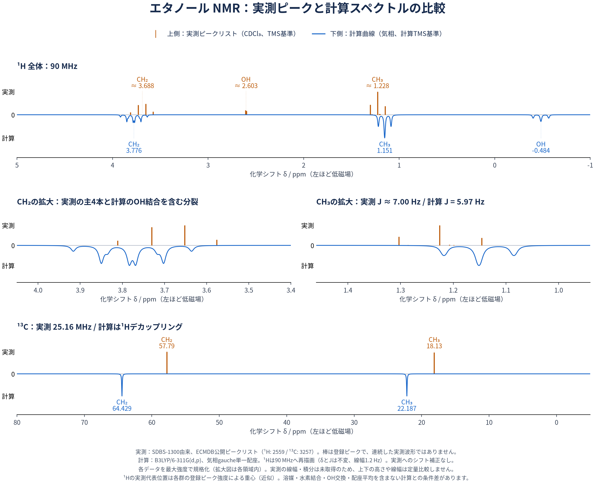
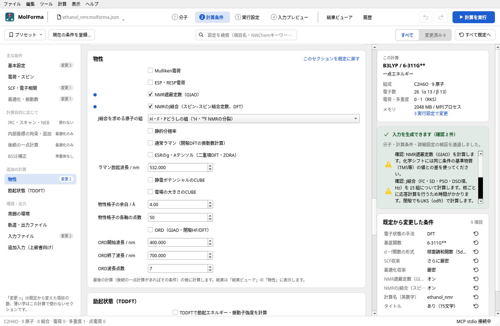
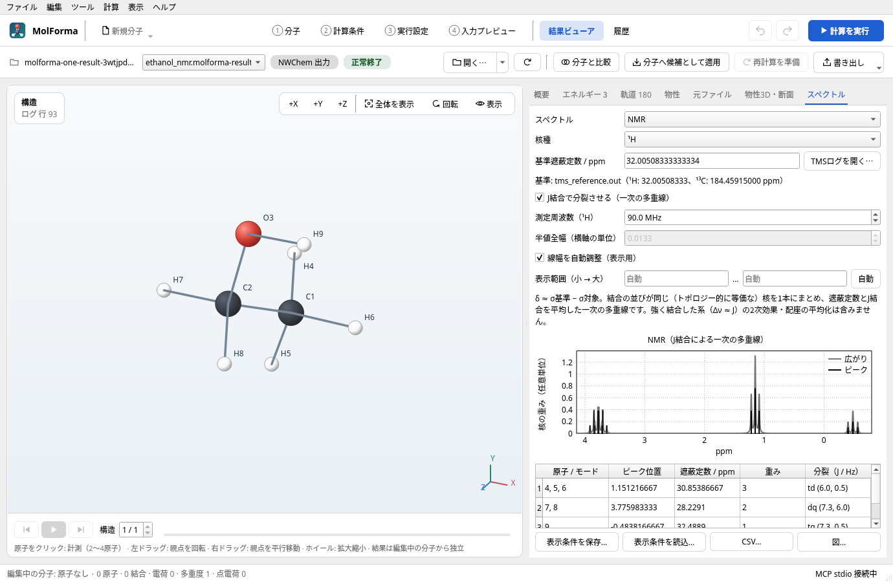

# 題材17 NMRの計算と実測比較（エタノールとTMS）

エタノールの¹H・¹³C NMRを計算し、基準物質TMS（テトラメチルシラン）との差から化学シフトを求めます。J結合による分裂を表示し、公開されている実測ピークと比べて、計算が役立つ部分と今回のモデルの限界を確かめます。

| 作るもの | 内容 |
| --- | --- |
| 分子 | エタノール CH₃CH₂OH（9原子）とTMS Si(CH₃)₄（17原子）、ともに電荷0・一重項 |
| 使う機能 | SMILESから作成、最適化構造の取り込み、NMR遮蔽定数、J結合、基準遮蔽定数、スペクトルの表示・書き出し |
| 計算 | 気相、B3LYP/6-311G(d,p)、GIAO遮蔽定数、エタノールのH–H J結合 |
| 実行記録 | 2026-11-12、MolForma MCPからNWChem 7.3.1（Linux）を実行。以下では同じ操作を画面で行う |
| 計算時間 | J結合は遮蔽定数だけの計算より重い。授業では最適化済み構造から始め、計算時間を確保できない場合は下の計算済みデータを開いて比較する |
| 練習データ | [エタノールの最適化済み構造とNMR条件](samples/ethanol_nmr.molforma.json)、[TMSの初期構造と最適化・遮蔽計算の条件](samples/tms_nmr.molforma.json) |

上記の練習用プロジェクトは構造と条件です。計算結果のログや実行設定は含めていません。自分で計算する場合は「3 実行設定」でNWChem・MPI・保存先を確認してください。基底名の `6-311G**` は、この実習の `6-311G(d,p)` と同じです。

## 計算済みデータを開く（再計算不要）

**[計算結果一式をダウンロード（ZIP・1.96 MB）](https://github.com/hnakada123/MolForma/releases/download/ethanol-nmr-data-v1/ethanol_nmr_results_v1.zip)** · [SHA-256チェックサム](https://github.com/hnakada123/MolForma/releases/download/ethanol-nmr-data-v1/ethanol_nmr_results_v1.zip.sha256)

エタノールとTMSのNWChem入力・出力ログ、練習用プロジェクト、計算曲線・ピーク表のCSV、チャートPDF・PNG、日本語・英語の開き方を収録しています。結果を見るためにNWChemを再実行する必要はありません。

| 個別に開くファイル | 確認できるもの |
| --- | --- |
| [エタノールのNMRログ（.out）](https://github.com/hnakada123/MolForma/releases/download/ethanol-nmr-data-v1/ethanol_nmr.out) | MolFormaで構造、遮蔽定数、15組のH–H J結合、¹H・¹³Cチャートを表示。正常終了したNMR専用ジョブ |
| [TMSの基準計算ログ（.out）](https://github.com/hnakada123/MolForma/releases/download/ethanol-nmr-data-v1/tms_reference.out) | MolFormaで最適化構造と基準遮蔽定数を確認。正常終了 |
| [計算スペクトル（PDF）](https://github.com/hnakada123/MolForma/releases/download/ethanol-nmr-data-v1/ethanol_nmr_calculated_400MHz.pdf) | ¹H（400 MHz）と¹³Cの計算チャート。PDFビューアで閲覧 |
| [実測との比較チャート（PDF）](https://github.com/hnakada123/MolForma/releases/download/ethanol-nmr-data-v1/ethanol_nmr_comparison_ja.pdf) | このページの比較図。¹Hの計算表示を実測と同じ90 MHzに設定 |

1. ZIPを保存・展開します。ログを個別に保存しても構いません。
2. MolFormaの「結果ビューア → 開く…」から `logs/ethanol_nmr.out` を開きます。「物性」で遮蔽定数とJ結合を確認できます。
3. 「スペクトル」でNMRと核種を選び、「J結合で分裂させる（一次の多重線）」をオンにしてから、次の値を入力します。範囲は左右の欄に数値だけを別々に入力し、Enterで確定してください。

| 核種 | 基準遮蔽定数 / ppm | 測定周波数（¹H） | 半値全幅 / ppm | 表示範囲（小 → 大） |
| --- | ---: | --- | ---: | --- |
| ¹H | `32.00508333` | 90 MHz | `0.0133` | 左 `-1`、右 `5` |
| ¹³C | `184.45915000` | 90 MHzのまま | `0.10` | 左 `-5`、右 `80` |

基準値はログを開いただけでは自動設定されません。核種を切り替えると基準欄が空になるため、核種を選んだ後で入力します。負の数は半角の `-` を使ってください。旧版では数学用の `−` を貼り付けると数値として認識されず、チャートが空になります。表示条件の保存ファイルは元ログの場所に依存するため同梱していません。手順4にも表示方法を記しています。

ZIP内の `logs/ethanol_geometry_interrupted.out` は最適化・振動数を確かめるための補足ログです。これらの計算が終わった後、続くJ計算中に停止した記録で、正常終了ログではありません。最終NMRチャートには、正常終了した `ethanol_nmr.out` を使います。

配布ログではホスト名とNWChemのビルド元パスのみ伏せ、座標や計算結果の数値は変更していません。閲覧用データで、NWChemの再開用データベースや軌道ファイルは含みません。詳しくは同梱の `README.ja.txt` を参照してください。

比較図はMolFormaから取得した計算曲線と、公開実測ピークリストを使って作成したものです。MolFormaの画面写真ではありません。実測の棒は連続した測定波形ではなく、上下の強度はそれぞれ規格化しています。

## 1. エタノールの構造を用意する

1. 練習データ `ethanol_nmr.molforma.json` を「ファイル → 開く…」で開きます。以下の結果に使った、B3LYP/6-311G(d,p)で最適化済みのgauche配座です。
2. 「2 計算条件」で電荷0・多重度1、手法DFT、汎関数B3LYP、基底6-311G**を確認します。基底関数の表現は「球面調和関数（5d・7f）」です。
3. 最適化済み構造から始めるので、計算目的は「一点エネルギー」にします。

最初から組む場合は「SMILESから作成」に `CCO` を入力し、候補を確定します（原子と結合から組む方法は[題材1](atoms_and_bonds.md)）。同じ手法・基底で「最適化 → 振動数」を実行し、最適化の収束と、並進・回転を除く内部振動に虚振動がないことを確かめます。「結果ビューア → 分子へ候補として適用」で最後の構造を取り込み、変更を確定してください（[題材14](reuse_result.md)）。SMILESから生成した配座が違えば、以下の値と一致するとは限りません。

今回のエタノールは、最適化・振動数を `xfine` グリッド、最適化収束「厳密」（`tight`）、SCF収束「さらに厳密」（`verytight`）（10⁻⁹）で計算しました。C–C–O–H二面角は約−61.52°で、内部振動21個はすべて正、最低振動数は272.61 cm⁻¹でした。これは局所的に安定な1配座の確認で、溶液中の配座分布を決めたものではありません。

## 2. 遮蔽定数とJ結合を計算する

1. 「2 計算条件」の「物性」で「NMR遮蔽定数（GIAO）」と「NMRのJ結合（スピン–スピン結合定数、DFT）」をオンにします。
2. 「J結合を求める原子の組」は「H・F・Pどうしの組（¹H・¹⁹F NMRの分裂）」にします。エタノールでは水素6個の全15組です。
3. DFTグリッドは `fine`、SCF収束は「さらに厳密」（`verytight`） にします。「周囲の環境」は気相のままです。今回の値と比較する段階では溶媒条件を変えません。
4. 「4 入力プレビュー」で `shielding` と `spinspin` の物性計算があることを確認し、「計算を実行」（F5）で実行します。
5. 正常終了後に「結果ビューア」を開き、「物性」の遮蔽定数とJ結合の表を確認します。

最適化・振動数とNMRを分けると、構造を変えずに遮蔽定数やJ結合を再計算できます。今回も、最適化・振動数・遮蔽まで終えた `xfine` ジョブをJ計算の途中で停止し、最適化済み構造から `fine` のNMR専用ジョブを完了させました。ここに載せるNMRの値は完了した後者の結果です。

閉殻分子のJ計算に必要な最後のUKS計算はMolFormaが入力に追加します。分子の多重度を変える操作ではありません。詳しくは[計算条件の物性](../features/calculation.md)を参照してください。

## 3. TMSを計算して化学シフトの基準にする

遮蔽定数σは、そのまま実験で使う化学シフトδではありません。同じ条件で計算したTMSとの差を使います。

**δ ≈ σ(TMS) − σ(対象核)**

1. エタノールのプロジェクトを保存し、TMSの練習データ `tms_nmr.molforma.json` を開きます。自分で作る場合のSMILESは `C[Si](C)(C)C` です。
2. B3LYP/6-311G**、球面調和関数、電荷0・一重項、気相、グリッド `fine`、SCF収束「さらに厳密」（`verytight`） を指定します。TMSの計算目的は「構造最適化」、最適化収束は「厳密」（`tight`） です。
3. 「NMR遮蔽定数（GIAO）」をオン、「NMRのJ結合」をオフにして計算します。基準を得るだけなのでTMSのJ結合は不要です。
4. 最適化の収束と遮蔽計算の完了を確認し、「物性」の等方遮蔽定数を、¹Hは12個、¹³Cは4個でそれぞれ平均します。Siの値は混ぜません。

| 基準 | 今回のTMSの平均遮蔽定数 / ppm |
| --- | ---: |
| ¹H | 32.00508333 |
| ¹³C | 184.45915000 |

TMSの最適化は収束していますが、今回は振動数による極小確認を省略しました。対象とTMSの遮蔽計算は同じ手法・基底・グリッド・SCF条件です。条件を変えて計算し直す場合は、上表の基準値をそのまま流用せず、TMSも同じ条件で求め直します。

## 4. ¹H・¹³Cスペクトルを表示する

1. 「履歴」から、手順2で完了したエタノールのNMRジョブを「結果ビューアで開く」で開き直します。
2. 「スペクトル」タブで「NMR」、核種「¹H」を選び、「基準遮蔽定数 / ppm」に `32.00508333` を入力します。
3. 「J結合で分裂させる（一次の多重線）」をオンにします。「測定周波数（¹H）」を `90 MHz`、「半値全幅」を `0.0133 ppm`（約1.2 Hz）にします。
4. 「表示範囲（小 → 大）」の左欄に `-1`、右欄に `5` を入力し、Enterで確定します。グラフの横軸は左ほどppmが大きくなります。
5. ピーク表の行を選び、CH₃・CH₂・OHに対応する原子を確かめます。

¹³Cを見るときは核種を切り替え、基準を `184.45915000`、半値全幅を `0.10 ppm`、範囲を `-5` から `80` にします。この分裂モデルの¹³Cは¹Hデカップリングで、エタノールでは炭素2本のピークになります。「測定周波数（¹H）」はプロトン周波数なので、¹³C実測の25.16 MHzをそこへ入力する必要はありません。

400 MHz表示へ変えても化学シフトδ（ppm）とJ（Hz）は変わりません。分裂のppm間隔が J / ν₀ に従って変わります。同じ1.2 Hzの線幅なら、400 MHzでの半値全幅は `0.0030 ppm` です。

チャートや表示条件は「スペクトル」タブのボタンから書き出せます。線幅を変えても元の遮蔽定数・Jは変わりません。MolFormaは結合の並びが同じ核をまとめて平均する一次の多重線モデルです。これは配座の存在比による平均ではなく、今回のCH₂の2個のHも1群になります。二次効果、OH交換、実験の積分・線幅は含みません。[結果ビューアの説明](../features/results.md)も参照してください。

## 5. 実測ピークと比べる

実測はAISTのSDBS-1300に由来するECMDBの[¹Hデータ](https://ecmdb.ca/spectra/nmr_one_d/2559)と[¹³Cデータ](https://ecmdb.ca/spectra/nmr_one_d/3257)です（2026-11-12参照）。どちらもCDCl₃・TMS基準で、¹Hは90 MHz、¹³Cは25.16 MHzです。温度・濃度は参照ページで確認できず、同一試料の測定とも確認していません。

| 核・部位 | 実測δ / ppm | 計算δ / ppm | 計算−実測 / ppm |
| --- | ---: | ---: | ---: |
| ¹H：CH₃ | 約1.228 | 1.151 | −0.076 |
| ¹H：CH₂ | 約3.688 | 3.776 | +0.088 |
| ¹H：OH | 約2.603 | −0.484 | −3.087 |
| ¹³C：CH₃ | 18.13 | 22.187 | +4.057 |
| ¹³C：CH₂ | 57.79 | 64.429 | +6.639 |

¹Hの実測代表位置は、登録されたピーク高さを重みにした各群の重心です。フィットした化学シフトや積分面積の重心ではありません。小さな登録ピークも含めて、CH₃を1.0〜1.4、CH₂を3.4〜4.0、OHを2.5〜2.7 ppmで集計しました。表の差は丸める前の値で計算しています。

CH₃の実測の主3本は、登録されたHz値から平均間隔 **約7.00 Hz**、計算のCH₃–CH₂平均Jは **5.97 Hz** でした。計算は約15%小さい値です。実測への位置・尺度補正は加えていません。計算の3:2:1の核数比は入力構造に由来し、実験の積分を再現したものではありません。

## 6. 計算はどこで役立つか考察する

まず次の問いを、図と表から自分で確かめてください。

1. CH₃・CH₂の¹H平均絶対差を計算してください。OHも含めると、評価はどう変わりますか。
2. ¹³Cの2本の間隔を比べてください。基準値を一律にずらすだけで、2本とも実測に一致させられますか。
3. 気相の1分子と溶液の実測との間で、モデルに足りないものは何でしょうか。ピーク位置と分裂・線幅を分けて考えてください。
4. 未知分子の構造候補を判別する場合、この1分子・5部位の比較からどこまで信頼性を主張できますか。

### 読み取りの例

- **帰属の補助には役立つ。** CH₂がCH₃より低磁場に出る順序を¹H・¹³Cの両方で捉えています。CH₃・CH₂の¹H平均絶対差は約0.082 ppmです。ただし2部位だけの評価で、OHも各部位1点として含めると約1.084 ppmになります。
- **OHは今回のモデルで再現できていない。** 約3.09 ppmの差があります。気相の単一配座には分子間の水素結合や溶液中の配座分布がありません。プロトン交換による分裂・線幅の変化も未計算です。エタノールのOHシフトの濃度依存と水素結合は[実験研究](https://doi.org/10.1016/0022-2852(58)90055-9)でも調べられていますが、この差のすべてを水素結合に帰することはできません。
- **¹³Cの精密予測には不足する。** 平均絶対差は約5.35 ppm。ピーク間隔も実測39.66 ppmに対し計算42.24 ppmで、共通のオフセットだけでは直りません。
- **数値の収束と実験との一致は別。** 同じエタノール構造で `fine` と `xfine` の遮蔽定数を比べた差は約0.0001 ppm以下でした。今回調べた範囲では、グリッドを細かくするだけで上の差を解消するとは考えにくい結果です。J結合のグリッド比較は行っていません。

この計算の価値は、原子ごとのピークを対応づけ、孤立分子モデルで説明できる部分と環境を検討すべき部分を見分けられることです。分子は最初からエタノールとして入力しているので、未知試料を独立に同定したことにはなりません。

発展課題では、溶媒条件を揃え、[配座セット](../features/molecule_pages.md)で複数配座の存在比を扱い、OHには周囲の分子との水素結合も検討します。計算法や補正の精度は別の分子・独立した実測データでも確かめます。これらはこのページで実行済みの計算ではありません。

## うまくいかないとき

- **チャートとピーク表が空白**: 設定欄の下のメッセージを確認します。`minimum` に数値を求めるメッセージが出る場合、表示範囲の左欄を半角で `-1`（¹³Cは `-5`）と打ち直し、Enterで確定します。範囲の両欄を空にすれば自動範囲でも確認できます。`reference_ppm` の場合は、核種を選んだ後で表の基準遮蔽定数を入力してください。入力欄には単位や `…` を含めません。
- **全ピークが大きくずれる**: 基準遮蔽定数を未入力、または¹Hと¹³Cで取り違えていないか確認します。基準は化学シフトの0 ppmではなく、計算したTMSの遮蔽定数です。
- **分裂を選べない**: 読み込んだログにJ結合がない、または計算がまだ完了していません。「物性」のJ結合表を確かめます。
- **計算が長い**: まず遮蔽だけでピーク位置を学び、時間を確保してJ結合を追加できます。「すべての原子の組」はこの実習には不要です。
- **自分の数値が表と違う**: 配座、基底の表現、グリッド、SCF収束、溶媒、TMSの基準条件を確認します。表示周波数や線幅を変えても、遮蔽定数そのものの差は直りません。
- **OHが負のppmに出る**: グラフの不具合とは限りません。今回は対象OHの遮蔽がTMSより大きく、差が負です。実測との一致は別に評価します。

出典: SDBS, National Institute of Advanced Industrial Science and Technology（AIST）, [SDBS-1300](https://sdbs.db.aist.go.jp/CompoundLanding.aspx?sdbsno=1300)（2026-11-12参照）。計算法は[NWChemのNMR物性](https://nwchemgit.github.io/Properties.html#nmr-and-epr)を参照してください。

関連: [実習の一覧](../recipes.md)、[題材1 原子と結合から組む](atoms_and_bonds.md)、[題材14 計算結果から次の計算へ](reuse_result.md)、[計算条件](../features/calculation.md)、[結果ビューア](../features/results.md)。
