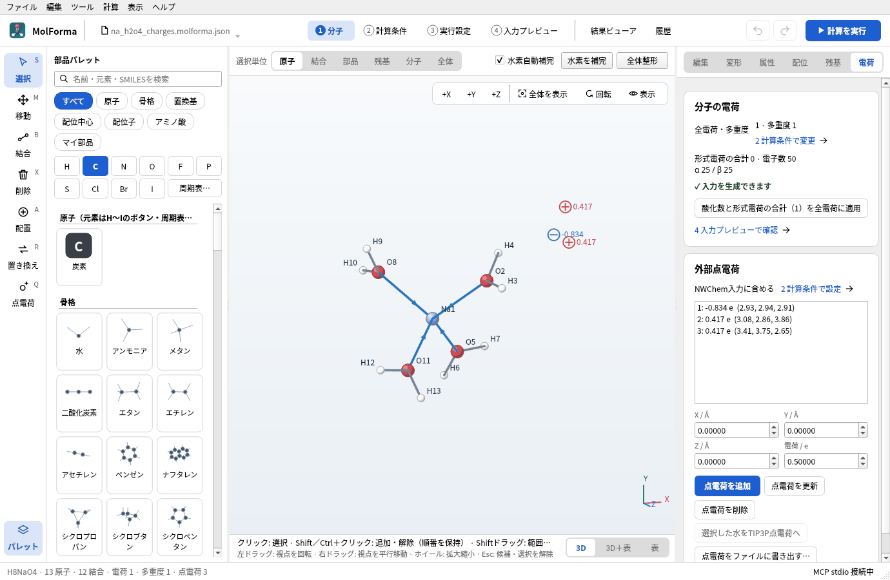
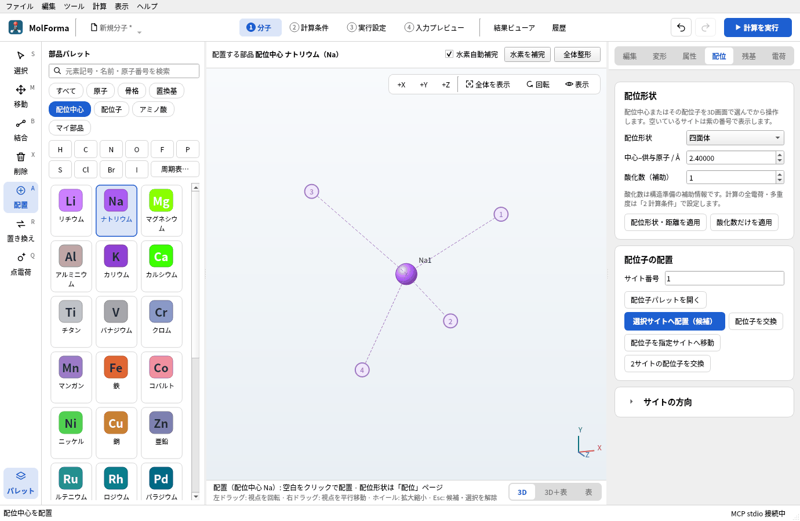
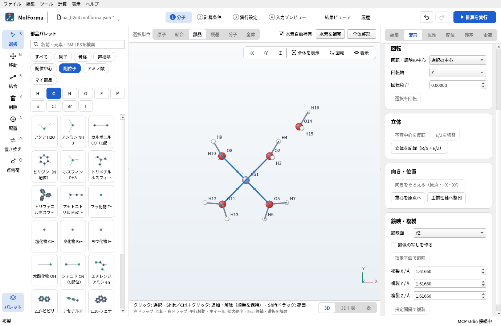
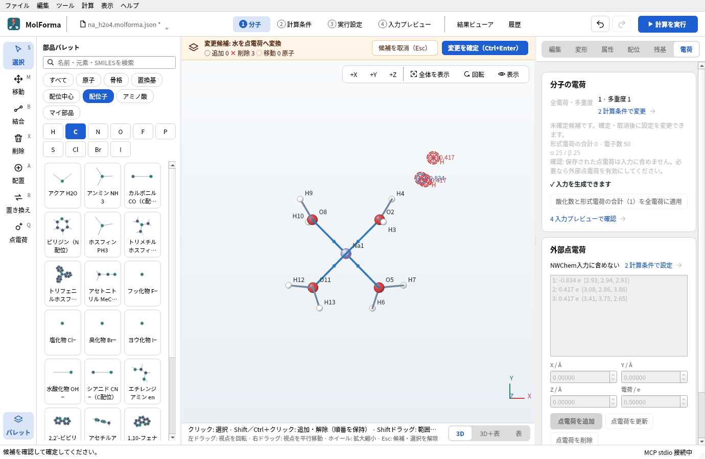
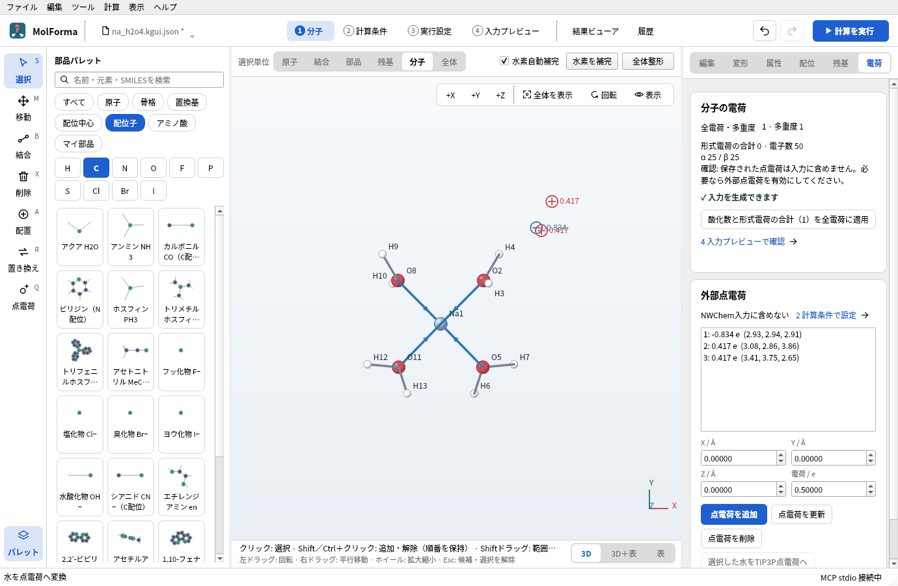
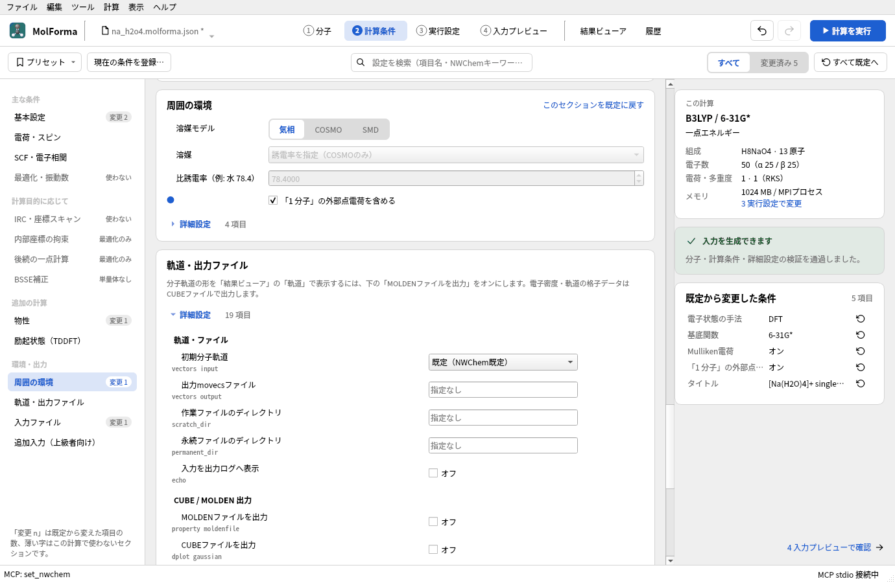
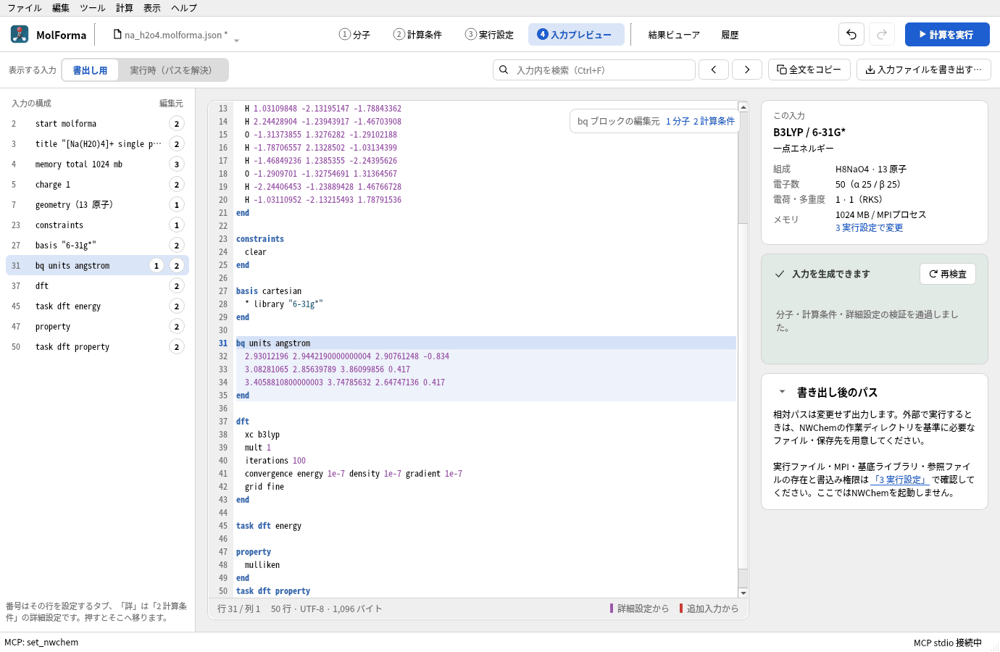
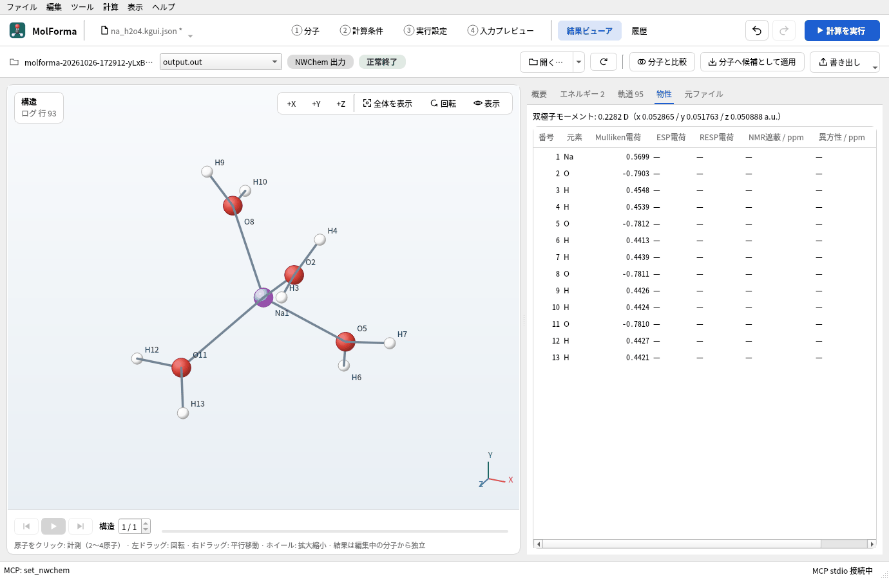

# 題材12 溶媒和クラスターと点電荷（水和したNa⁺）

Na⁺のまわりに水を4つ配位させた [Na(H₂O)₄]⁺ を組み、最適化した構造の外側にもう1つ水を置きます。その外側の水を量子化学の原子として扱う代わりに、TIP3Pの3つの点電荷（O −0.834 e、H +0.417 e）に置き換え、NWChemの外部点電荷として計算に含めます。点電荷なし・点電荷あり・外側の水も原子にした場合の3通りを比べます。

| 作るもの | 内容 |
| --- | --- |
| 分子 | [Na(H₂O)₄]⁺ H₈NaO₄（13原子・電荷 +1）と、外側の水のTIP3P点電荷3個 |
| 使う機能 | 配位中心Na・四面体、アクア配位子、選択単位「部品」「分子」、指定間隔で複製、「電荷」ページの選択した水をTIP3P点電荷へ、点電荷の一覧、周囲の環境（外部点電荷をNWChem入力に含める）、点電荷をファイルに書き出す |
| 計算 | B3LYP/6-31G*、構造最適化（点電荷なし）と一点エネルギー3通り |
| 計算時間の目安 | 最適化 約1分、一点計算 各10〜20秒（MPI 8プロセス） |
| 練習データ | [`na_h2o4.kgui.json`](samples/na_h2o4.kgui.json)（クラスター）、[`na_h2o4_charges.kgui.json`](samples/na_h2o4_charges.kgui.json)（点電荷つき）、[`na_h2o5.kgui.json`](samples/na_h2o5.kgui.json)（外側の水も原子） |

## 1. [Na(H₂O)₄]⁺ を組んで最適化する

1. 「ファイル → 新規」で、分類「配位中心」の「ナトリウム」を選びます。
2. 「配位」ページで「配位形状」を「四面体」、「中心–供与原子 / Å」を 2.40、「酸化数（補助）」を 1にして空白をクリックします。全電荷は+1になります。

   

   **図1** ナトリウムを四面体の配位中心として置いたところ。

3. 分類「配位子」の「アクア H2O」で、サイト1〜4を順にクリックして確定します。H8NaO4 · 13原子 · 電荷 1です。

   ![4つのアクア配位子を置いて確定した [Na(H₂O)₄]⁺。水の酸素からNaへ配位結合の矢印が出ている](images/hydrated_sodium/02_na_h2o4.png)

   **図2** 確定した [Na(H₂O)₄]⁺（H8NaO4 · 13原子 · 電荷 1）。

4. 「2 計算条件」で、計算目的を「構造最適化」、手法を「DFT」（B3LYP）、基底関数を「6-31G*」にして計算します。
5. 終わったら「結果ビューア」の「分子へ候補として適用」で最適化した構造を取り込み、確定します（[題材14](reuse_result.md)）。

## 2. 外側に水を1つ置く

四面体のサイト1は (1, 1, 1) の向きです。サイト1の水を、その向きに2.8 Å（O···O、水素結合の距離）ずらして複製します。

1. 3D画面の上の「選択単位」を「部品」にして、サイト1の水の原子をクリックします（水の3原子が選ばれます）。
2. 「変形」ページの「鏡映・複製」で、「複製 X / Å」「複製 Y / Å」「複製 Z / Å」をすべて 1.6166 にして（2.8 Å ÷ √3）「指定間隔で複製」を押します。結合していない水が1つ増え、H10NaO5 · 16原子になります（全電荷は+1のまま）。

   

   **図3** 「鏡映・複製」でサイト1の水を (1, 1, 1) の向きにずらして複製したところ（+Zから見た図）。

3. この状態を `na_h2o5.kgui.json` として保存しておきます（5つの水をすべて原子として計算する比較用）。

## 3. 外側の水を点電荷にする

1. 「選択単位」を「分子」にして、外側の水の原子をクリックします（結合していない水の3原子が選ばれます）。
2. 右側の「電荷」ページの「選択した水をTIP3P点電荷へ」を押します。水の3原子が消えて、同じ位置にO −0.834・H +0.417の点電荷3個を置く候補になります。確定すると H8NaO4 · 13原子 · 点電荷 3です。

   

   **図4** 外側の水を点電荷に置き換える候補。点電荷は電荷の値付きの円で表示されます。

3. 「電荷」ページの「外部点電荷」に「NWChem入力に含めない」と点電荷の一覧（`1: -0.834 e (2.93, 2.94, 2.91)` など）が出ます。点電荷は置いただけでは入力に出ません。

   

   **図5** 「電荷」ページの「外部点電荷」。この時点では入力に含めません。

4. 「2 計算条件で設定」を押し、「周囲の環境」の「「1 分子」の外部点電荷を含める」をオンにします。「4 入力プレビュー」に `bq units angstrom` のブロックが加わります。点電荷の座標は分子の出力単位にかかわらずÅで出力します。

   

   **図6** 「周囲の環境」で外部点電荷を含めるようにします。

   

   **図7** 入力の `bq` ブロック。座標はÅで出力されます。

5. `na_h2o4_charges.kgui.json` として保存します。

点電荷は分子の全電荷・電子数に含めません（全電荷は+1のまま、電子数は50）。点電荷を3D画面で置くには左端の列の「点電荷」（Q）ツール、数値で置くには「電荷」ページの「点電荷を追加」を使います。「点電荷をファイルに書き出す…」は `x y z q`（Å）の形式で保存します。

これは固定した外部静電場で、力場やQM/MM境界を持つNWChemのQM/MM計算ではありません。点電荷には短距離の反発がないので、点電荷を含めた構造最適化では原子が点電荷に引き寄せられることがあります。この題材のように、点電荷なしで最適化した構造に点電荷を加えて一点計算するのが安全です。

## 4. 3通りの一点計算

最適化した [Na(H₂O)₄]⁺ の構造で、計算目的を「一点エネルギー」にして、次の3つを計算します（B3LYP/6-31G*）。

1. 点電荷なし（`na_h2o4.kgui.json`、外部点電荷をオフ）
2. 点電荷あり（`na_h2o4_charges.kgui.json`）
3. 外側の水も原子（`na_h2o5.kgui.json`、16原子）

「物性」の「Mulliken電荷」をオンにすると、「結果ビューア」の「物性」タブで原子ごとの電荷を比べられます。

**図8** 点電荷ありの計算の「物性」タブ。原子ごとのMulliken電荷が並びます。

外側の水との相互作用エネルギーには、外側の水だけのエネルギーも要ります。`na_h2o5.kgui.json` を開き、選択単位「分子」でNaをクリックして（Naと配位した4つの水が選ばれます）削除し、確定します。H2O · 3原子になり、全電荷は+1から0に戻ります。これも同じ条件で一点計算します（保存はしなくてかまいません）。

### 実行した結果

最適化は5ステップで収束し、Na–Oは4本とも2.27 Åになりました。外側の水のOは、サイト1の水のOから2.80 Å、その2つのHから2.34 Åの位置です。

| 計算 | 計算のエネルギー | Na⁺のMulliken電荷 | サイト1の水のO |
| --- | --- | --- | --- |
| 1. 点電荷なし | −467.880411491 Eh | +0.578 | −0.782 |
| 2. TIP3P点電荷あり | −467.897394297 Eh | +0.570 | −0.790 |
| 3. 外側の水も原子 | −544.304244308 Eh | +0.564 | −0.794 |
| 外側の水だけ | −76.408888746 Eh | — | — |

- 点電荷による安定化: (2) − (1) = −10.66 kcal/mol
- 外側の水との相互作用: (3) − (1) − (外側の水だけ) = −9.38 kcal/mol（基底関数重ね合わせ誤差は補正していません）

3つの点電荷だけで、外側の水を量子化学で扱った相互作用をおおよそ再現しています。点電荷には交換反発や電荷移動がないので、(3)で外側の水に移る電荷（+0.03 e）は表せません。

## うまくいかないとき

- **「独立したH2O分子を選択してください。」**: 配位している水（Naと配位結合している）は変換できません。選択単位「分子」で外側の水だけを選びます。「水分子のOとH2個を選択してください。」と出たら、選んだ原子が水の3原子になっていません。
- **点電荷が入力に出ない**: 「周囲の環境」の「「1 分子」の外部点電荷を含める」がオフです。
- **振動数を計算できない**: 外部点電荷を含む振動数計算はNWChemの制限で対応していません（「外部点電荷中の振動数解析は未対応です。」）。
- **溶媒を連続誘電体で扱いたい**: 「周囲の環境」の溶媒モデルでCOSMO（HF・DFT）やSMD（DFT）を選びます。点電荷と併用することもできます。

関連: 「[機能と操作](../features.md)」の「1 分子」の右側タブ（電荷）・溶媒、[題材2 配位化合物](cobalt_complex.md)。
