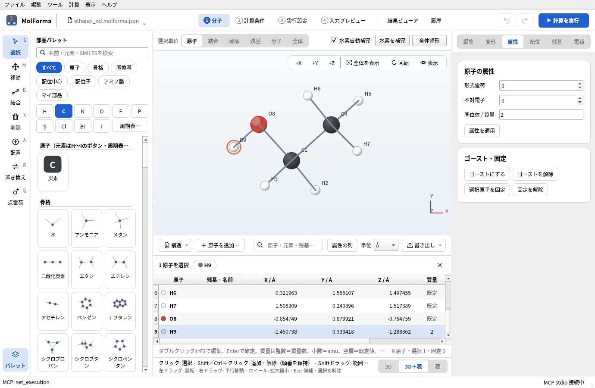
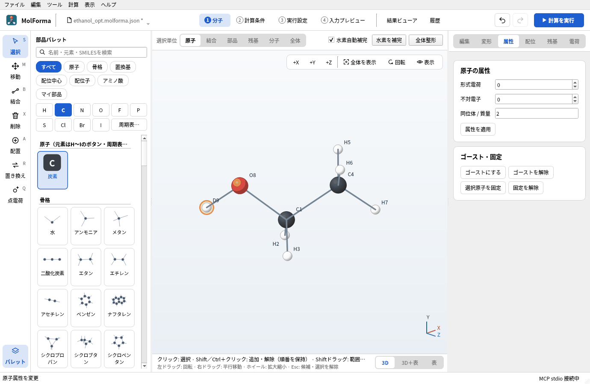
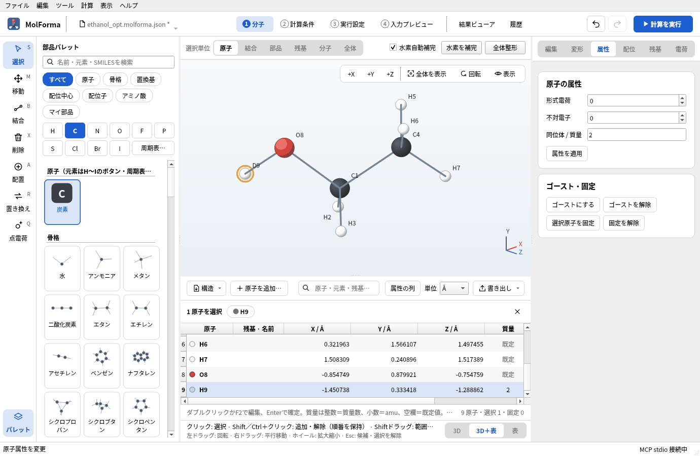
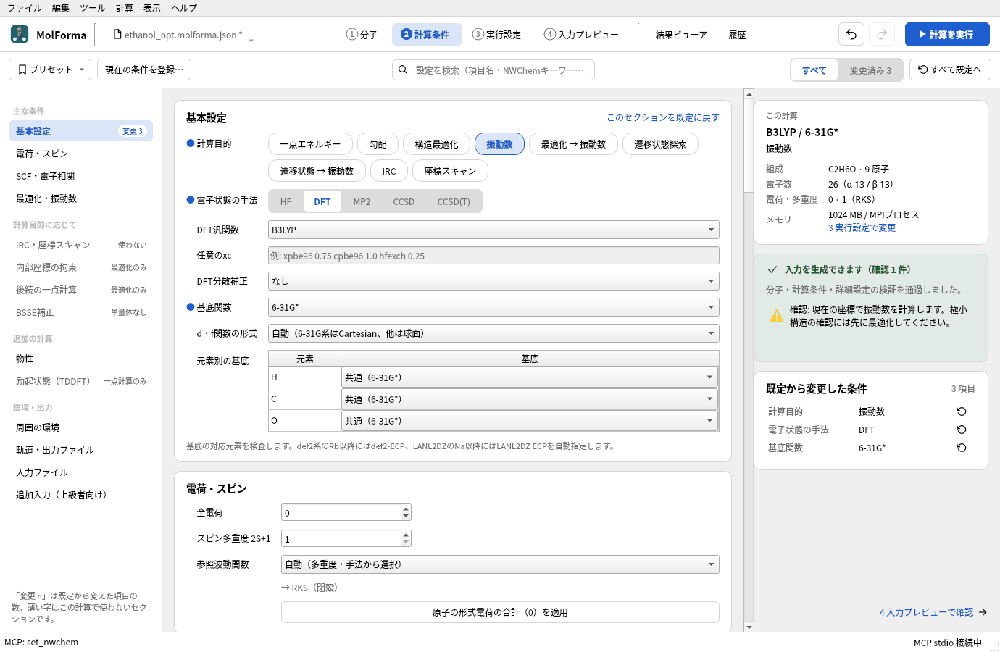
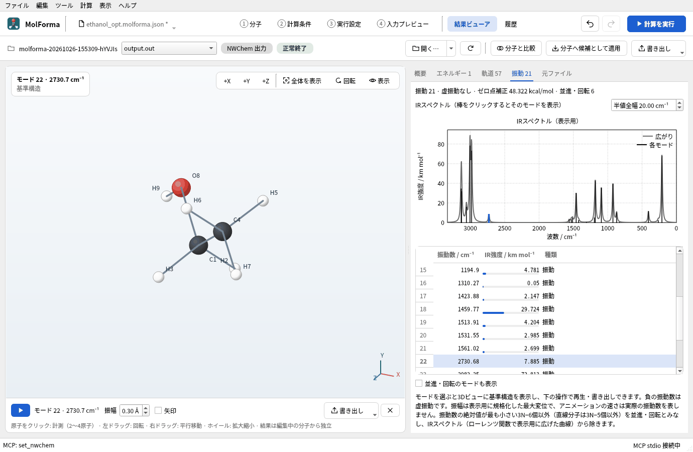
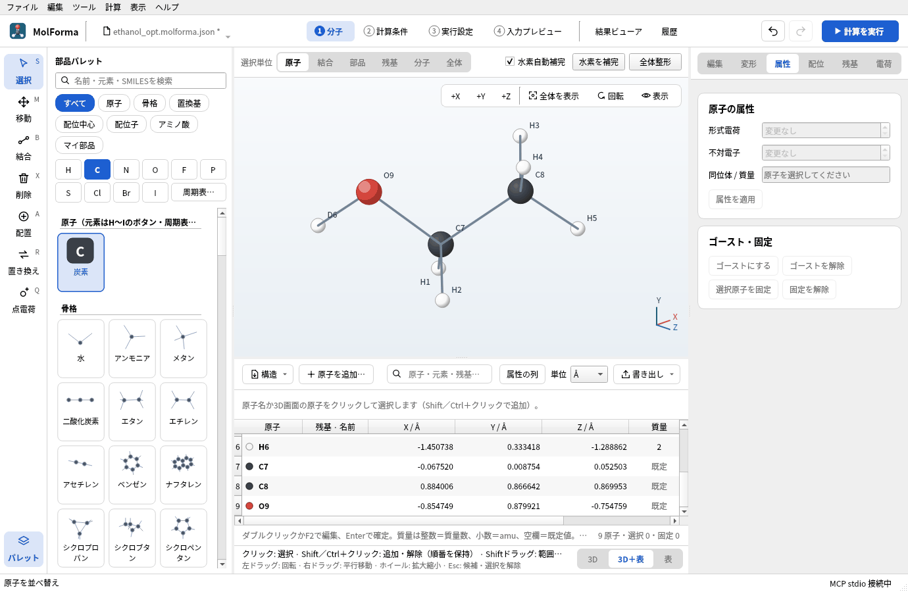

# 題材15 同位体と原子の並び順（エタノール-OD）

最適化したエタノールのO–Hの水素を重水素にして、振動数を計算し直します。元素は同じで質量だけが変わるので、同じ座標での電子エネルギーは変わらず、振動数・ゼロ点エネルギー・熱化学の値が変わります。あわせて、座標の表で質量を確かめ、原子の並び順（NWChem入力の `geometry` の行の順番）を整える方法を試します。

| 作るもの | 内容 |
| --- | --- |
| 分子 | エタノール-OD CH₃CH₂OD（9原子・電荷 0・一重項） |
| 使う機能 | 「属性」ページの同位体 / 質量、座標の表の質量の列と元素のセル（D・T）、原子を並べ替え、振動数だけの計算 |
| 計算 | B3LYP/6-31G*、振動数（[題材1](atoms_and_bonds.md)で最適化した構造） |
| 計算時間の目安 | 約1分（MPI 8プロセス） |
| 計算環境 | AMD Ryzen 7 2700X（8コア・16スレッド）、メモリ 32 GB、NWChem 7.3.1（Linux） |
| 練習データ | [`ethanol_opt.molforma.json`](samples/ethanol_opt.molforma.json)（最適化した構造）、[`ethanol_od.molforma.json`](samples/ethanol_od.molforma.json)（O–D） |

## 1. 最適化した構造から始める

振動数は、その手法・基底で最適化した構造で計算します。[題材1](atoms_and_bonds.md)の計算結果を「履歴」→「結果ビューアで開く」→「分子へ候補として適用」で「1 分子」に取り込み、確定します（[題材14](reuse_result.md)）。練習データの `ethanol_opt.molforma.json` は取り込んだ後の状態です。

## 2. 水素を重水素にする

1. 「選択」ツールでO–Hの水素（H9）をクリックします。
2. 右側の「属性」ページの「同位体 / 質量」に 2 を入れて「属性を適用」を押します。整数は質量数（²H）、小数は質量そのもの（amu、例: 2.0141）です。空欄で適用すると既定の質量に戻ります。
3. 3D画面のラベルが「D9」になります。

   

   **図1** 「属性」ページで質量数2を適用すると、ラベルがD9になります。

4. 3D画面の下の帯の右端で「3D＋表」を選ぶと、座標の表の「質量」の列に質量数の 2 が出ます（ほかの原子は「既定」）。選んだ原子の行が見えていなければ、表はその行まで送られます。表の「原子」のセルに `D` や `T` と入れても、水素の質量数2・3を指定できます。

   

   **図2** 座標の表の「質量」の列。選んだ原子の行が見えるように表が送られます。

「属性」ページの「元素」を変える（「選択原子をこの元素に変更」など）と、同位体の指定は外れます。NWChemの入力では `geometry` の行の末尾に `mass 2.014101778` が付きます（質量数はOpen Babelの同位体データでamuに変換）。

## 3. 振動数を計算する

1. 「2 計算条件」の「基本設定」で、計算目的を「振動数」にします（最適化はしません）。手法・基底は最適化と同じ B3LYP/6-31G* にします。

   

   **図3** 計算目的を「振動数」にしたところ。最適化はしません。

2. 「計算を実行」（F5）で計算し、「結果ビューア」の「振動」タブでO–DとO–Hの伸縮の振動数を、[題材1](atoms_and_bonds.md)の結果と比べます。

   

   **図4** O–Dの伸縮（2730.7 cm⁻¹）。

### 実行した結果

| 項目 | エタノール（[題材1](atoms_and_bonds.md)） | エタノール-OD |
| --- | --- | --- |
| 計算のエネルギー | −155.033797408 Eh | −155.033797408 Eh（同じ） |
| O–H / O–D伸縮 | 3751 cm⁻¹ | 2731 cm⁻¹ |
| C–H伸縮 | 2982〜3134 cm⁻¹ | 2982〜3134 cm⁻¹（変わらない） |
| ゼロ点補正 | 50.37 kcal/mol | 48.32 kcal/mol |
| エントロピー（298.15 K） | 64.34 cal/(mol·K) | 65.19 cal/(mol·K) |

O–Dの伸縮はO–Hの0.728倍で、換算質量の比から見込まれる約1/√2に近い値です。電子エネルギーは質量に依らないので同じで、ゼロ点エネルギーは2.05 kcal/mol下がります。

CH3CH2OH の3つのメチルの水素をまとめて選んで質量数2にすると CD3CH2OH になります。複数の原子を選んで「属性を適用」すると、選んだすべての原子に同じ同位体を設定します。

## 4. 原子の並び順を整える

「4 入力プレビュー」の `geometry` の行は、3D画面の番号の順です。原子を足したり消したりした後は順番が混ざるので、必要なら並べ替えます。

1. 座標の表の上の「構造」メニューで「原子を並べ替え」を開き、「元素順」「残基順」「選択した原子を先頭へ」のどれかを選びます。
2. 元素順では原子番号の小さい順（H・C・N・O…）に並び、同じ元素の中では元の順番を保ちます。並べ替えは「元に戻す」で戻せます。

   

   **図5** 「元素順」で並べ替えた座標の表。重水素は6番目の水素（H6）になりました。

3. 固定原子・拘束・スキャンの原子は永続IDで管理しているので、並べ替えても番号は自動で追従します（`fix atom` や `zcoord` の番号が新しい順番になります）。

## うまくいかないとき

- **質量を入れても変わらない**: 「属性を適用」を押していません。座標の表の「質量」のセルでも直接編集できます。
- **「属性を適用」で質量が消えた**: 1原子だけを選んで空欄のまま適用すると、既定の質量に戻ります。
- **振動数に虚振動が出る**: 最適化と違う手法・基底で振動数を計算しています。同じ条件で最適化した構造を使います。

関連: [座標の表](../features/coordinates.md)（NWChemへの出力）、[題材1 原子と結合から組む](atoms_and_bonds.md)。
