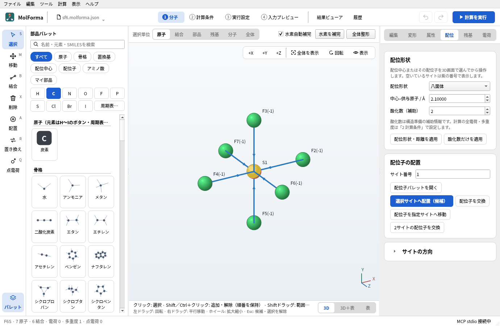
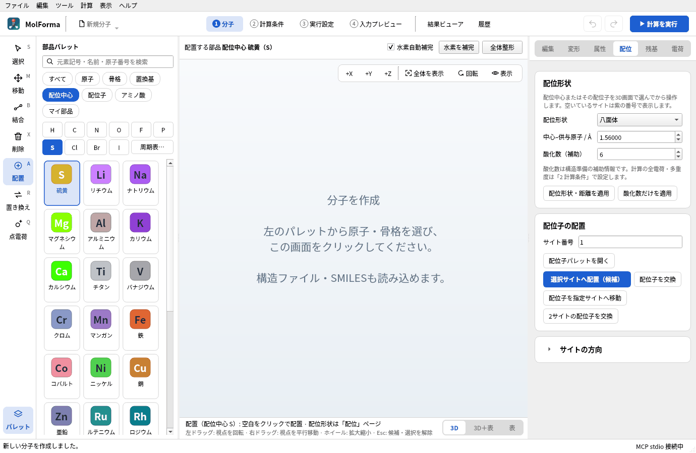
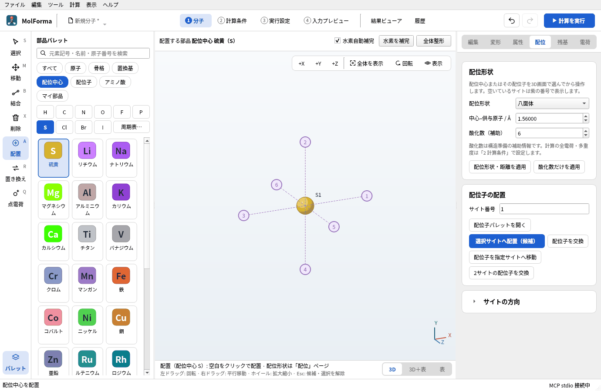
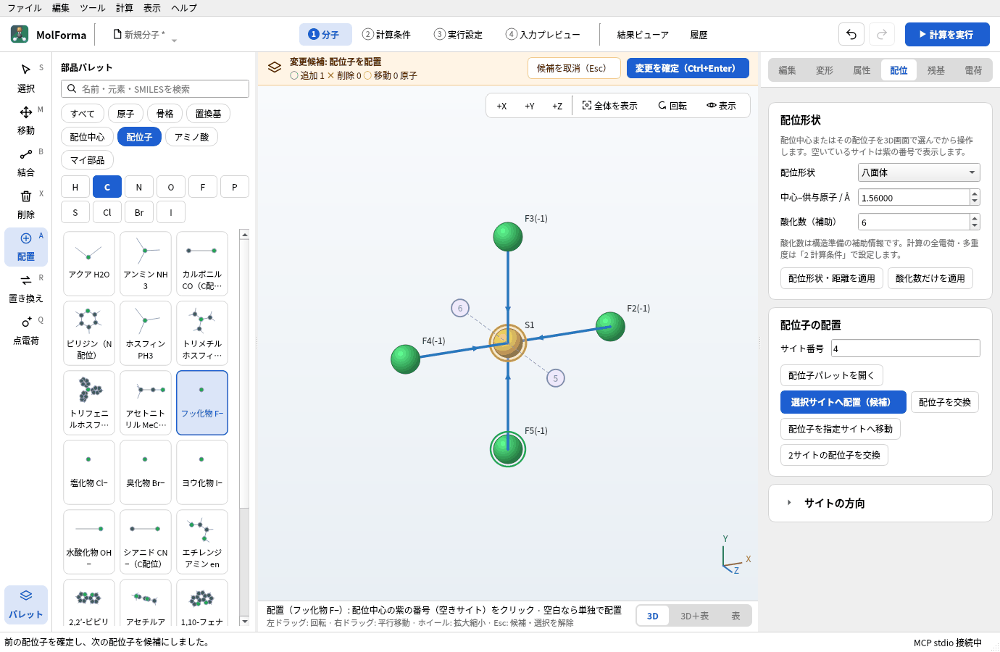
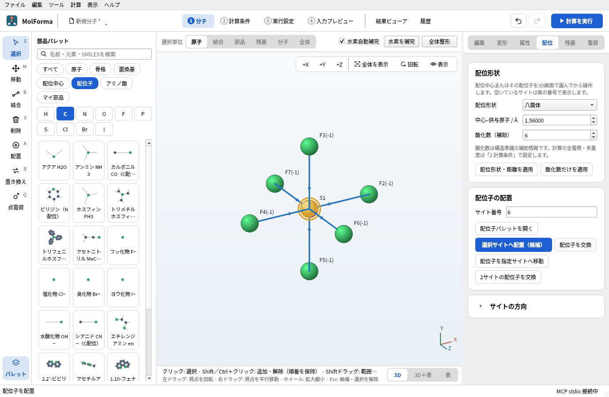
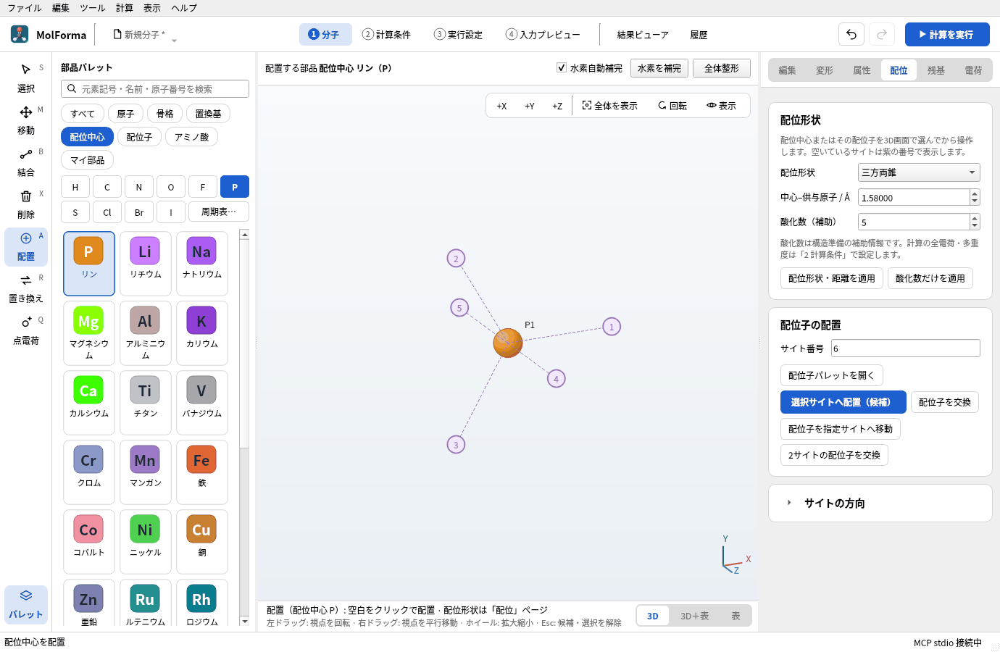
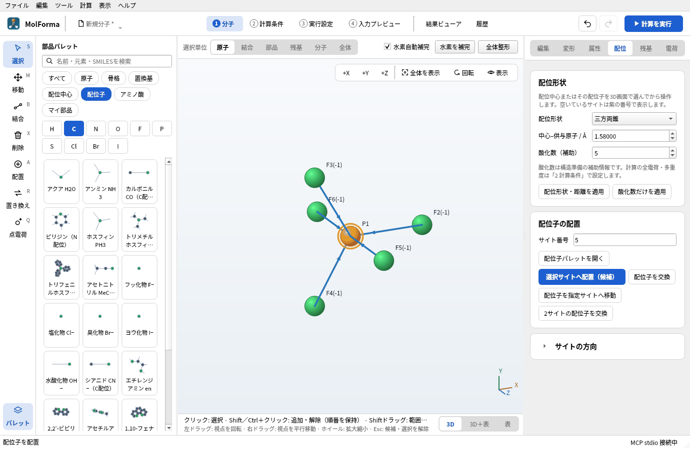
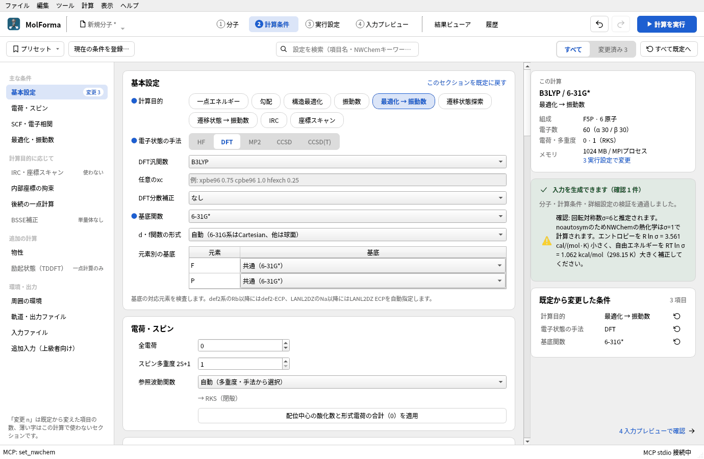
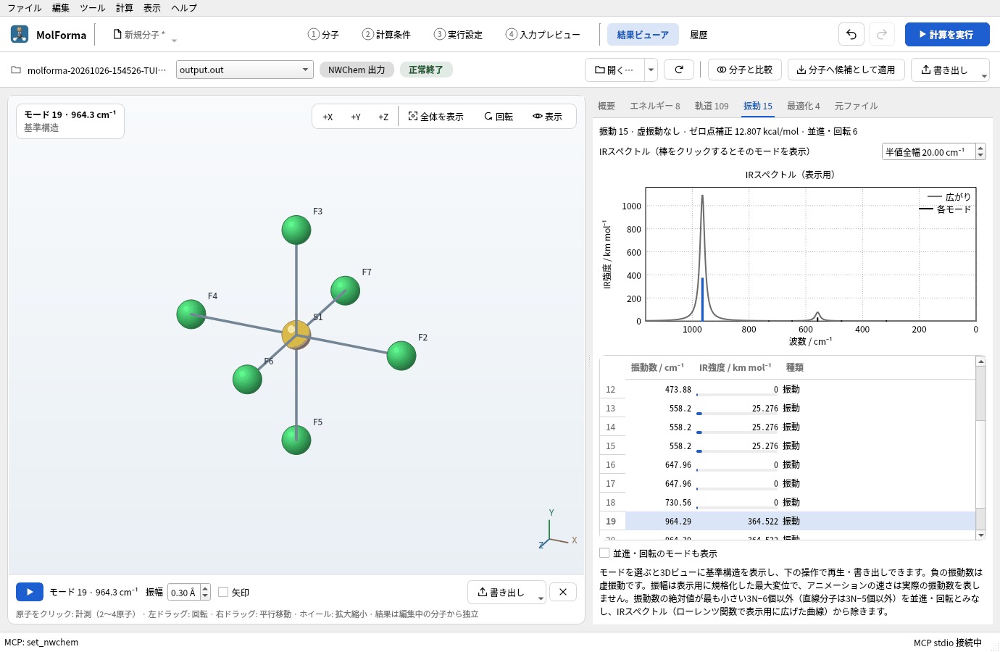

# 題材11 主族元素の分子（SF₆とPF₅）

配位中心は金属でなくてもかまいません。硫黄を八面体の配位中心として置き、フッ化物を6つの配位サイトに並べるとSF₆に、リンを三方両錐の中心にしてフッ化物を5つ並べるとPF₅になります。VSEPRの形をそのまま初期構造にして、B3LYP/6-31G*で最適化と振動数を計算します。

| 作るもの | 内容 |
| --- | --- |
| 分子 | SF₆（7原子・八面体）、PF₅（6原子・三方両錐）。どちらも電荷 0・一重項 |
| 使う機能 | 配位中心の分類で元素ボタン・周期表・検索から中心の元素を選ぶ、配位形状、酸化数と電荷の追従、フッ化物配位子、回転対称数 |
| 計算 | B3LYP/6-31G*、最適化 → 振動数 |
| 計算時間の目安 | SF₆ 約4分、PF₅ 約2分（MPI 8プロセス） |
| 計算環境 | AMD Ryzen 7 2700X（8コア・16スレッド）、メモリ 32 GB、NWChem 7.3.1（Linux） |
| 練習データ | [`sf6.molforma.json`](samples/sf6.molforma.json)、[`pf5.molforma.json`](samples/pf5.molforma.json) |

## 1. 硫黄を配位中心として置く

1. 「ファイル → 新規」で空の分子にし、部品パレットの分類「配位中心」を選びます。一覧には金属が並びます。
2. 元素のボタンの「S」を押します。一覧の先頭に「硫黄」が加わって強調され、3D画面の下に「配置（配位中心 S）」と出ます。分類「配位中心」では、元素のボタン・「周期表…」・検索欄（元素記号・名前・原子番号）で、金属以外の元素も中心に選べます。
3. 右側の「配位」ページで「配位形状」を「八面体」、「中心–供与原子 / Å」を 1.56、「酸化数（補助）」を 6にします。

   

   **図1** 元素ボタン「S」で、硫黄が配位中心の一覧の先頭に加わります。

4. 3D画面の空白をクリックします。紫の配位サイト1〜6が出て、全電荷はS(VI)の酸化数に合わせて6になります。

   

   **図2** 空白をクリックすると、八面体の6つの配位サイトが出ます。

## 2. フッ化物を6つ置く

1. 分類「配位子」の「フッ化物 F−」をクリックします。
2. サイト1〜4を順にクリックします。2つ目からは、前の配位子を確定してから次を候補にします。

   

   **図3** サイト1〜4にフッ化物を置いたところ。最後の配位子は候補として表示されます。

3. 「+X」で横から見て、サイト5・6をクリックし、「変更を確定」します。SF₆（F6S · 7原子 · 6結合）になり、全電荷は 6 + 6×(−1) = 0 に戻ります。

   

   **図4** 確定したSF₆（F6S · 7原子 · 6結合）。

「電荷」ページには「形式電荷の合計 −6」と、「酸化数と形式電荷の合計（0）を全電荷に適用」が出ます。配位結合（中心への矢印）はNWChemの入力には出ず、原子と座標だけが計算に使われます。

金属でない中心でも、配位結合を含む分子は力場の対象外です（「全体整形」は使えません）。初期構造の距離は「配位」ページで変え、NWChemで最適化します。

## 3. PF₅を作る

1. 「ファイル → 新規」で、分類「配位中心」の元素ボタン「P」を押します。
2. 「配位形状」を「三方両錐」、「中心–供与原子 / Å」を 1.58、「酸化数（補助）」を 5にして空白をクリックします。

   

   **図5** 三方両錐では、赤道面に3つ、軸に2つの配位サイトが出ます。

3. 「フッ化物 F−」でサイト1〜3（赤道面）をクリックし、「+X」で横から見てサイト4・5（軸）をクリックして確定します。PF₅（F5P · 6原子）、全電荷 0です。

   

   **図6** 確定したPF₅（F5P · 6原子）。

三方両錐では赤道と軸の結合長が違います（実験値 P–F 赤道 1.53 Å・軸 1.58 Å）。初期構造ですべて1.58 Åにしても、最適化で分かれます。初めから分けたい場合は「配位」ページの「サイトの方向」を開き、サイトごとの方向と距離を指定します。

## 4. 計算して結果を見る

SF₆とPF₅のそれぞれで、「2 計算条件」の計算目的を「最適化 → 振動数」、手法を「DFT」（B3LYP）、基底関数を「6-31G*」にして計算します。

検査結果の確認事項に、回転対称数の推定（SF₆はσ=24、PF₅はσ=6）と、エントロピー・自由エネルギーの補正量が出ます。NWChemの熱化学はσ=1で計算されるので、文献の熱化学と比べるときはこの補正を加えます。

**図7** PF₅の計算条件と、回転対称数の確認事項。

### 実行した結果

| 項目 | SF₆ | PF₅ |
| --- | --- | --- |
| 計算のエネルギー | −997.106811197 Eh | −840.676345065 Eh |
| 構造最適化 | 3ステップで収束 | 2ステップで収束 |
| 結合長 | S–F 1.600 Å（実験 1.564 Å） | P–F 赤道 1.569 Å・軸 1.597 Å（実験 1.534・1.577 Å） |
| 虚振動 | なし | なし |
| IR活性の振動（三重・二重縮退） | 964 cm⁻¹・558 cm⁻¹（実験 939・615 cm⁻¹） | 1021・995・544・503 cm⁻¹ |
| エントロピー（298.15 K、σ=1） | 77.22 cal/(mol·K) | 76.00 cal/(mol·K) |

SF₆のエントロピーを回転対称数σ=24で補正すると 77.22 − 6.32 = 70.90 cal/(mol·K) で、実験値（69.7）に近づきます。「振動」タブでは、縮退した振動が同じ振動数で並びます。

**図8** SF₆の「振動」タブ。縮退した振動は同じ振動数で3行並びます。

## うまくいかないとき

- **金属が置かれる**: 分類「配位中心」で元素ボタンを押したか、3D画面の下の「配置（配位中心 S）」で確かめます。分類「原子」や「すべて」で「S」を押すと、配位中心ではなく普通の硫黄原子（水素補完つき）になります。
- **サイト5・6が見えない**: 正面からは中心と重なります。「+X」「+Y」で向きを変えます。
- **全電荷が0にならない**: 配位子を置く前に全電荷を手で変えていると追従しません。「電荷」ページの「酸化数と形式電荷の合計（0）を全電荷に適用」で合わせます。

関連: [題材2 配位化合物](cobalt_complex.md)、[「1 分子」の画面・ツール・選択](../features/molecule.md)（原子パレットと周期表）。
