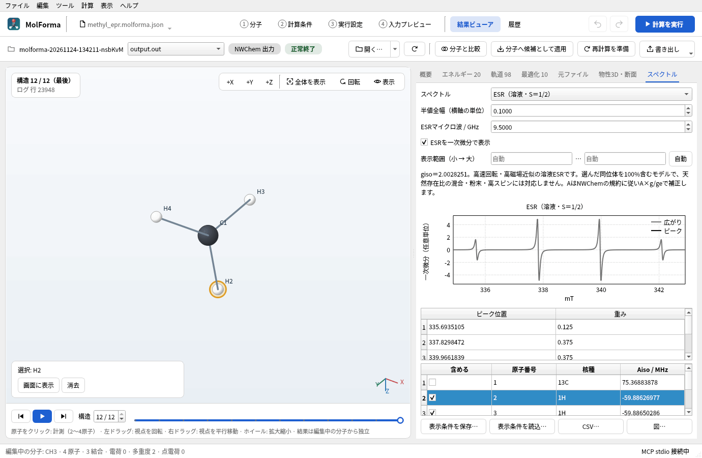
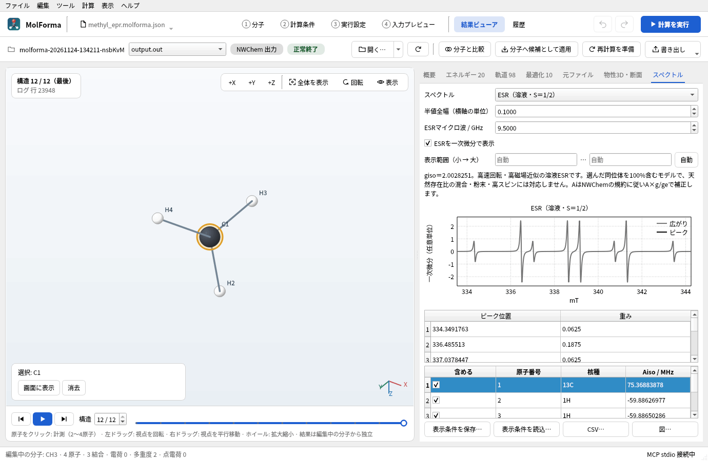

# 題材19 ESR（EPR）の計算と実測比較（メチルラジカル）

いちばん簡単なπラジカルであるメチルラジカル CH₃• のgテンソルと超微細結合テンソルを、B3LYP/def2-TZVP（ZORA）で計算します。結果ビューアで溶液ESRのスペクトルを描き、等価な3個の水素による1:3:3:1の4本線と、¹³Cを含めたときの分裂を確かめます。公表されている実測値と比べ、超微細結合の符号、¹³Cの値が平面構造の計算では小さく出る理由（分子の振動）、基底関数への依存を考えます。

| 作るもの | 内容 |
| --- | --- |
| 分子 | メチルラジカル CH₃•（4原子・電荷 0・二重項） |
| 使う機能 | 原子の配置と削除、「属性」ページの不対電子、多重度と参照波動関数（UKS）、相対論ハミルトニアン（ZORA）、ESRのg・Aテンソル、結果ビューアの「スペクトル」（溶液ESR）、含める核の選択 |
| 計算 | 気相、B3LYP/def2-TZVP（ZORA）、構造最適化 → g・Aテンソル。比較として、組んだままの構造の一点計算 |
| 計算時間の目安 | 約1分（MPI 8プロセス。最適化 42秒、g・A 15秒）。手順5の一点計算は約20秒。NWChemを使えない場合は下の計算済みデータを開いて比較する |
| 計算環境 | AMD Ryzen 7 2700X（8コア・16スレッド）、メモリ 32 GB、NWChem 7.3.1（Linux）。2026-11-24にMolForma MCPから実行 |
| 練習データ | [`methyl_epr.molforma.json`](samples/methyl_epr.molforma.json)（組んだままのメチルラジカルと計算条件） |

練習データは構造と計算条件だけで、計算結果や実行設定は含めていません。自分で計算する場合は「3 実行設定」でNWChem・MPI・保存先を確認してください。

## 計算済みデータを開く（再計算不要）

**[計算ログをダウンロード（.out・1.54 MB）](https://github.com/hnakada123/MolForma/releases/download/methyl-epr-data-v1/methyl_epr.out)** · [SHA-256](https://github.com/hnakada123/MolForma/releases/download/methyl-epr-data-v1/methyl_epr.out.sha256)

[比較表・図も含む一式（ZIP・2.68 MB）](https://github.com/hnakada123/MolForma/releases/download/methyl-epr-data-v1/methyl_epr_results_v1.zip) · [ZIPのSHA-256](https://github.com/hnakada123/MolForma/releases/download/methyl-epr-data-v1/methyl_epr_results_v1.zip.sha256)

このページの計算（2026-11-24）のNWChem出力ログです。構造最適化とg・Aテンソルが1つのログに入っているので、結果を見るためにNWChemを再実行する必要はありません。ZIPにはこのログのほか、手順5（組んだままの構造）と手順6の表（基底関数、炭素をずらした構造）の計算のログ、入力ファイル、練習用プロジェクト、構造のXYZ、超微細結合・gテンソル・線の位置・実測比較の表（CSV）、計算曲線のCSV、チャートのPDF・PNG、日本語・英語の開き方を収録しています。

| 個別に開くファイル | 確認できるもの |
| --- | --- |
| [計算スペクトル（PDF）](https://github.com/hnakada123/MolForma/releases/download/methyl-epr-data-v1/methyl_epr_calculated.pdf) | ¹Hだけ、¹³Cも含めたときの溶液ESRの計算チャート（9.5 GHz、半値全幅 0.1 mT、一次微分）と分裂の図。PDFビューアで閲覧 |
| [実測との比較チャート（PDF）](https://github.com/hnakada123/MolForma/releases/download/methyl-epr-data-v1/methyl_epr_comparison_ja.pdf) | 手順6の比較を図にしたもの。実測のg・aから描いた4本線と計算の4本線、炭素をずらしたときと基底関数を変えたときの超微細結合 |

1. 上の `methyl_epr.out` を保存します。ZIPを使う場合は、展開したフォルダー内の `logs/methyl_epr.out` を選びます。
2. MolFormaの「結果ビューア → 開く…」で、そのファイルを開きます。
3. 右側の「スペクトル」タブを選ぶと、溶液ESRのチャートが表示されます。以降は手順3の3と手順4をそのまま行えます。手順5の結果は、ZIPの `logs/methyl_epr_as_built.out` を同じように開いて確かめられます。

ESR（g・Aテンソルと溶液ESR）の読み込みはMolForma 1.1.0以降の機能です（現時点ではGitHubのmainからビルドした版）。1.0.0ではESRを表示できないため、PDFとCSVで確認してください。

配布ログではホスト名とNWChemのビルド元パスのみ伏せ、座標や計算結果の数値は変更していません。閲覧用データで、NWChemの再開用データベースや軌道ファイルは含みません。詳しくは同梱の `README.ja.txt` を参照してください。

## 1. メチルラジカルを組む

1. 「ファイル → 新規」で空の分子にし、元素のボタン「C」を押して3D画面の空白をクリックします。メタン（CH4 · 5原子）になります（[題材1](atoms_and_bonds.md)の図1・図2と同じ操作です）。
2. 左端の列の「削除」で水素を1個クリックし、「変更を確定」で確定します。CH3 · 4原子になります。電子数が9（奇数）なのに多重度が1のままなので、「2 計算条件」に「電子数 9 と多重度 1 が整合しません。」と出ます（[題材10](phenoxyl_radical.md)の図2と同じです）。
3. 「選択」ツールで炭素をクリックし、右側の「属性」ページで「不対電子」を 1 にして「属性を適用」を押します。
4. 「2 計算条件」の「電荷・スピン」で「スピン多重度 2S+1」を 2にします。参照波動関数の下に「→ UKS（開殻）」と出ます。

組んだままの構造は、メタンから水素を1個除いたピラミッド形です（H–C–Hは約107〜110°）。次の手順の構造最適化で平面になります。

## 2. 計算条件を決める

1. 「2 計算条件」の「基本設定」で、計算目的を「構造最適化」、電子状態の手法を「DFT」（B3LYP）、基底関数を「def2-TZVP」にします。
2. 「SCF・電子相関」の「相対論ハミルトニアン」を「ZORA（DFTのみ）」にします。
3. 「物性」で「ESRのg・Aテンソル（二重項DFT・ZORA）」をオンにします。
4. 上部の「変更済み」を選ぶと、変えた条件だけが並びます。右の「既定から変更した条件」に、計算目的・電子状態の手法・基底関数・相対論ハミルトニアン・ESRのg・Aテンソルが出ます（練習データでは、さらに「入力ファイル」のタイトルを methyl radical にしています）。

   

   **図1** メチルラジカルの計算条件（「変更済み」の表示）。

5. 「4 入力プレビュー」で、`relativistic` ブロックの `zora on`、`dft` ブロックの `mult 2` と `odft`、`task dft optimize` の後の `property` ブロック（`gshift` と `hyperfine`）と `task dft property` があることを確かめます。

ESRのg・Aテンソルは、多重度2（不対電子1個）・非制限DFT・ZORAで使えます。後続の一点計算やゴースト中心とは併用できません（[計算条件](../features/calculation.md)）。NWChemはgシフトと超微細結合をZORAの計算の中で求めるので（出力の見出しも「ZORA g-Shift」「ZORA NMR Hyperfine」です）、相対論ハミルトニアンをZORAにします。炭素と水素だけの分子では、相対論の効果そのものはごく小さいものです。

## 3. 計算して溶液ESRを表示する

1. 「計算を実行」（F5）で実行します。NWChemは構造最適化の後、最適化した構造でgシフトと超微細結合を計算します。
2. 正常終了したら、実行パネルの「結果ビューアへ」（または「履歴」の「結果ビューアで開く」）でジョブを開き、右側の「スペクトル」タブを選びます。種類は「ESR（溶液・S＝1/2）」になり、マイクロ波は9.5 GHz（Xバンド）、半値全幅は0.1 mT、「ESRを一次微分で表示」がオンです。
3. 下の核の表には、原子ごとに「核種」と「Aiso / MHz」（等方的な超微細結合定数）が並びます。原子番号1の¹³C（75.37 MHz）は「含める」がオフ、2〜4の¹H（−59.89 MHz）はオンです。表の行を選ぶと、3D画面でその原子に印が付きます。3D画面を左ドラッグで回すと、平面の正三角形になったことがわかります。

**図2** メチルラジカルの溶液ESR（B3LYP/def2-TZVP、9.5 GHz、半値全幅 0.1 mT、¹Hだけを含める）。

チャートの4本の線は335.69、337.83、339.97、342.10 mTにあり、間隔は2.136 mT、中心は338.90 mTです。等価な3個の¹H（核スピン1/2）の向きは「3個とも上」「2個が上」「1個が上」「すべて下」の4種類に分かれ、それぞれの組合せの数が1、3、3、1なので、線の強度比も1:3:3:1になります。線の間隔は超微細結合定数aの大きさ（絶対値）、中心の位置はg値で決まります。チャート上部の文に giso＝2.0028251 と出ます。

ESR装置は磁場を変調して吸収を検出するので、測定のスペクトルは吸収の一次微分の形をしています。既定の一次微分表示はこれに合わせたもので、線の中心は曲線が0を横切る位置です。「ESRを一次微分で表示」をオフにすると吸収の形になります。

ピーク表には線ごとに位置（mT）と重みが並び、重みは0.125、0.375、0.375、0.125（1:3:3:1、合計1）です。3個の水素のAisoは計算の数値誤差で0.002 MHzほど違いますが、MolFormaは同じ核種でAisoの差が0.01 MHz未満の核を等価な核としてまとめます。

### 実行した結果

| 項目 | 値 |
| --- | --- |
| 計算のエネルギー | −39.881382250 Eh |
| 構造最適化 | 収束（「最適化」タブの10点） |
| 構造 | 平面、C–H 1.079 Å、H–C–H 120.0° |
| 等方g値 | 2.00283（Δg = g − ge = +0.51 × 10⁻³） |
| 超微細結合（等方） | ¹³C +75.37 MHz（+2.689 mT）、¹H −59.89 MHz（−2.136 mT）×3 |
| 計算時間 | 最適化 42秒、g・A 15秒（MPI 8プロセス） |

MHzからmTへは、A / (g μB / h) で換算します（giso = 2.00283では28.03 MHz/mT）。核の表のAisoは、NWChemの規約に従いA×g/geで補正した値なので、ログの値（¹Hでは−59.87 MHz）と4桁目が少し違います（[結果ビューア](../features/results.md#nmr通常ラマン溶液esrのスペクトル)）。

## 4. ¹³Cを含める

1. 核の表で原子番号1（¹³C）の「含める」をオンにします。4本の線がそれぞれ2本に分かれ、334.35〜343.45 mTに8本が並びます。

   

   **図3** ¹³Cも含めると、1:3:3:1の4本線が¹³Cの超微細結合（2.689 mT）で2組に分かれます。

2. 「ESRマイクロ波 / GHz」を 34（Qバンド）にします。チャートの中心は約1212.9 mTに移りますが、線の間隔は変わりません。超微細分裂は磁場の単位では周波数によらず、中心（g値）だけが周波数に比例して動きます。確かめたら 9.5 に戻します。

¹³Cは核スピン1/2なので、線を2本に分けます。MolFormaは、選んだ核種を100%含む分子（ここでは¹³CH₃）のスペクトルを描きます。天然の炭素の¹³Cは約1.1%なので、ふつうのメチルラジカルのスペクトルは¹²CH₃の4本線が主で、¹³CH₃の8本は合わせても全体の約1%の強度しかない弱い線（サテライト）として重なります。天然存在比の混合は描きません。

## 5. 組んだままの構造で計算する（ピラミッド形）

1. 「2 計算条件」で計算目的を「一点エネルギー」にします。分子は最適化の前の、組んだままのピラミッド形のままです（計算結果は分子を変えません）。ESRのg・Aテンソルはオンのままにします。
2. 「計算を実行」で計算し、結果ビューアの「スペクトル」タブの核の表を見ます。

| 項目 | 平面（手順3） | 組んだまま（ピラミッド形） |
| --- | --- | --- |
| C–H結合と3個のHの面のなす角（面外角） | 0° | 20.9° |
| エネルギーの差 | 0 | +9.33 kcal/mol |
| 等方g値 | 2.00283 | 2.00285 |
| a(¹H) / mT | −2.136 | −0.40〜−0.49 |
| a(¹³C) / mT | +2.689 | +13.44 |

ピラミッド形では¹³Cの超微細結合が平面の5倍になり、¹Hは小さくなります。組んだままの構造はH–C–Hの角が少しずつ違うので、3個の水素の値も少し違います。g値はほとんど変わりません。

## 6. 実測と比べる

実測はFessendenらが測定したメチルラジカルの値です。スペクトルの線の間隔からはaの大きさしか決まらないので、実測の符号は教科書（Weil & Bolton）の記載に従い、¹³Cは大きさだけを示します。1 mT = 10 G（ガウス）です。

| 量 | 計算（平面、B3LYP/def2-TZVP） | 実測 | 実測の出典 |
| --- | ---: | ---: | --- |
| 等方g値 | 2.00283 | 2.00255 | Fessenden & Schuler（1963） |
| a(¹H) / mT | −2.136 | −2.304 | Fessenden & Schuler（1963） |
| a(¹³C) / mT | +2.689 | 3.83（96 K） | Fessenden（1967） |
| a(¹³C)の平面構造での値 / mT | +2.689 | 2.70（実測の解析からの見積もり） | Fessenden（1967）、Adam et al.（2015）の表III |

計算は、¹Hのaの大きさを7%小さく、¹³Cを30%小さく出しています。¹³Cは、実測の解析から見積もられた平面構造での値（2.70 mT）とはよく合います。次の表は、手順3の計算条件のまま基底関数だけを変えて最適化とg・Aを計算した結果です。

| 基底関数 | C–H / Å | 等方g値 | a(¹H) / mT | a(¹³C) / mT |
| --- | ---: | ---: | ---: | ---: |
| 6-31G*（デカルト関数の6d） | 1.083 | 2.00274 | −2.532 | +4.410 |
| 6-311+G** | 1.081 | 2.00283 | −2.252 | +2.551 |
| def2-TZVP（この題材） | 1.079 | 2.00283 | −2.136 | +2.689 |
| x2c-TZVPall | 1.079 | 2.00283 | −2.136 | +2.750 |

もう1つの表は、手順3の最適化構造から炭素だけを3個の水素の面に垂直にずらし、同じ条件で一点計算した結果です（水素は動かさないので、C–H結合も少し伸びます）。

| 炭素のずれ / Å | 面外角 | C–H / Å | エネルギーの差 / kcal mol⁻¹ | 等方g値 | a(¹H) / mT | a(¹³C) / mT |
| ---: | ---: | ---: | ---: | ---: | ---: | ---: |
| 0（最適化構造） | 0° | 1.079 | 0 | 2.00283 | −2.136 | +2.689 |
| 0.1 | 5.3° | 1.084 | 0.33 | 2.00282 | −1.980 | +3.600 |
| 0.2 | 10.5° | 1.097 | 1.74 | 2.00282 | −1.558 | +6.151 |
| 0.3 | 15.5° | 1.120 | 5.24 | 2.00281 | −0.977 | +9.890 |

## 7. 計算はどこで役立つか考察する

まず次の問いを、図と表から自分で確かめてください。

1. 計算のa(¹H)は負です。スペクトルから符号はわかりますか。不対電子は炭素の2p軌道（分子面に垂直で、水素の位置では節になる）にあるのに、水素の核の位置にスピン密度が生じるのはなぜでしょうか。
2. ¹³Cの計算値は実測より30%小さいのに、平面構造での見積もりとはよく合います。手順5と最後の表から、平面構造の計算に何が足りないと考えられますか。
3. 計算と実測のg値の差は、9.5 GHzでの線の位置にすると何mTですか。線幅0.1 mTと比べてください。
4. 基底関数を変えると、¹Hと¹³Cのどちらが大きく変わりますか。

### 読み取りの例

- **分裂の数と強度比は確実に予測できる。** 等価なn個の核スピン1/2はn+1本・二項係数の強度比の線を与えます。¹H 3個で1:3:3:1の4本、¹³Cを含めると8本です。線の数と間隔から、どの核がいくつ不対電子と相互作用しているかを読み取れます。
- **符号はスペクトルに現れない。** 線の位置はaの大きさだけで決まります。a(¹H)が負なのは、スピン分極のためです。炭素の2p軌道の不対電子（α）が、交換相互作用でC–Hのσ結合の電子対をわずかに偏らせ、水素の核の位置にβスピンが少し多く残ります。π電子のスピン密度ρ(C)と水素の超微細結合を結ぶMcConnellの関係 a(H) = Q·ρ(C) では、Q ≈ −2.2〜−2.3 mT（Weil & Bolton）で、ρ(C) = 1のメチルラジカルの実測 −2.304 mT はこの範囲にあります。この計算から求めると Q = −2.14 mT です。平面のメチルラジカルの¹³Cの値（正）も、2p軌道ではなく内側の1s・2s電子のスピン分極から生じます。
- **¹³Cの差は分子の振動による。** 計算は平面の平衡構造1点の値で、実測は振動で揺れる分子の平均です。メチルラジカルには面がかさのように反転する柔らかい振動（傘振動、実測の振動数 606.5 cm⁻¹。Adam et al. 2015 の表I）があり、その零点振動エネルギーは約300 cm⁻¹（0.87 kcal/mol）です。炭素を0.1 Åずらすのに要るエネルギーは116 cm⁻¹（0.33 kcal/mol）で、零点振動の範囲内です。ピラミッド形になると炭素の2s軌道が不対電子の軌道に混ざり、¹³Cの値は0.1 Åで+0.91 mT、0.3 Åで+7.2 mTと急に増えます。振動の平均は平面の値より大きくなります。Adam et al.（2015）の高精度計算では、零点振動による増加は平面での値の44%（1.13 mT）です。
- **おおまかに見積もる。** 最後の表の0.1 Åの点から、エネルギーを 116 cm⁻¹ × (d / 0.1 Å)²、¹³Cの増加を 0.91 mT × (d / 0.1 Å)² と近似します。調和振動子の零点状態では位置エネルギーの平均が振動数の1/4（152 cm⁻¹）なので、d²の平均は0.013 Ų、¹³Cの増加は約1.2 mTで、平均の値は約3.9 mTになります。実測の3.83 mTに近い値ですが、振動の形を炭素のずれだけで表し、実測の振動数を使った粗い見積もりです。
- **¹Hの差は振動では説明できない。** 炭素をずらすとa(¹H)の大きさは小さくなるので、振動で平均すると計算値はさらに実測から離れます。平面でのa(¹H)の大きさがもともと小さいのは、汎関数と基底関数による誤差と考えられます。6-31G*の−2.532 mTは実測に近く見えますが、同じ基底で¹³Cは4.4 mTと大きく外れており、誤差の打ち消し合いです。
- **g値はほとんどgeのまま。** 実測のΔg = 2.00255 − 2.00232 = +0.23 × 10⁻³、計算は+0.51 × 10⁻³です。gのずれはスピン軌道相互作用から生じ、炭素と水素だけの分子では小さくなります。計算と実測の差0.00028は、9.5 GHzで中心が0.05 mTずれる量（計算 338.90 mT、実測のgでは338.94 mT）で、線幅0.1 mTより小さい差です。g値はピラミッド形にしてもほとんど変わりません。
- **¹³Cは基底関数に敏感。** ¹Hの値は三重ゼータ級の基底でほぼ決まりますが、¹³Cは6-31G*の4.41 mTからx2c-TZVPallの2.75 mTまで大きく変わります。核の位置のスピン密度を表すには、核の近くに広がる急峻なs関数が必要だからです。

この計算の価値は、線の数と強度比、どの核がどれだけ分裂させるか、超微細結合の符号とその由来を示せることです。メチルラジカルのように柔らかい振動をもつ分子では、平衡構造1点の計算と実測の差に、振動の平均が大きく入ります。気相の1分子の計算なので、溶媒の効果や線幅（分子の運動による）は別に考える必要があります。

発展課題として、ピラミッド形のσラジカルであるCF₃（実測のa(¹³C)は27.1 mT。Weil & Bolton）を組んで計算し、メチルラジカルの¹³Cと比べることができます。これはこのページで実行した計算ではありません。

## うまくいかないとき

- **「ESRのg・Aテンソル」をオンにすると検査結果にエラーが出る**: 多重度が2か、電子状態の手法がDFTで参照波動関数が非制限（→ UKS）か、相対論ハミルトニアンがZORAかを確かめます。後続の一点計算やゴースト中心を使う設定ではオンにできません。
- **「電子数 9 と多重度 1 が整合しません。」と出る**: 「電荷・スピン」で多重度を2にします。検査結果の行をダブルクリックしても直せます。
- **「スペクトル」タブにESRが出ない**: g・Aを計算する前に計算が止まると、ログにgシフトと超微細結合の表がありません。実行パネルや「履歴」で正常終了したかを確かめます。
- **線の本数が違う・線がつながる**: 核の表の「含める」を確かめます。既定ではH・N・F・Pの核だけを含めます。半値全幅が大きいと近い線が重なります。実測の論文の線幅はピーク間の幅（一次微分の極大と極小の間）で示すことが多く、Lorentz形ではピーク間の幅 = 半値全幅 / √3 です。
- **「超微細結合が大きすぎるため高磁場近似のESRを表示できません。」と出る**: 含めた核の分裂の合計がマイクロ波のエネルギーの10%を超えると、一次の高磁場近似が成り立たないので表示しません。マイクロ波の周波数を上げるか、含める核を減らします。
- **自分の数値が表と違う**: 基底関数、DFTのグリッド（この題材は fine）、SCFの収束、構造最適化が収束したかを確かめます。¹³Cの値は基底関数と構造に特に敏感です。核の表のAisoはA×g/geで補正した値なので、ログの値とは4桁目が違います。

出典: 実測の¹HとgはR. W. Fessenden, R. H. Schuler, J. Chem. Phys. 39, 2147 (1963)、¹³C（96 K）と平面構造での見積もりはR. W. Fessenden, J. Phys. Chem. 71, 74 (1967)（A. Y. Adam, A. Yachmenev, S. N. Yurchenko, P. Jensen, J. Chem. Phys. 143, 244306 (2015), [doi:10.1063/1.4938253](https://doi.org/10.1063/1.4938253) の表IIIによる）。傘振動の実測の振動数と零点振動による¹³Cの増加も同じAdam et al.（2015）の表I・表IIIによります。¹Hの符号とMcConnellのQはJ. A. Weil, J. R. Bolton, Electron Paramagnetic Resonance, 2nd ed., Wiley (2007), 9.2節、CF₃の¹³Cは同書9.3節によります。計算法は[NWChemのEPRとpNMR](https://nwchemgit.github.io/EPR-pNMR.html)を参照してください。

関連: [実習の一覧](../recipes.md)、[題材10 イオンとラジカル](phenoxyl_radical.md)（多重度と参照波動関数）、[題材17 NMRの計算と実測比較](ethanol_nmr.md)、[題材18 通常ラマンの計算と実測比較](benzene_raman.md)、[計算条件](../features/calculation.md)、[結果ビューア](../features/results.md#nmr通常ラマン溶液esrのスペクトル)。
