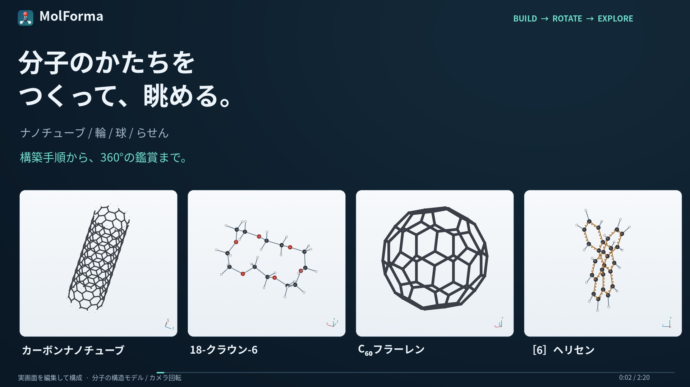

# 題材20 分子のかたちを眺める（動画の4分子）

2分20秒の紹介動画に登場するカーボンナノチューブ、18-クラウン-6、C₆₀フラーレン、［6］ヘリセンを、自分のMolFormaで開いて回してみる実習です。下の練習データには、動画で表示した原子の座標と結合を保存しています。**構造を眺めるだけなので、NWChemや計算の実行設定は不要です。**

| 作るもの | 内容 |
| --- | --- |
| 分子 | チューブ・輪・球・らせんの形をした4種類 |
| 使う機能 | プロジェクト・SDFを開く、回転、拡大縮小、表示スタイル、座標の表、SMILESから作成、PubChemから取得 |
| 計算 | この実習では実行しません。配布データは構造モデルで、NWChemによる最適化結果ではありません |
| 練習データ | 下のZIPでまとめて、または表から分子ごとにダウンロードできます |



## 1. 動画の分子データを開く

**[4分子のデータをまとめてダウンロード（ZIP）](https://hnakada123.github.io/MolForma/recipes/samples/molecular_shapes.zip)**

ZIPには、下の表と同じ4つのプロジェクトと3つのSDFが入っています。ダウンロード後にZIPを展開し、中の `.molforma.json` をMolFormaで開いてください。アプリ内マニュアルからZIPのリンクを押すと、ブラウザーでダウンロードします。

| 分子 | 組成・原子数・結合数 | プロジェクト（動画と同じ構造） | 読み込み用SDF |
| --- | --- | --- | --- |
| カーボンナノチューブ | C₂₄₀H₂₄・264原子・372結合 | [nanotube.molforma.json](samples/nanotube.molforma.json) | [nanotube.sdf](samples/nanotube.sdf) |
| 18-クラウン-6 | C₁₂H₂₄O₆・42原子・42結合 | [crown.molforma.json](samples/crown.molforma.json) | SMILESから作成する手順を後述 |
| C₆₀フラーレン | C₆₀・60原子・90結合 | [c60.molforma.json](samples/c60.molforma.json) | [c60.sdf](samples/c60.sdf) |
| ［6］ヘリセン | C₂₆H₁₆・42原子・47結合 | [helicene.molforma.json](samples/helicene.molforma.json) | [helicene.sdf](samples/helicene.sdf) |

1. ZIPをダウンロードして展開するか、表の「プロジェクト」のリンクをクリックして保存します。アプリ内のマニュアルから個別のプロジェクトを開く場合は、保存先を選ぶとそのまま分子が開きます。
2. MolFormaで「ファイル → 開く…」を選び、保存した `.molforma.json` を開きます。
3. 「1 分子」で「全体を表示」を押します。下のステータスバーの組成・原子数・結合数を表と見比べます。
4. 別の分子を見るときも、表のファイルを同じ方法で開きます。編集したものを残したいときは、先に「ファイル → 名前を付けて保存…」で別名に保存してください。

プロジェクトには原子座標と結合が入っているので、開くためにインターネット接続や構造の再生成は必要ありません。SDFから始める場合も「ファイル → 開く…」を使います。SDFの芳香族結合は読み込み時に認識されるため、結合の線種が変わることがありますが、原子の座標はそのままです。

## 2. 回転・表示切替で形を確かめる

「選択」ツールにしてから、3D画面を**左ドラッグ**すると視点が回転します。ホイールは拡大縮小、右ドラッグは視点の平行移動です。原子の座標を変えずに向きを変えられます。「回転」のスライダーでも左右・上下・画面内の角度を指定できます。ラベルが重なるときは「表示 → ラベル → なし」にします。

| 分子 | 試す操作 | 見るところ |
| --- | --- | --- |
| ナノチューブ | 「表示 → 表示スタイル → スティック」にし、横から回す。「+Y」で筒の軸方向から見て、ホイールで拡大 | 六角形の網目と中央の空洞。両端の白い原子は水素 |
| 18-クラウン-6 | ボール＆スティックで回し、空間充填（CPK）にも切り替える | 18原子からなる環と、その中の6個の赤い酸素。水素を含めた総原子数は42 |
| C₆₀ | スティック表示で少しずつ回す | 五角形12枚と六角形20枚が作る閉じたかご |
| ［6］ヘリセン | 正面に近い向きから、横へ回す | 6つの縮合環が平面に収まらず、末端どうしがずれて重なる形 |

3D画面の下の「3D＋表」を選ぶと、同じ原子の座標も確認できます。動かしたいのが視点だけのときは「移動」ツールで原子をドラッグしないようにしてください。図の球の大きさ・色や結合の太さは表示用の表現です。動画の回転も視点の変化で、分子運動のシミュレーションではありません。

## 3. 動画と同じ方法で構造を用意する

### ナノチューブとC₆₀：用意したSDFを読む

この2分子は、外部で生成した座標と結合をSDFとして用意し、MolFormaで「ファイル → 開く…」から読み込みました。この実習はMolFormaのナノチューブ専用生成ボタンを使う手順ではありません。上の `nanotube.sdf` と `c60.sdf` を開けば、動画の読み込み操作を試せます。

### 18-クラウン-6：SMILESから作る

1. 「ファイル → SMILESから作成…」を開きます。
2. 次の1行を入力し、「3Dで作成」を押します。

   ```text
   C1COCCOCCOCCOCCOCCO1
   ```

3. Open Babelが3D座標を生成し、力場で整えた構造が候補になります。C12H24O6・42原子・42結合であることを確かめて、「変更を確定」を押します。
4. 「ファイル → 名前を付けて保存…」でプロジェクトを保存します。

生成するたびに配座（環の折れ曲がり方）が変わることがあります。動画と同じ配座で確認したいときは、配布した `crown.molforma.json` を開いてください。

### ［6］ヘリセン：PubChemから取得する

1. インターネットにつながる環境で「ファイル → PubChemから取得…」を開きます。
2. CIDとして `98863` を入力して「OK」を押します。
3. 3D構造が表示されたら、C26H16・42原子・47結合であることを確認します。

動画ではPubChemの3D構造を取得しました。PubChemの登録内容は更新されることがあるため、動画と同じ保存済みの座標を使うには、上の `helicene.molforma.json` または `helicene.sdf` を開いてください。

## 4. データの取得元と作成方法

**外部データベースから3D座標をダウンロードしたのは［6］ヘリセンです。** ほかの3分子は動画用に生成した構造です。配布ファイルは2026-11-28に用意しました。

| 分子 | 取得元・作成方法 | 配布データの状態 |
| --- | --- | --- |
| ナノチューブ | ダウンロードした構造ではなく、自作スクリプトで生成。C–C間隔1.42 Åの六角格子を、(6,6)アームチェア型の円筒へ10周期分写像し、両端をC–H距離1.09 Åの水素で終端 | 有限長の理想座標。構造最適化は未実施。周期境界条件や閉じたキャップは含まない |
| 18-クラウン-6 | 上記のSMILESをMolFormaに入力し、Open Babelの3D生成と力場整形で作成。外部からの座標ダウンロードはなし | 生成された配座の1つ。最安定配座を探索した結果ではない |
| C₆₀ | ダウンロードした座標ではなく、自作スクリプトで切頂二十面体の60頂点・90辺から構築し、RDKitのUFF力場で整形 | 力場で整えた構造モデル。NWChemの最適化結果ではない |
| ［6］ヘリセン | [PubChem：CID 98863（［6］Helicene）](https://pubchem.ncbi.nlm.nih.gov/compound/98863) の3D構造を2026-11-28に取得。[取得した形式と同じ3D SDFのURL（PUG REST）](https://pubchem.ncbi.nlm.nih.gov/rest/pug/compound/cid/98863/SDF?record_type=3d) | 公開3D座標。配布SDFは取得したファイルで、プロジェクトはMolFormaで読み込んで保存したもの。この実習では追加の構造最適化をしていない |

PubChemのリンクは外部の取得元、上の練習データのリンクはこの実習で使った保存済みファイルです。取得元の更新や通信状態にかかわらず、配布プロジェクトから同じ形を確認できます。

## うまくいかないとき

- **ファイルがブラウザーに文字で表示された**: リンクを右クリックして「名前を付けてリンク先を保存」を選び、拡張子を `.molforma.json` または `.sdf` のまま保存します。
- **分子が小さい・見えない**: 「1 分子」の「全体を表示」を押し、ホイールで大きさを調整します。「表示 → すべての原子を表示」も確認してください。
- **形を変えてしまった**: 「元に戻す」を使うか、配布プロジェクトをもう一度開きます。回して眺めるときは「選択」ツールを使います。
- **PubChemに接続できない**: 配布したヘリセンのプロジェクトまたはSDFを開けば、通信なしで確認できます。

詳しい画面操作は[「1 分子」](../features/molecule.md)、SMILESと構造ファイルからの作成は[題材4](caffeine_smiles.md)を参照してください。
