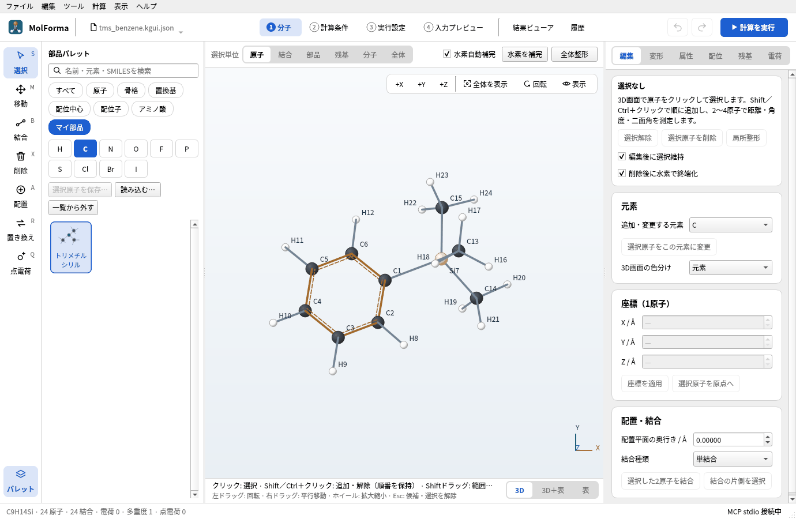

# 題材16 自作の部品（マイ部品）

置換基テンプレートにないトリメチルシリル基 –Si(CH₃)₃ を組み、接続点を決めて「マイ部品」として保存します。保存した部品はパレットの分類「マイ部品」に並び、組込みの置換基と同じく、クリックした水素を置き換えて付けられます。部品ファイル（`.kpart.json`）で受け渡す方法と、付けた分子の構造最適化も確かめます。

| 作るもの | 内容 |
| --- | --- |
| 部品 | トリメチルシリル（置換基、接続点はSi） |
| 分子 | トリメチルシリルベンゼン C₉H₁₄Si（24原子） |
| 使う機能 | 周期表・検索での元素の選択、選択順と接続点、マイ部品の保存（部品名・種類・ファイル）、マイ部品の一覧・読込・一覧から外す、マイ部品の配置 |
| 計算 | B3LYP/6-31G*、構造最適化 |
| 計算時間の目安 | 約48分（MPI 8プロセス、ほかの計算と並行。メチル基の回転で40ステップ） |
| 練習データ | `docs/recipes/samples/trimethylsilyl.kpart.json`（部品）、`tms_benzene.kgui.json` |

## 1. 部品にする原子を組む

1. 「ファイル → 新規」で空の分子にし、部品パレットの分類「原子」で検索欄に `Si`（または「ケイ素」・14）を入れます。「ケイ素」をクリックして空白に置くと SiH4 になります。元素のボタンにない元素は、検索か「周期表…」で選びます。
2. 分類「置換基」の「メチル」で、Siの水素を3つ順に置き換えます。(CH3)3SiH（C3H10Si · 14原子）になります。
3. 「全体整形」で整えて確定します。

## 2. 接続点を決めて保存する

置換基の部品は「外へ出る結合1本の内側の端」が接続点です。Si–Hの水素が外れて、そこに分子がつながる部品にします。

1. 「選択」ツールで、**接続点のSiを最初に**クリックし、続けてメチル基の原子（炭素と水素の12原子）をShift＋クリックで追加します。Si–Hの水素は選びません（選択 13原子）。選択範囲がつながっていないと保存できません。
2. 分類「マイ部品」を選び、一覧の上の「選択原子を保存…」を押します。
3. 「部品名」に `トリメチルシリル` を入れてOK、「種類」で「置換基（接続点1つ）」を選んでOKを押します。
4. 部品ファイルの保存先を聞かれるので、`trimethylsilyl.kpart.json` などの名前で保存します。分類「マイ部品」の一覧に「トリメチルシリル」が並びます。

部品の種類は3つです。

| 種類 | 接続点 | 置き方 |
| --- | --- | --- |
| 置換基（接続点1つ） | 最初に選んだ原子 | クリックした水素を置き換える |
| 配位子 | 最初に選んだ原子（供与原子） | 配位中心の紫のサイトをクリック |
| 骨格（接続点なし・空白に配置） | なし | 空白をクリック |

マイ部品の一覧はアプリ設定に保存され、次に起動したときも使えます。部品はプロジェクトにも記録されます。

## 3. マイ部品を付ける

1. 「ファイル → 新規」で「ベンゼン」を置きます。
2. 分類「マイ部品」の「トリメチルシリル」をクリックします。3D画面の下に「配置（トリメチルシリル）: 置き換える水素をクリック」と出ます。
3. ベンゼンの水素をクリックします。トリメチルシリルベンゼン（C9H14Si · 24原子）になります。「全体整形」で整えて確定します。

ほかの人から受け取った部品ファイルは、分類「マイ部品」の「読み込む…」で一覧に加えます。「一覧から外す」は一覧から消すだけで、ファイルは消しません。

## 4. 計算する

「2 計算条件」で、計算目的を「構造最適化」、手法を「DFT」（B3LYP）、基底関数を「6-31G*」にして計算します。

### 実行した結果

| 項目 | 値 |
| --- | --- |
| 計算のエネルギー | −640.924517685 Eh |
| 構造最適化 | 40ステップで収束（3つのメチル基の回転は力が小さく、ステップが多くなる） |
| Si–C | 1.893 Å（ベンゼン環）、1.895 Å（メチル基） |
| 双極子モーメント | 0.11 D |

柔らかい自由度（メチル基の回転など）が多い分子は、最適化のステップが増えます。「最適化・振動数」の詳細設定で最大反復や収束の厳しさを調整できます。

## うまくいかないとき

- **保存を断られる**: 「最初に接続点の原子を選択してください。」は選ぶ順番、「置換基の外部結合は1本、配位子は0または1本にしてください。」は選んだ範囲の外へ出る結合の数、「部品の原子は互いに結合している必要があります。」はつながっていない原子が混じっていることを示します。接続点の原子を最初に選び、外側に1本だけ結合が出るように選び直します。
- **付けた部品の向きがおかしい**: 置換基は、置き換えた水素の結合の向きに接続点を置きます。「全体整形」で整えるか、「置き換え」ツールで付け直します。
- **パレットに部品が出ない**: 検索欄に文字が残っていないか、分類が「マイ部品」か「すべて」かを確かめます。

関連: 「[機能と操作](../features.md)」のツールと部品パレット、[題材3 芳香族の置換体](aromatic_substitution.md)。
