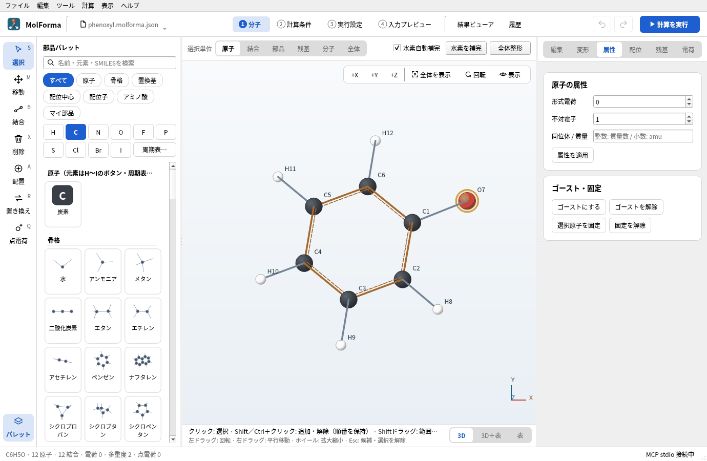
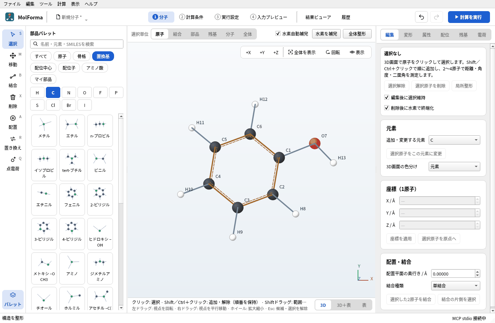
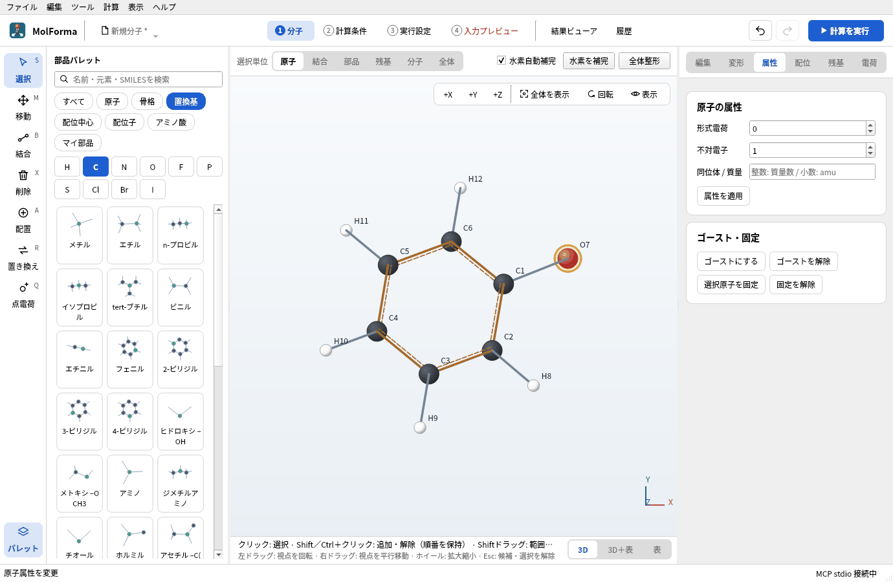
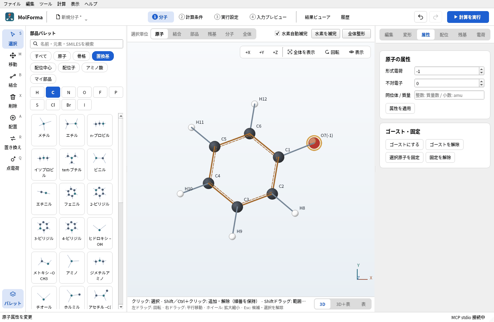
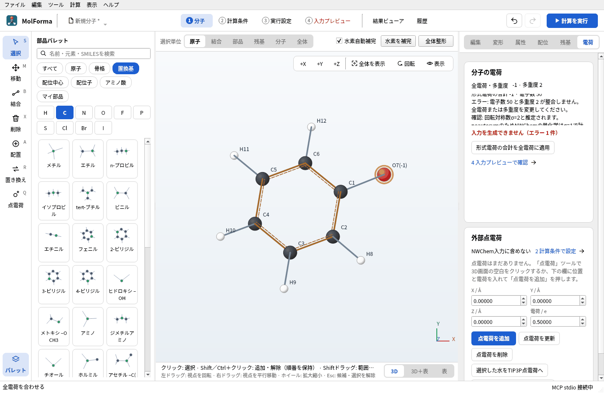
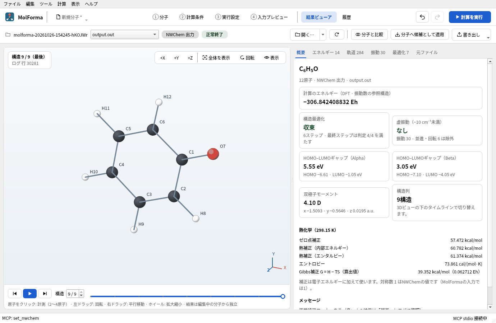

# 題材10 イオンとラジカル（フェノール・フェノキシラジカル・フェノラート）

フェノールのO–Hの水素を1個だけ消して、酸素に不対電子を付けたフェノキシラジカル（二重項）と、形式電荷−1を付けたフェノラートイオンを作ります。原子の属性（形式電荷・不対電子）と、計算の全電荷・多重度・参照波動関数の関係を確かめ、3つをB3LYP/6-31+G*で最適化してO–H結合解離エネルギーと気相の酸性度を求めます。

| 作るもの | 内容 |
| --- | --- |
| 分子 | フェノール C₆H₆O（13原子）、フェノキシラジカル C₆H₅O（12原子・電荷 0・二重項）、フェノラート C₆H₅O⁻（12原子・電荷 −1・一重項） |
| 使う機能 | 水素の削除、「属性」ページの形式電荷・不対電子、「電荷」ページ、多重度と参照波動関数（RKS・UKS）、回転対称数の確認事項 |
| 計算 | B3LYP/6-31+G*、最適化 → 振動数（3分子）、水素原子の一点 |
| 計算時間の目安 | フェノール 約26分、フェノキシラジカル 約58分、フェノラート 約19分（MPI 6プロセス、ほかの計算と並行）、水素原子 数秒 |
| 練習データ | [`phenol.kgui.json`](samples/phenol.kgui.json)、[`phenoxyl.kgui.json`](samples/phenoxyl.kgui.json)、[`phenolate.kgui.json`](samples/phenolate.kgui.json) |

## 1. フェノールを作る

1. 「ファイル → 新規」で、分類「骨格」の「ベンゼン」を置き、分類「置換基」の「ヒドロキシ –OH」で水素を1つ置き換えます。
2. 「全体整形」で整えて確定し、「ファイル → 名前を付けて保存…」で `phenol.kgui.json` として保存します。

   

   **図1** 整形したフェノール（C6H6O · 13原子）。

## 2. フェノキシラジカルにする

1. 左端の列の「削除」（X）で、O–Hの水素をクリックし、候補を確定します。C6H5O · 12原子になります。
2. このままでは電子数が49（奇数）なのに多重度1なので、ヘッダーの「4 入力プレビュー」が赤字になり、「2 計算条件」に「電子数 49 と多重度 1 が整合しません。」と出ます。

   

   **図2** 水素を1個消すと電子数が奇数になり、多重度1のままでは入力を作れません。

3. 「選択」ツールで酸素をクリックし、右側の「属性」ページで「不対電子」を 1 にして「属性を適用」を押します。不対電子は水素補完などの構造の準備に使う属性で、多重度は自動では変わりません。

   

   **図3** 「属性」ページで酸素の不対電子を1にします。

4. 「2 計算条件」の「電荷・スピン」で「スピン多重度 2S+1」を 2にします。参照波動関数の下に「→ UKS（開殻）」と出ます（DFTの開殻は非制限）。検査結果の「電子数 49 と多重度 1 が整合しません。」の行をダブルクリックしても多重度を直せます。

   

   **図4** 多重度を2にすると、参照波動関数がUKS（開殻）になります。

5. `phenoxyl.kgui.json` として保存します。

## 3. フェノラートにする

1. フェノキシラジカルの酸素を選び、「属性」ページで「形式電荷」を −1、「不対電子」を 0にして「属性を適用」を押します。

   

   **図5** 形式電荷を付けた原子は、ラベルに電荷が付きます。

2. 右側の「電荷」ページで「形式電荷の合計を全電荷に適用」を押します。全電荷が−1になります（原子の形式電荷と計算の全電荷は別に管理しています）。

   

   **図6** 「電荷」ページの「分子の電荷」。全電荷は−1になりました。多重度は次の手順で1に戻します。

3. 「2 計算条件」で多重度を 1に戻します（→ RKS（閉殻））。
4. 検査結果の確認事項に「回転対称数σ=2と推定されます。」と出ます。座標を `noautosym` で出力するので、NWChemの熱化学は対称数1で計算されます。フェノラート（C2v）のエントロピーと自由エネルギーは、表示された量（−R ln 2、+RT ln 2 = 0.411 kcal/mol）だけ補正して使います。

   

   **図7** 検査結果の確認事項に、回転対称数とエントロピー・自由エネルギーの補正量が出ます。

5. `phenolate.kgui.json` として保存します。

## 4. 計算条件と計算

3つのプロジェクトそれぞれで、「2 計算条件」の計算目的を「最適化 → 振動数」、手法を「DFT」（B3LYP）、基底関数を「6-31+G*」にして計算します。陰イオンでは電子が広がるので、分散関数（+）を含む基底を使います。

結合解離エネルギーには水素原子のエネルギーも要ります。「ファイル → 新規」で原子のボタン「H」を押し、3D画面の上の「水素自動補完」をオフにして空白に水素を1個置き、多重度 2・計算目的「一点エネルギー」・同じ手法と基底で計算します。

## 5. 結果から求める

「履歴」に4つのジョブが並びます。それぞれを「結果ビューアで開く」で開き、「概要」の計算のエネルギーと熱化学の補正値を読みます。

**図8** フェノキシラジカルの「概要」。開殻なのでHOMO–LUMOギャップがα・βの2つ出ます。熱化学の補正値は下の欄にあります。

それぞれの分子のエンタルピーを H = 計算のエネルギー + エンタルピー補正（298 K）として、

- O–H結合解離エンタルピー（298 K）: D = H(フェノキシラジカル) + H(水素原子) − H(フェノール)
- 気相の酸性度（脱プロトン化エンタルピー）: ΔH = H(フェノラート) + H(H⁺) − H(フェノール)。H⁺のエンタルピーは 5/2 RT = 1.481 kcal/mol です。

### 実行した結果

| 項目 | フェノール | フェノキシラジカル | フェノラート | 水素原子 |
| --- | --- | --- | --- | --- |
| 参照波動関数 | RKS | UKS（⟨S²⟩ = 0.788） | RKS | UKS |
| 計算のエネルギー | −307.480295774 Eh | −306.842408832 Eh | −306.920980884 Eh | −0.500272779 Eh |
| 構造最適化 | 10ステップで収束 | 6ステップで収束 | 5ステップで収束 | （一点） |
| 虚振動 | なし | なし | なし | — |
| C–O | 1.373 Å | 1.260 Å | 1.276 Å | — |
| エンタルピー補正（298.15 K） | 69.607 kcal/mol | 61.374 kcal/mol | 60.682 kcal/mol | 1.481 kcal/mol（5/2 RT） |

水素原子には振動がないので、エンタルピー補正は並進の 3/2 RT と PV項の RT を合わせた 5/2 RT です（H⁺と同じ）。

- O–H結合解離エンタルピー: ΔE = 86.35 kcal/mol、エンタルピー補正 −6.75 kcal/mol で D = 79.6 kcal/mol（実験値 約87 kcal/mol）
- 気相の酸性度: ΔE = 350.98 kcal/mol、エンタルピー補正 −7.44 kcal/mol で ΔH = 343.5 kcal/mol（実験値 約350 kcal/mol）

B3LYPは結合解離エネルギーを数kcal/mol小さく見積もる傾向があります。置換フェノールどうしの差のように、同じ方法の値どうしを比べると誤差が打ち消し合います。フェノキシラジカルのC–Oはフェノールより0.11 Å短く、不対電子が酸素と環に広がった二重結合に近い結合になっています。⟨S²⟩ は二重項の厳密値 0.75 に近く、スピン汚染は小さいです。

## うまくいかないとき

- **「4 入力プレビュー」が赤字のまま**: 電子数と多重度の組合せが合っていません。奇数電子なら多重度は2・4…、偶数なら1・3…です。
- **開殻にROHFを使いたい**: 参照波動関数を「ROHF」にできるのはHFだけです。DFT・MP2の開殻は非制限（UKS・UHF）です。
- **形式電荷を変えたのに全電荷が変わらない**: 原子の形式電荷は全電荷に自動では反映しません。「電荷」ページの「形式電荷の合計を全電荷に適用」か、「2 計算条件」の「原子の形式電荷の合計（−1）を適用」で合わせます。
- **水素を消すと隣に水素が付いてしまう**: 重原子を消したときだけ、切れた結合の相手に水素を補います（「削除後に水素で終端化」）。水素だけを消したときは補いません。

関連: [「2 計算条件」](../features/calculation.md)（対応する計算・診断）、[題材1 原子と結合から組む](atoms_and_bonds.md)。
