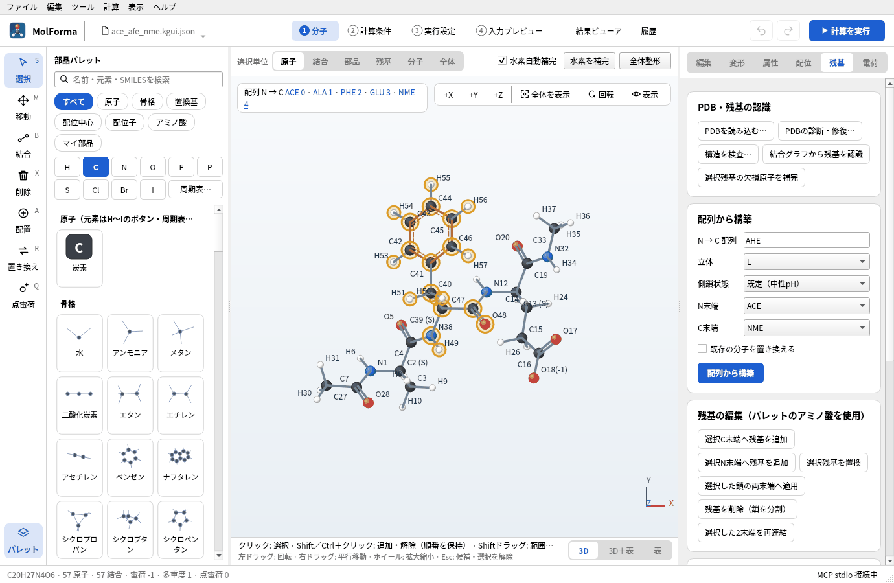
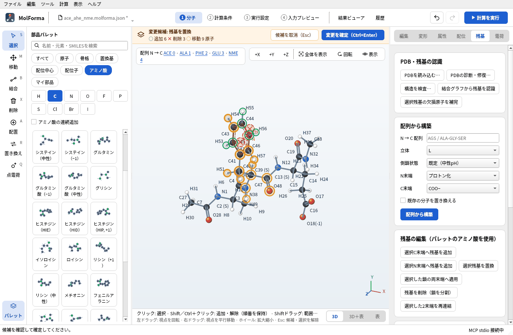
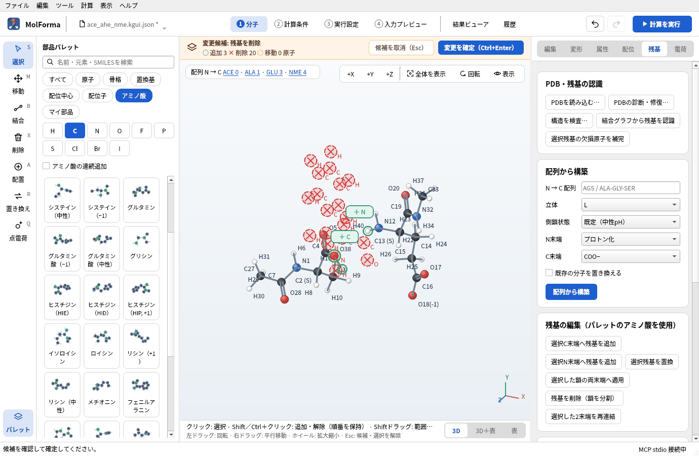
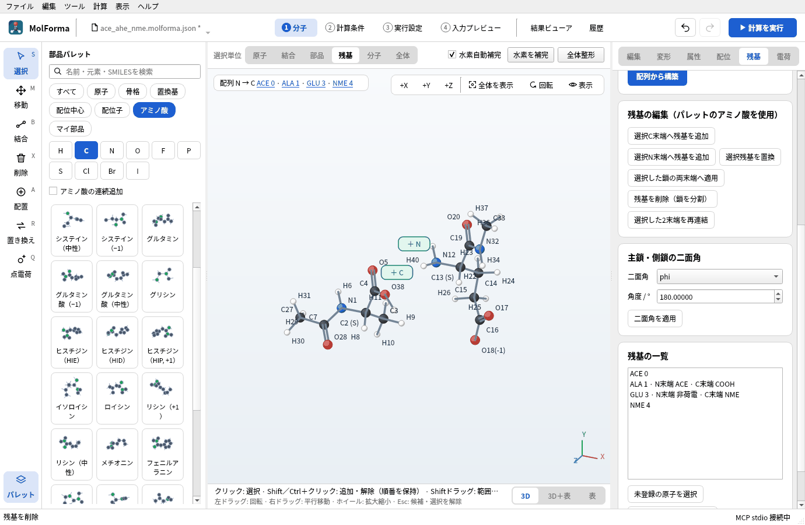
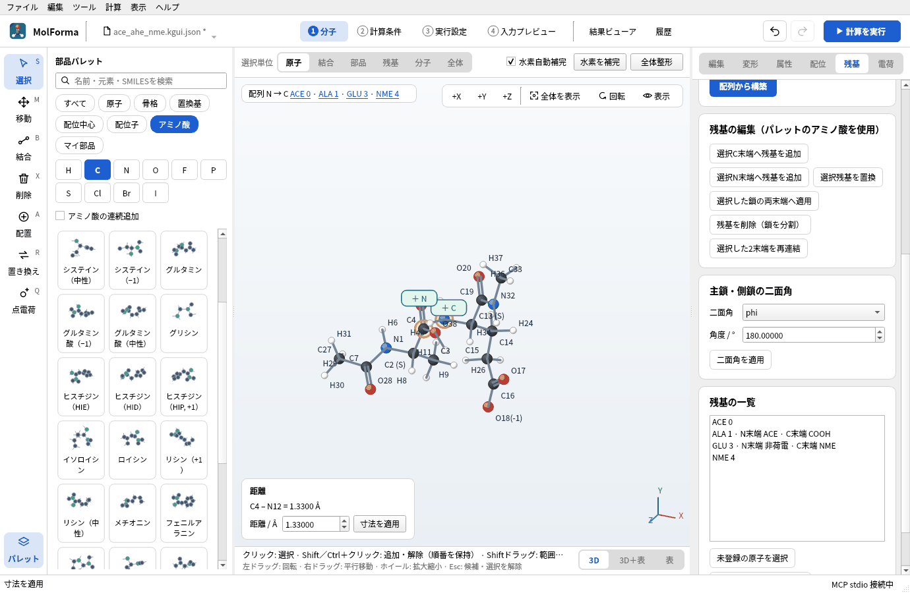
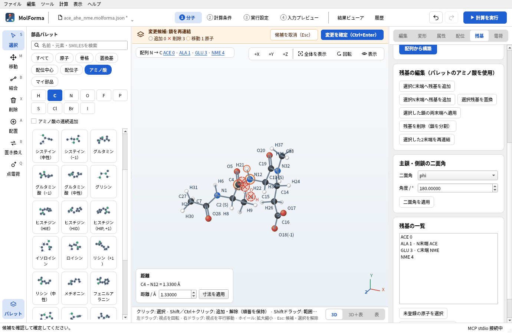
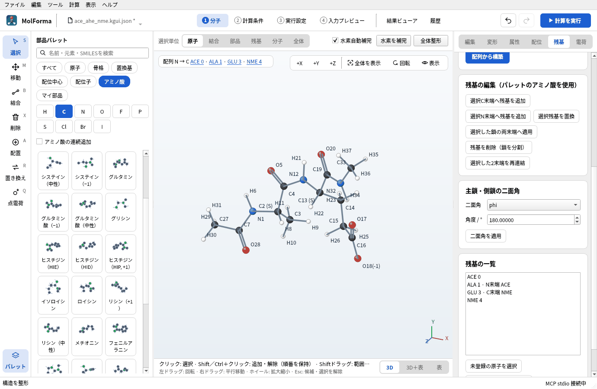
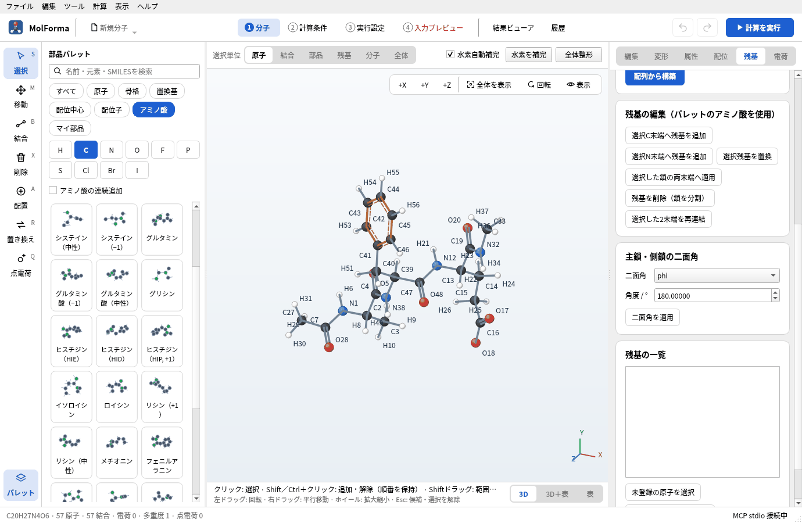
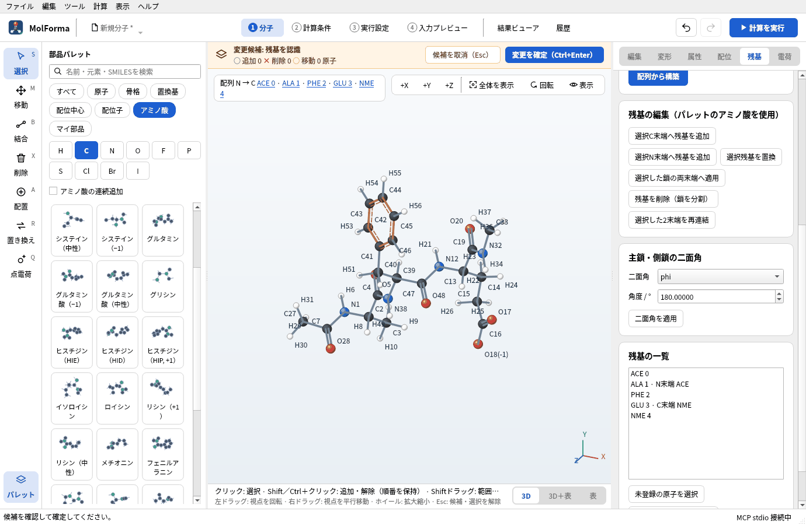
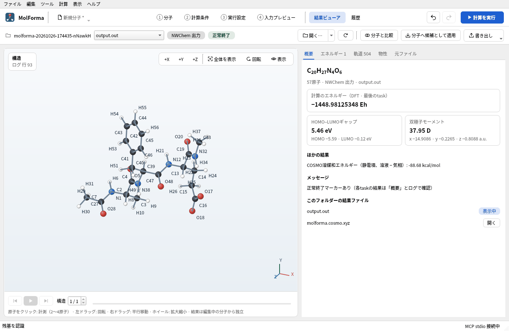

# 題材8 残基の置換と鎖の編集（変異体を作る）

[題材7](capped_peptide.md)のACE–Ala–His–Glu–NMEのHisをPheに置き換えて変異体を作り、次にPheを削除して2本に分かれた鎖を再びつなぎます。最後に、XYZに書き出した構造から残基を認識し直す方法と、COSMO（水）の中での一点計算を確かめます。

| 作るもの | 内容 |
| --- | --- |
| 分子 | ACE–Ala–Phe–Glu–NME C₂₀H₂₇N₄O₆（57原子・電荷 −1）、ACE–Ala–Glu–NME C₁₁H₁₈N₃O₅（37原子・電荷 −1） |
| 使う機能 | 選択残基を置換、残基を削除（鎖を分割）、寸法による2つの鎖の位置合わせ、選択した2末端を再連結、残基の一覧、結合グラフから残基を認識 |
| 計算 | B3LYP/6-31G*、一点エネルギー、COSMO（水）（変異体） |
| 計算時間の目安 | 約31分（MPI 8プロセス、ほかの計算と並行、「DFT積分を毎回再計算」オン） |
| 計算環境 | AMD Ryzen 7 2700X（8コア・16スレッド）、メモリ 32 GB、NWChem 7.3.1（Linux） |
| 練習データ | [`ace_afe_nme.kgui.json`](samples/ace_afe_nme.kgui.json)（変異体）、[`ace_ae_nme.kgui.json`](samples/ace_ae_nme.kgui.json)（再連結後） |

## 1. HisをPheに置き換える

1. [題材7](capped_peptide.md)のプロジェクト（`ace_ahe_nme.kgui.json`）を開きます。
2. 3D画面の配列の「HIS 2」をクリックしてHisの原子を選びます。
3. 部品パレットの分類「アミノ酸」で「フェニルアラニン」をクリックし、右側の「残基」ページの「選択残基を置換」を押します。
4. 候補が C20H27N4O6 · 57原子 · 電荷 −1 であることを確かめて「変更を確定」します。

   

   **図1** HisをPheに置換した候補（C20H27N4O6 · 57原子）。配列の表示もPHEに変わります。

主鎖のN・Cα・C・Oの位置はそのままで、側鎖とその水素が入れ替わります。主鎖のアミドの水素はペプチド結合の面内（前の残基のC=Oと反対側）に置き直されます。原子の番号は振り直されるので、番号で原子を指定する設定（拘束など）は置換の後に確かめてください。側鎖の向き（χ1）は「主鎖・側鎖の二面角」の chi1 で変えられます。

## 2. 残基を削除して鎖を分ける

1. 「PHE 2」を選び、「残基」ページの「残基を削除（鎖を分割）」を押します。候補は C11H20N3O6 · 40原子です。確定します。

   

   **図2** 「残基を削除（鎖を分割）」の候補。消える原子に×印が付きます。

2. 鎖はACE–Ala と Glu–NME の2本に分かれ、切れ目はそれぞれ非荷電の末端（AlaのC末端はCOOH、GluのN末端はNH2）になります。「残基」ページの「残基の一覧」には「ALA 1 · N末端 ACE · C末端 COOH」「GLU 3 · N末端 非荷電 · C末端 NME」のように表示されます。

   

   **図3** 分割後の「残基の一覧」。切れ目は非荷電の末端になります。

3. 全電荷はGluの側鎖の−1のままです。

末端の状態を変えるには、残基を選んで「N末端」「C末端」を選び、「選択した鎖の両末端へ適用」を押します（例: COO−とNH3+の荷電末端にすると、全電荷が形式電荷の合計に追従します）。

## 3. 2本の鎖をつなぎ直す

再連結は、C末端のCとN末端のNが1.1〜1.7 Åの距離にあるときだけ行います。離れた鎖は先に寸法で近づけます。

1. 3D画面の上の「選択単位」を「原子」にし、AlaのC末端の炭素（C）をクリック、GluのN末端の窒素（N）をShift＋クリックします。左下に距離が出ます。
2. 「距離 / Å」に 1.33 を入れて「寸法を適用」を押します。2原子は別々の鎖（結合していない分子）なので、後に選んだ原子を含むGlu–NMEの鎖全体が平行移動します。

   

   **図4** 別々の鎖の2原子に距離を適用すると、後に選んだ原子の鎖が平行移動します。

3. AlaとGluの原子を、C末端側（Ala）→ N末端側（Glu）の順に選んだまま、「選択した2末端を再連結」を押します。末端のOH・Hが外れ、C11H18N3O5 · 37原子の候補になります。確定します。

   

   **図5** 「選択した2末端を再連結」の候補（C11H18N3O5 · 37原子）。

4. 「全体整形」で結合の周りを整えます。

   

   **図6** 再連結して整形したACE–Ala–Glu–NME。

離れていると「C–N距離が … Å です。1.1〜1.7 Åに整えてから連結してください（…）」と、今の距離と近づけ方を表示して拒否します。同じ鎖の両端をつなぐ環状ペプチドは作れません（異なる鎖の末端どうしだけです）。

## 4. XYZから残基を認識し直す

XYZファイルには元素と座標しかないので、開くと残基・形式電荷・計算条件の情報は失われ、結合は距離から、結合次数は幾何から推定されます。

1. 「1 分子」の座標の表の「書き出し → XYZ（Å）を書き出す…」でXYZに書き出し、「ファイル → 開く…」で開き直します。ステータスバーの電荷は0になり、「残基」ページの一覧は空です。

   

   **図7** XYZを開き直すと、残基・形式電荷の情報はなくなります（「残基の一覧」は空）。

2. 「残基」ページの「結合グラフから残基を認識」を押します。元素とつながりから標準アミノ酸の残基を見つけて原子名を付け、鎖の両端のACE・NMEのキャップも認識した候補を作ります（RDKitが必要）。
3. 形式電荷は水素の数から決めます。水素のないカルボキシ基の酸素（COO−）は−1、4本の結合を持つ窒素（NH3+、Lys・Argの側鎖）は+1、両方の窒素に水素があるHisはHIP（+1）です。HisのHID・HIE、Asp・Gluの荷電・中性などの側鎖の状態も同じく決まります。
4. 確定すると、3D画面の配列（ACE 0 · ALA 1 · PHE 2 · GLU 3 · NME 4）と残基の一覧が戻り、全電荷は形式電荷の合計（−1）に追従します（認識の前の全電荷が形式電荷の合計と一致していた場合）。

   

   **図8** 「結合グラフから残基を認識」の候補。配列とキャップ、Gluの電荷が戻ります。

5. 認識できなかった原子は「未登録の原子を選択」で選べます。選んだ原子は「選択原子を残基に登録…」で3文字コードを付けて登録できます。

残基・電荷・計算条件を保ったまま受け渡すには、XYZではなくプロジェクト（`.kgui.json`）を使います。

## 5. 計算して結果を見る

変異体（ACE–Ala–Phe–Glu–NME）を、[題材7](capped_peptide.md)と同じ条件（B3LYP/6-31G*、一点エネルギー、COSMO・水、全電荷 −1、「DFT積分を毎回再計算」オン）で計算します。組成が違う分子どうしのエネルギーの差には意味がないので、比べるのは溶媒和エネルギーなどの性質です（電荷を持つ分子の双極子モーメントは原点の取り方で変わるので、比べられません）。

**図9** 変異体の「結果ビューア」の「概要」。

### 実行した結果

| 項目 | ACE–Ala–His–Glu–NME（[題材7](capped_peptide.md)） | ACE–Ala–Phe–Glu–NME（変異体） |
| --- | --- | --- |
| 原子数 | 54 | 57 |
| 計算のエネルギー（COSMO・水） | −1442.962159354 Eh | −1448.981253478 Eh |
| 同じ構造の気相のエネルギー | −1442.808414957 Eh | −1448.839933595 Eh |
| COSMO溶媒和エネルギー（静電項） | −96.48 kcal/mol | −88.68 kcal/mol |

極性のあるイミダゾール（His）を無極性のベンジル基（Phe）に替えると、溶媒和エネルギーは約7.8 kcal/mol小さくなります。どちらも大部分はGluのカルボキシラート（−1）の寄与です。

## うまくいかないとき

- **「対象の残基を選択してください。」**: 残基の原子を選んでいません。配列の残基名をクリックするか、選択単位を「残基」にして原子をクリックします。
- **「アミノ酸を選択してください。」**: パレットでアミノ酸（分類「アミノ酸」）を選んでから「選択残基を置換」を押します。
- **「異なる鎖の空いたC末端、N末端を選んでください。」**: 同じ鎖の残基を選んだか、選んだ順番が逆です。C末端側の残基を先に選びます。
- **XYZを開き直すと結合が多い・少ない**: 距離から結合を推定するため、原子どうしが近すぎる（1 Å前後）と余分な結合ができます。開く前の構造で「全体整形」をしておくか、プロジェクトで受け渡します。

関連: [「1 分子」の右側のページ](../features/molecule_pages.md)（残基）、[題材7 ペプチド](capped_peptide.md)、[題材15 同位体と原子の並び順](isotopes.md)。
