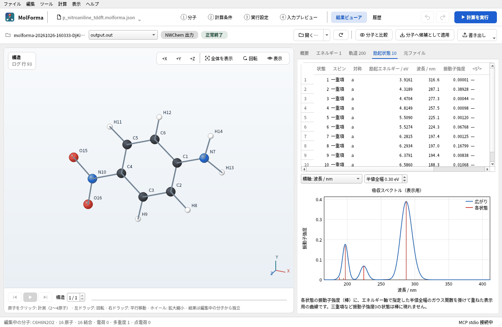
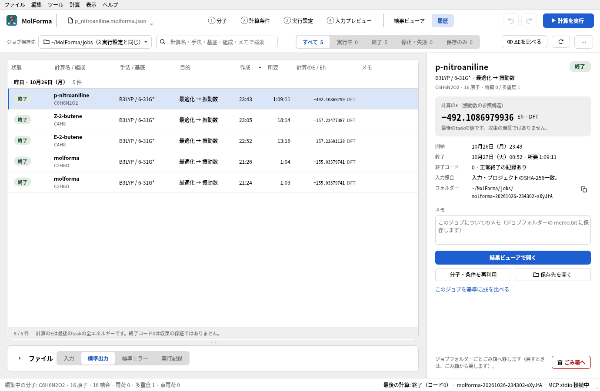
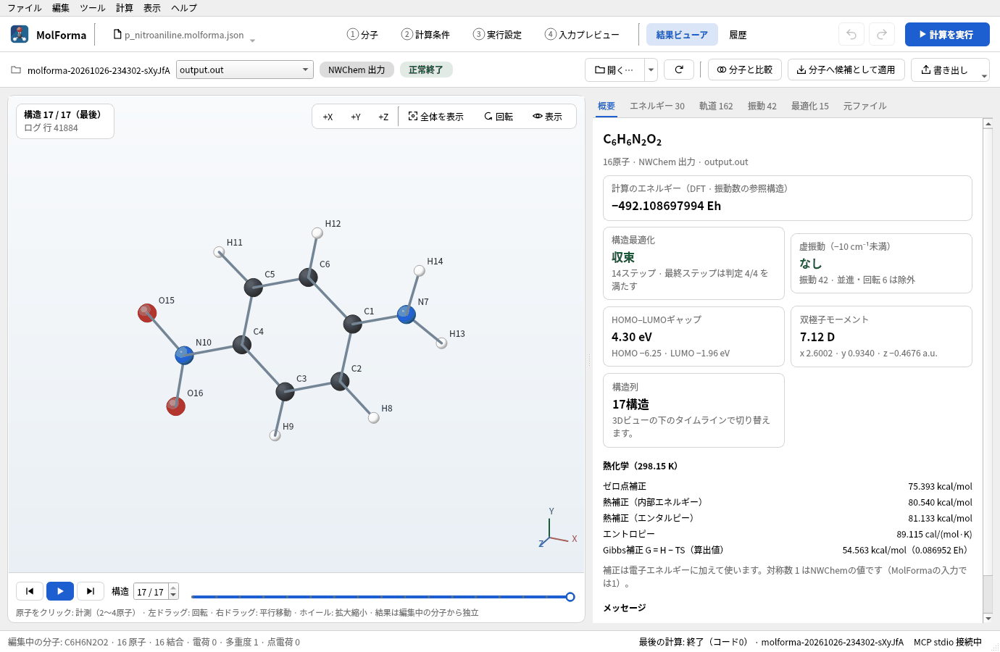
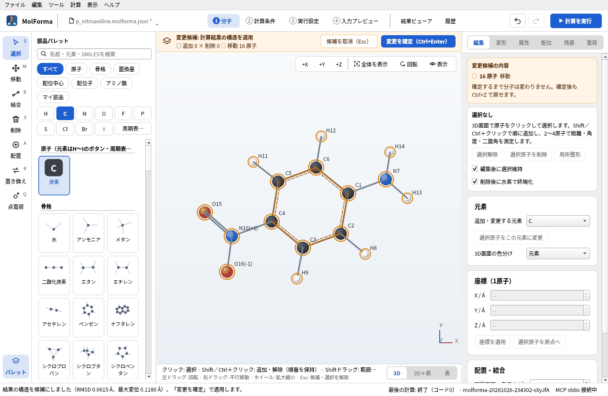
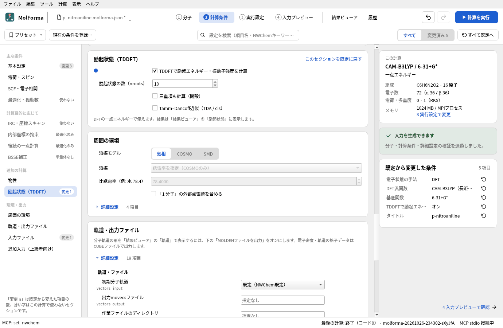
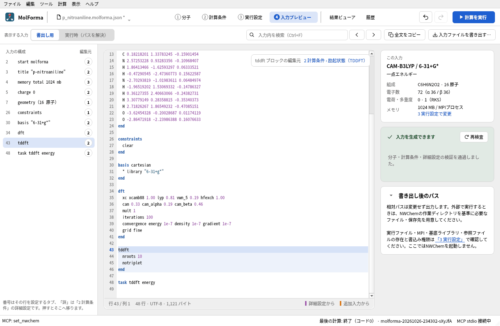
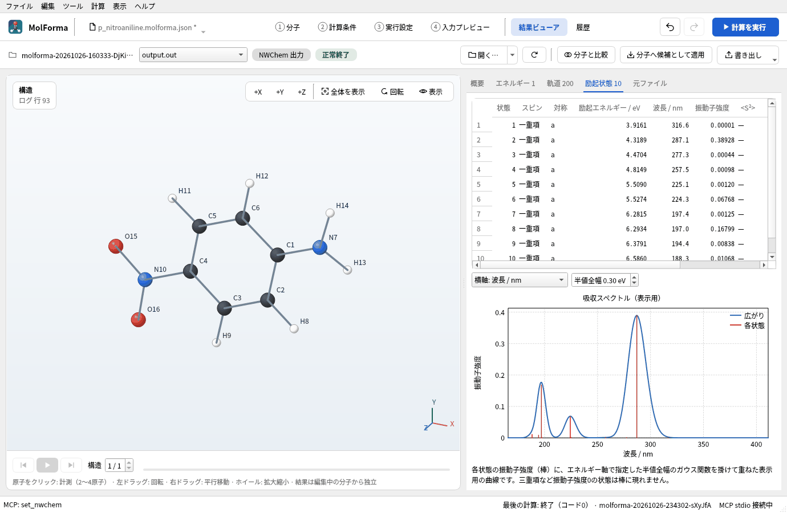

# 題材14 計算結果から次の計算へ（最適化したp-ニトロアニリンでTDDFT）

[題材3](aromatic_substitution.md)で最適化したp-ニトロアニリンの構造を「履歴」から呼び出し、「結果ビューア」の「分子へ候補として適用」で「1 分子」に取り込みます。その構造で計算の種類を変え、CAM-B3LYP/6-31+G*のTDDFTで励起状態（UVスペクトル）を求めます。組み立てた構造と、計算で得た構造の受け渡し方をまとめて確かめます。

| 作るもの | 内容 |
| --- | --- |
| 分子 | 最適化したp-ニトロアニリン（16原子） |
| 使う機能 | 履歴、結果ビューアで開く、分子へ候補として適用（RMSD・最大変位）、分子と比較、結果の書き出し、分子・条件を再利用、励起状態（TDDFT）、吸収スペクトルの表示 |
| 計算 | CAM-B3LYP/6-31+G*、一点エネルギー＋TDDFT（10状態、一重項） |
| 計算時間の目安 | 約42分（MPI 6プロセス） |
| 計算環境 | AMD Ryzen 7 2700X（8コア・16スレッド）、メモリ 32 GB、NWChem 7.3.1（Linux） |
| 練習データ | [`p_nitroaniline_tddft.molforma.json`](samples/p_nitroaniline_tddft.molforma.json)（取り込んだ構造とTDDFTの条件） |

## 1. 計算した構造を取り込む

1. [題材3](aromatic_substitution.md)のプロジェクト（`p_nitroaniline.molforma.json`）を開きます。分子は計算前の初期構造です。
2. ヘッダーの「履歴」を開きます。「3 実行設定」のジョブ保存先にあるジョブが、計算名（既定の計算名のままならタイトル）・組成・手法・目的・エネルギーとともに並びます。
3. p-ニトロアニリンのジョブを選び、右側の「結果ビューアで開く」を押します（行のダブルクリックでも同じ）。

   

   **図1** 「履歴」でジョブを選ぶと、右に詳細と「結果ビューアで開く」が出ます。

   

   **図2** 「結果ビューア」で開いたところ。最適化の最後の構造を表示しています。

4. 「結果ビューア」の上部のバーの「分子へ候補として適用」を押します。表示中の構造（最適化の最後の構造）が「1 分子」の候補になり、ステータスバーに「結果の構造を候補にしました（RMSD 0.0615 Å、最大変位 0.1180 Å）。」のように動いた量が出ます。

   

   **図3** 結果の構造は候補として表示され、ステータスバーに動いた量が出ます。

5. 「変更を確定」します。原子のID・結合・計算条件はそのままで、座標だけが入れ替わります。

「分子へ候補として適用」は、原子の数・順番・元素が一致する結果だけを受け付けます。固定原子が動いている結果は拒否します。「分子と比較」は、取り込まずにRMSDと最大のずれだけを表示します。

### 構造を受け渡すほかの方法

| 方法 | 持ってくるもの | 注意 |
| --- | --- | --- |
| 「結果ビューア」→「分子へ候補として適用」 | 表示中の構造の座標 | 原子の数・順番が同じ分子に限る |
| 「結果ビューア」→「書き出し」→「表示中の構造をXYZで書き出す…」 | 構造（XYZ） | 結合は開くときに距離から推定。残基・電荷・計算条件は付かない |
| 「履歴」→「分子・条件を再利用」 | 計算に使ったプロジェクト | 計算**前**の分子と条件を新しい未保存のプロジェクトとして開く |
| 「ファイル → 開く…」で `.nw`（NWChem入力） | 最初の `geometry` と計算条件 | 入力の座標は計算開始時の構造 |

## 2. TDDFTの条件にする

1. 「2 計算条件」の「基本設定」で、計算目的を「一点エネルギー」にします。
2. DFT汎関数を「CAM-B3LYP（長距離補正）」、基底関数を「6-31+G*」にします。電荷移動型の励起には長距離補正汎関数が向いています。
3. 左の一覧の「励起状態（TDDFT）」で「TDDFTで励起エネルギー・振動子強度を計算」をオンにし、「励起状態の数（nroots）」を 10にします。閉殻なので「三重項も計算」はオフのままにします（入力に `notriplet`）。

   

   **図4** 「励起状態（TDDFT）」の設定。

4. 「4 入力プレビュー」で、`tddft` ブロック（`nroots 10`）と `task tddft energy` を確かめます。

   

   **図5** 入力の `tddft` ブロックと `task tddft energy`。

TDDFTは一点エネルギーの計算目的だけで使えます（励起状態の構造最適化は対象外）。メタGGA（TPSS・SCAN・M06系など）はNWChemのTDDFTで止まるため選べません。

## 3. 計算して結果を見る

「計算を実行」（F5）で計算し、「結果ビューア」の「励起状態」タブを開きます。状態ごとの励起エネルギー（eV・nm）と振動子強度の表と、振動子強度をガウス関数で広げた表示用の吸収スペクトル（半値全幅をeVで指定、波長またはエネルギー軸）が出ます。

**図6** 「励起状態」タブ。状態ごとの表と、振動子強度を広げた吸収スペクトルが出ます。

### 実行した結果

基底状態のエネルギーは −491.901382279 Eh（CAM-B3LYP/6-31+G*）です。主な状態は次のとおりです。

| 状態 | 励起エネルギー | 波長 | 振動子強度 |
| --- | --- | --- | --- |
| 1 | 3.92 eV | 317 nm | 0.00001 |
| 2 | 4.32 eV | 287 nm | 0.389 |
| 6 | 5.53 eV | 224 nm | 0.068 |
| 8 | 6.29 eV | 197 nm | 0.168 |

いちばん強い吸収は状態2（287 nm）で、アミノ基からニトロ基へ電子が移る電荷移動型の励起です。気相の実験値（約290 nm）とよく合います。状態1はほとんど光を吸収しない（振動子強度がほぼ0の）n→π*型の励起です。水などの極性溶媒中では電荷移動型の吸収は大きく長波長側（約380 nm）へずれるので、溶液と比べるときは「周囲の環境」で溶媒を指定します。

## うまくいかないとき

- **「分子へ候補として適用」が拒否される**: 結果と今の分子で原子の数・順番・元素が違います。原子を足したり並べ替えたりした後なら、その前のプロジェクトを開き直すか、XYZで受け渡します。
- **履歴にジョブが出ない**: 「履歴」の上部の保存先が「3 実行設定」のジョブ保存先と同じか確かめます。別の場所は「保存先を選ぶ…」で選べます。
- **TDDFTの項目が使えない**: 手法がDFT以外か、計算目的が一点エネルギー以外です。

関連: [「結果ビューア」](../features/results.md)、[「履歴」](../features/history.md)、[題材3 芳香族の置換体](aromatic_substitution.md)、[題材15 同位体](isotopes.md)。
