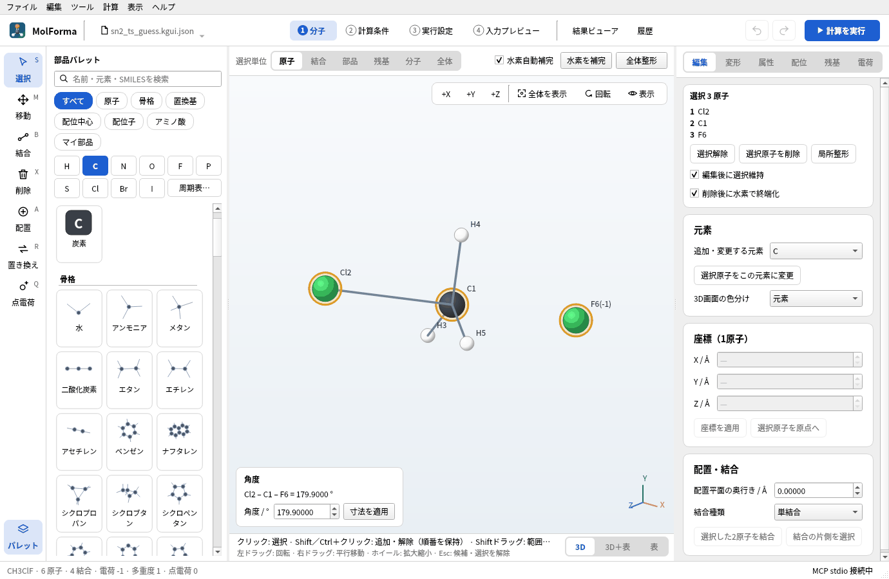

# 題材13 遷移状態と反応経路（F⁻ + CH₃Cl → CH₃F + Cl⁻）

SN2反応の遷移状態 [F···CH₃···Cl]⁻ を探します。2つの構造から経路を作る機能はないので、遷移状態に近い推定構造を、距離と角度の数値指定で手で組みます。M06-2X/aug-cc-pVDZで遷移状態探索と振動数計算を行い、虚振動が1つだけであることを確かめ、IRCで反応物側・生成物側へ経路をたどります。反応物錯体も最適化して活性化エネルギーを求めます。

| 作るもの | 内容 |
| --- | --- |
| 分子 | 遷移状態の推定構造 [F···CH₃···Cl]⁻（6原子・電荷 −1・一重項）、反応物錯体 F⁻···CH₃Cl |
| 使う機能 | 原子の単独配置（水素自動補完をオフ）、形式電荷と全電荷、距離・角度の数値指定（別々の分子は後に選んだ側が動く）、遷移状態探索 → 振動数、虚振動の再生、IRCとその方向 |
| 計算 | M06-2X/aug-cc-pVDZ、遷移状態探索 → 振動数、IRC、反応物錯体の最適化 → 振動数 |
| 計算時間の目安 | 遷移状態探索 → 振動数 約13分、反応物錯体 約8分、IRC 約25分（前進）・約15分（後退）（MPI 8プロセス） |
| 練習データ | `docs/recipes/samples/sn2_ts_guess.kgui.json`（推定構造）、`sn2_reactant.kgui.json`（反応物錯体の初期構造） |

## 1. CH₃Clとフッ化物イオンを置く

1. 「ファイル → 新規」で、分類「骨格」の「メタン」を空白に置き、分類「置換基」の「クロロ」で水素を1つ置き換えます。CH3Cl（C1・Cl2・H3〜H5）になります。
2. 元素のボタン「F」を押し、3D画面の上の「水素自動補完」をオフにして、CH3Clから離れた空白をクリックします。水素の付かないF原子（F6）が別の分子として置かれます。置いたら「水素自動補完」はオンに戻しておきます。
3. F6を選び、「属性」ページで「形式電荷」を −1にして「属性を適用」を押します。続けて「電荷」ページの「形式電荷の合計を全電荷に適用」で全電荷を−1にします。電子数36、多重度1です。

## 2. 反応物錯体を組む

距離・角度は、原子を順に選んで3D画面の左下の欄に数値を入れ、「寸法を適用」で決めます。CとFは結合していない別々の分子なので、後に選んだFが動きます。

1. C1 → F6 の順に選び、距離を 2.8 にして「寸法を適用」。
2. Cl2 → C1 → F6 の順に選び、角度を 179.9 にして「寸法を適用」（ちょうど180°は向きが定まらないため指定できません）。
3. `sn2_reactant.kgui.json` として保存します。FがClの反対側からCに近づいた反応物錯体の初期構造です。

## 3. 遷移状態の推定構造を作る

遷移状態では、CH3が平面になり、C–FとC–Clがどちらも伸びています。

1. C1 → F6 で距離を 2.05、C1 → Cl2 で距離を 2.10にします（C–Clは結合しているので、後に選んだCl側が動きます）。
2. Cl2 → C1 → H3、Cl2 → C1 → H4、Cl2 → C1 → H5 の順に選び、それぞれ角度を 90 にします。3つの水素がClとFの軸に垂直な面に並び、H–C–Hは120°になります。
3. `sn2_ts_guess.kgui.json` として保存します。

## 4. 遷移状態探索と振動数

1. 「2 計算条件」の「基本設定」で、計算目的を「遷移状態 → 振動数」にします。
2. 手法を「DFT」、DFT汎関数を「M06-2X」、基底関数を「aug-cc-pVDZ」にします。B3LYPではこの反応の障壁がほとんど出ないため、障壁の高さに定評のあるM06-2Xと、陰イオンに必要な分散関数（aug-）を含む基底を使います。
3. 全電荷 −1・多重度 1を確かめます。確認事項に「振動数には数値Hessianを使用します。」（メタGGAは解析Hessianがない）と、遷移状態探索の注意が出ます。
4. 「計算を実行」（F5）で計算します。NWChemの `task dft saddle` が負の曲率の方向に沿って山の頂上を探し、続けて振動数を計算します。
5. 「結果ビューア」の「概要」の「虚振動」が1つであることを確かめます。「振動」タブで虚振動（負の振動数）の行を選んで3Dビューの下の再生ボタンを押すと、CH3がFとClの間を往復する動き（傘の反転）が見えます。

## 5. IRCで経路をたどる

1. 「結果ビューア」の「分子へ候補として適用」で遷移状態の構造を「1 分子」に取り込み、確定します。
2. 「2 計算条件」の計算目的を「IRC」にし、「IRC・座標スキャン」で「IRCの点数（各方向）」と「IRCの刻み幅 / amu½·Bohr」を決めます（ここでは60点・0.15）。点数が足りずに極小に届かないとNWChemはエラーで終わるので、余裕をもって指定します。
3. 計算すると、「結果ビューア」の「経路・スキャン」タブに、遷移状態を0とした反応座標（前進が正、後退が負）とエネルギーのグラフが出ます。行を選ぶとその点の構造を表示します。

この反応では、両方向のIRCは前進方向（この例では反応物錯体 F⁻···CH₃Cl の側。どちらが前進になるかは虚振動のベクトルの符号で決まります）の途中で「NWChemエラー: mepgs: could not optimize」となって止まります。NWChemは経路の長さが1 amu½·Bohrを超えるまで極小に着いたと判定しませんが、この側は遷移状態から極小まで約0.8しかありません。極小に着いた後も小さな刻みで60点まで進んで止まり、後退方向は計算されません。前進方向の点は「経路・スキャン」で見られます。

4. 残りの方向は、「IRC・座標スキャン」の「IRCの方向」を「後退のみ」にして、同じ遷移状態の構造から計算します。後退方向は生成物錯体 CH₃F···Cl⁻ まで経路の長さ2.35で届き、「IRC: 9点、後退方向で収束」となります。

## 6. 反応物錯体と活性化エネルギー

`sn2_reactant.kgui.json` を開き、同じ手法・基底で「最適化 → 振動数」を計算します。遷移状態とのエネルギー差が、錯体からの活性化エネルギーです。「履歴」の「ΔEを比べる」で、同じ組成・手法・基底のジョブどうしの差を並べて見られます（熱補正は含みません）。

### 実行した結果

| 構造 | 計算のエネルギー | C–F | C–Cl | 虚振動 |
| --- | --- | --- | --- | --- |
| 反応物錯体 F⁻···CH₃Cl（最適化） | −599.924707582 Eh | 2.446 Å | 1.867 Å | なし |
| 遷移状態 [F···CH₃···Cl]⁻ | −599.920574451 Eh | 2.053 Å | 2.095 Å | 1つ（477.7i cm⁻¹、IR強度 1180） |
| 生成物錯体 CH₃F···Cl⁻（IRCの終点） | −599.972948960 Eh | 1.417 Å | 3.144 Å | — |

- 遷移状態探索は10ステップで収束し、虚振動は1つだけでした。
- 錯体からの活性化エネルギー: ΔE‡ = 2.59 kcal/mol、298 Kのエンタルピーで ΔH‡ = 2.10 kcal/mol、自由エネルギーで ΔG‡ = 3.21 kcal/mol
- IRCの前進方向の終わり（−599.924705 Eh）は、別に最適化した反応物錯体と0.002 kcal/mol以内で一致しました。
- 反応物錯体から生成物錯体へは −30.3 kcal/mol の発熱です。遷移状態は反応物側に近い（C–Clの伸びが小さく、C–Fは長い）「早い」遷移状態で、大きな発熱反応に見られる形です。

## うまくいかないとき

- **F原子に水素が付いてHFになる**: 「水素自動補完」をオフにしてから置きます。付いてしまったら水素を削除します。
- **角度に180を入れると「角度は0°より大きく180°未満にしてください。」**: 一直線では回す向きが決まらないため、179.9のように少しずらします。
- **虚振動が2つ以上ある**: 推定構造が山の頂上から遠すぎます。虚振動のモードを見て、反応座標と関係ない動き（メチル基の回転など）であれば、その方向に少しずらした構造から探し直します。
- **IRCが「mepgs: could not optimize」で止まる**: 点数が足りないか、遷移状態から極小までが短い（経路の長さ1 amu½·Bohr未満）側です。「経路・スキャン」で止まった側の最後の点が極小に着いているかを見て、着いていれば「IRCの方向」で残りの方向だけを計算します。
- **遷移状態探索が収束しない**: 「最適化・振動数」の詳細設定で最大反復を増やすか、反応座標（C–FとC–Clの距離）を拘束した最適化や緩和スキャン（[題材5](butane_conformers.md)）で山の位置を先に見積もります。

関連: 「[機能と操作](../features.md)」の遷移状態・IRC・拘束・スキャン、[題材14 計算結果から次の計算へ](reuse_result.md)。
