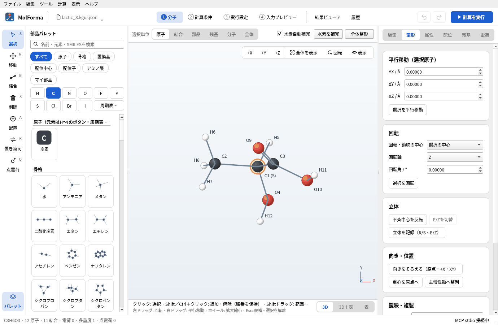

# 題材6 立体化学（乳酸のR/S、2-ブテンのE/Z）

テンプレートを組み合わせただけの構造では、不斉中心の立体や二重結合の幾何は「たまたまできた形」です。乳酸の不斉中心の立体（R/S）と2-ブテンの二重結合の幾何（E/Z）を記録して確かめ、「不斉中心を反転」「E/Zを切替」でもう一方の異性体を作ります。E体とZ体はB3LYP/6-31G*で最適化と振動数を計算してエネルギーを比べます。

| 作るもの | 内容 |
| --- | --- |
| 分子 | 乳酸 C₃H₆O₃（12原子）のR体・S体、2-ブテン C₄H₈（12原子）のE体・Z体 |
| 使う機能 | 立体を記録（R/S・E/Z）、3D画面のR/S・E/Zの表示、不斉中心を反転、E/Zを切替、名前を付けて保存 |
| 計算 | B3LYP/6-31G*、最適化 → 振動数（2-ブテンのE体・Z体） |
| 計算時間の目安 | E体 約35分・Z体 約47分（MPI 2プロセス、ほかの計算と並行） |
| 練習データ | `docs/recipes/samples/lactic_R.kgui.json`、`lactic_S.kgui.json`、`butene_E.kgui.json`、`butene_Z.kgui.json` |

R/S・E/Zの判定にはRDKitを使います。RDKitを含まないビルドでは「立体を記録（R/S・E/Z）」が無効になります（反転・切替は使えます）。

## 1. 乳酸を組んで立体を記録する

1. 「ファイル → 新規」で、分類「骨格」の「エタン」を空白に置きます。
2. 分類「置換基」の「カルボキシ –C(=O)OH」でC1の水素を1つ置き換え、続けて「ヒドロキシ –OH」でC1の残りの水素を1つ置き換えます。CH3–CH(OH)–COOH（C3H6O3 · 12原子）になります。
3. 「全体整形」で整えて確定します。
4. 右側の「変形」ページを開き、「立体」の「立体を記録（R/S・E/Z）」を押します。ステータスバーに「立体配置を記録しました: C1: S」のように出て、3D画面のC1のラベルが「C1 (S)」になります。どちらになるかは、置換基を付けた水素で決まります。
5. 「ファイル → 名前を付けて保存…」で保存します（この例では `lactic_S.kgui.json`）。

## 2. 不斉中心を反転してもう一方を作る

1. 不斉中心C1だけを選び、「変形」ページの「不斉中心を反転」を押します。C1に付いた2つの置換基（ここでは水素とメチル基）の位置が入れ替わり、ラベルが「C1 (R)」になります。
2. 別の名前（`lactic_R.kgui.json`）で保存します。

記録した立体は、その後の「全体整形」で守られます。整形の結果が記録と違う立体になる場合は「整形結果が記録済みの立体配置と異なります。元の構造を保持しました。」と出て、構造を変えません。

鏡像を横に並べて見比べるには、分子全体を選んで「変形」ページの「鏡映・複製」で「鏡像の写しを作る」をオンにして「指定平面で鏡映」を押します（写しは元の分子の+X方向6 Åに置かれます）。

## 3. 2-ブテンのE/Zを作り分ける

1. 「ファイル → 新規」で、分類「骨格」の「エチレン」を置きます。
2. 「メチル」でC1の水素を1つ置き換え、続けてC2の水素のうち、さっきの水素と二重結合をはさんで反対側の水素を置き換えます。「全体整形」で整えて確定します。
3. 二重結合の2つの炭素（C1とC2）を選び、「立体を記録（R/S・E/Z）」を押します。二重結合の中央に「(E)」が出ます。
4. C1とC2を選んだまま「E/Zを切替」を押すと、二重結合の片側が180°回ってZ体になり、表示も「(Z)」に変わります。E体・Z体をそれぞれ別名で保存します。

## 4. 計算して比べる

E体とZ体のそれぞれで、「2 計算条件」の計算目的を「最適化 → 振動数」、手法を「DFT」（B3LYP）、基底関数を「6-31G*」にして計算します。2つのジョブは「履歴」の「ΔEを比べる」で、同じ組成・手法・基底どうしのエネルギー差として並べて比べられます。

R体とS体の乳酸は鏡像異性体なので、どの手法でもエネルギーは同じです（念のため一点計算で確かめるとよい練習になります）。

### 実行した結果

| 項目 | E-2-ブテン | Z-2-ブテン |
| --- | --- | --- |
| 計算のエネルギー | −157.226911282 Eh | −157.224773869 Eh |
| 構造最適化 | 12ステップで収束 | 22ステップで収束 |
| 虚振動 | なし | なし |
| 双極子モーメント | 0.00 D（対称中心） | 0.18 D |
| ゼロ点補正 | 68.05 kcal/mol | 68.18 kcal/mol |

Z体はE体より ΔE = +1.34 kcal/mol、298 Kのエンタルピーで ΔH = +1.47 kcal/mol、自由エネルギーで ΔG = +1.26 kcal/mol 不安定です（メチル基どうしの立体反発）。実験の生成エンタルピーの差は約1.0 kcal/molです。どちらも回転対称数は2なので、σの補正は差には効きません。

## うまくいかないとき

- **「立体を記録」を押しても何も表示されない**: 不斉中心・E/Zの二重結合がない分子では「記録する不斉中心・E/Zの二重結合はありません。」と出ます。「表示 → ラベル」が「なし」になっていないかも確かめます。
- **「不斉中心を反転」が押せない・拒否される**: 4配位の不斉中心を1原子だけ選びます。入れ替える置換基どうしが環でつながっている中心は「環で接続した置換基は反転できません。」と拒否されます。
- **「E/Zを切替」が押せない**: 二重結合の両端の2原子だけを選びます。
- **整形すると拒否される**: 記録した立体と違う形に整形されそうなときは構造を保ちます。もう一度「立体を記録」で記録し直すか、反転・切替で合わせます。

関連: 「[機能と操作](../features.md)」の「1 分子」の右側タブ（変形）、[題材5 鎖状分子と配座](butane_conformers.md)。
